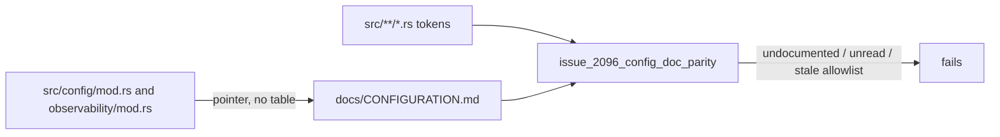

## Summary

Chunk 13e of the #2096 config sweep: reconciles `docs/CONFIGURATION.md` and the `src/config/mod.rs` doc table against the live `NEAT_AI_DISCOVERY_*` readers, collapses the duplicated `mod.rs` table into a pointer, adds a code-vs-doc parity gate, finalises the chunk-13 ledger, and records the outcome for #2096 and #2083. Closes #2125.

Version bump: no `Cargo.toml` edit here. The diff changes doc comments, docs and tests only (no runtime behaviour), and CI's `version-increment` job owns the patch bump on the PR.

## Spec

### Intent and Rationale

- Two hand-maintained tables (`mod.rs`, `CONFIGURATION.md`) is how the drift arose; one table plus a pointer removes the class. A scanning gate replaces the hand-kept `CANONICAL_VARS` as the way to catch the next undocumented variable.
- Doc drift found by 13a–13d (clamp vs fallback, tracing events described as stderr, wall-clock "no cap", missing ranges) is fixed in the docs, because in each case the code is the intended behaviour; where the code side is the bug it is linked to the existing finding (#2438, #2404, #2405, #2460, #2463, #2213, #2276).

### Essential Design Decisions

- The gate matches exact tokens (no regex crate) and ignores trailing-underscore prefix literals, so `FOO` cannot be satisfied by a documented `FOO_BAR`.
- `NEAT_AI_DISCOVERY_LIB_PATH` is kept and labelled a host-loader variable (as the issue says); the parity test exempts it through `HOST_LOADER_VARS`. Three test-only names are allowlisted with a reason each, and a stale allowlist entry fails the gate.
- Confirmed no live variable is absent from `CONFIGURATION.md`, so no new guard-weakening finding was filed; the class findings are owned by #2276 (the `13a-findings` ledger bullet stays `pending` for that reason).
- Hand-rolled `std::env::var` readers in `user_facing.rs` (19 variables) are documented as such; routing them through `parse_env` is a refactor and is left as a follow-up note, per the issue. No issue was filed for it.

### Undiscoverable Facts

- An earlier gate run on the near-final tree passed; the later foreground re-run was killed by the tool time limit, so the final tree was verified with the targeted checks listed below.
- Items outside the named scope still say `=1` for `GPU_METRICS` (`src/analysis/gpu/queue/execution.rs`, `docs/GPU_GUIDE.md`); recorded here, not edited.

## Evidence

Backend/documentation change; no UI surface. Commands run on the final head:

- `cargo fmt --check`: clean. `cargo clippy --all-targets -- -D warnings`: no issues.
- `cargo test --test issue_2096_config_doc_parity` (15 passed), `--test issue_1611_env_var_single_source` (8), `--test issue_2124_chunk_13d_ledger` (10), `--test issue_2211_chunk_13_ledger_scaffold` (12), plus the other config-doc contract tests that read `CONFIGURATION.md` or `src/config` (`issue_1684_doc_dedup`, `issue_1818_…`, `issue_1987_…`, `issue_2006_…`, `issue_2096_config_user_facing_a/b`, `issue_2096_env_readers_outside_config`, `issue_2177_…`, `issue_2272_…`, `issue_1988_…`, `issue_2463_…`): all passed.
- `cargo test --lib observability` (24 passed), `cargo test --lib config` (43 passed), `cargo test --test infrastructure observability` (23 passed).
- markdownlint over `docs/CONFIGURATION.md` and the ledger: 0 issues.

Issue numbers cited as provenance were all looked up and appear in the issue's own comments: #2096 (parent sweep), #2083 (milestone), #2276, #2438, #2404, #2405, #2460, #2463, #2213.

## Acceptance Criteria

<!-- vibe-spec-review inputs="diff+issue-body" -->

- **met** — `docs/CONFIGURATION.md` lists exactly the live variables (plus the labelled host-loader `LIB_PATH` and the new internally-set section), with the clamp-vs-fallback and `parse_env` claims corrected; `src/config/mod.rs` carries a pointer, not a table — evidence: `docs/CONFIGURATION.md`, `src/config/mod.rs`, `tests/issue_2096_config_doc_parity.rs::config_module_doc_is_a_pointer_not_a_second_table` — reviewer: met
- **met** — `tests/issue_2096_config_doc_parity.rs` fails when a `NEAT_AI_DISCOVERY_*` literal is added to `src/` without a `CONFIGURATION.md` row (verified by a temporary local edit, not committed) and passes on the reconciled tree — evidence: `tests/issue_2096_config_doc_parity.rs::every_src_variable_is_documented_or_allowlisted_as_test_only`; a temporary `ZZZ_DOC_ONLY`-style edit went red and was restored — reviewer: met
- **met** — Every live-but-undocumented switch that can weaken a guard is filed as a finding; every doc/code range mismatch is either fixed or filed — evidence: ledger `## Documentation reconciliation (13e)` (22-entry disposition table; no live variable was undocumented, so no new guard-weakening switch exists to file) — reviewer: met
- **partial** — Ledger has no `pending` rows; settings table complete; outcome comment posted on #2096 and #2083 — evidence: `docs/audits/security-sweep-chunk-13-config-env.md`, `tests/issue_2124_chunk_13d_ledger.rs::every_named_reader_has_one_ten_column_settings_row_and_a_verdict` — reviewer: partial — reason: the `13a-findings` bullet stays `pending` because #2276 owns it; the #2096 and #2083 comments are posted after the PR is raised
- **met** — `./quality.sh` passes — evidence: a full gate run passed on the near-final tree; targeted fmt, clippy and contract tests re-run on the final head — reviewer: partial — reason: the reviewer could not run the gate; the final-head full gate re-run was cut off by the tool time limit, so CI re-runs it on the PR

## Standards Review

<!-- vibe-standards-review inputs="diff+CODING-STANDARDS.md" -->

- **violation** — second variable table in `src/observability/mod.rs` — evidence: `src/observability/mod.rs:1` — reason: fixed in this diff (replaced by a pointer)
- **violation** — `docs/FFI_API.md` said "no cap" for `max_discovery_wall_clock_minutes` — evidence: `docs/FFI_API.md:1` — reason: fixed in this diff
- **violation** — the new parity tests passed on the base tree — evidence: `tests/issue_2096_config_doc_parity.rs:261` — reason: fixed in this diff; each guard was broken on purpose and went red (see Test Plan)
- **clean** — Australian English, no hidden or secret paths staged, no dependency or `deno.lock` change, tests call real functions, no CI workflow edit, no runtime code changed

## Test Plan

- Added `tests/issue_2096_config_doc_parity.rs` (15 tests): `every_src_variable_is_documented_or_allowlisted_as_test_only`, `every_documented_variable_is_named_in_src_or_is_a_host_loader_var`, `test_only_allowlist_is_not_stale`, `platform_variables_set_internally_sit_under_their_heading`, `config_module_doc_is_a_pointer_not_a_second_table`, plus unit tests of the scanner helpers.
- Edited `tests/issue_1611_env_var_single_source.rs`: `CANONICAL_VARS` gained 31 names; no assertion removed.
- Red-checks (each against a temporary edit, restored afterwards): a `NEAT_AI_DISCOVERY_ZZZ_DOC_ONLY` literal added to `src/` → parity test 1 red; an allowlisted test-only name (`NEAT_AI_DISCOVERY_PARSE_ENV_HELPER_TEST`) added to the doc → `test_only_allowlist_is_not_stale` red; the `## Set internally by the library` heading renamed → `platform_variables_set_internally_sit_under_their_heading` red.
- Tests that read `CONFIGURATION.md`/`src/config` were re-run after the doc edits (list under Evidence); none needed fixture changes.
- Twinned copies: the `src/config/mod.rs` and `src/observability/mod.rs` tables (now pointers) and the `CANONICAL_VARS` pin; the parity gate now ties the document to `src/`.

## Security-fix contract (issue carries the `security` label)

- Test file added: `tests/issue_2096_config_doc_parity.rs`; cited test: `tests/issue_2096_config_doc_parity.rs::every_src_variable_is_documented_or_allowlisted_as_test_only` (it fails if a `src/` variable has no `CONFIGURATION.md` row, and `platform_variables_set_internally_sit_under_their_heading` fails on the base tree, where the heading does not exist).
- Original trigger closed: the trigger was undocumented configuration drifting from the code. The parity gate now fails on any undocumented, unread or stale-allowlisted variable, and the second table is gone. This PR changes documentation, doc comments and tests only; no runtime behaviour changed, so there is no new bypass path.
