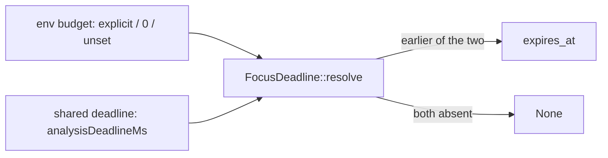

## Summary

Adds three `#[serial]` unit tests to `focus_deadline_tests` in `src/focus/ranking/mod.rs`. They pin that an explicit `NEAT_AI_DISCOVERY_FOCUS_RANKING_BUDGET_MS` stays bounded by the caller's shared deadline (`analysisDeadlineMs`) in `FocusDeadline::resolve`. This closes probe (a) of #2123. The five existing `resolve_*` tests are now `#[serial]` too, so the new env mutation cannot race them. The diff is test-only: no production line changes. Closes #2264.

Version bump: none in this diff; CI's `version-increment` job bumps `Cargo.toml` on the PR, and the merged commit records the final version.

## Spec

### Intent and Rationale

- `resolve` already takes the earlier of the env budget and the shared deadline. Nothing pinned that an *explicit* override, including the 1-hour clamp maximum, is still capped by a sooner shared deadline. These tests close that gap.
- The tests sit inline because `FocusDeadline::resolve` is private. `tests/issue_3172_focus_ranking_budget_scaling.rs` covers the override value itself, and these tests do not repeat it.

### Essential Design Decisions

- Each new test has a positive control showing the env value was actually read. With the budget at the maximum, the budget-only deadline must be exactly `3_600_000`. With the budget at `0`, the budget-only deadline must be `None`. With a non-zero value, the same call must return `Some`. This keeps an unread env var from making a test pass vacuously.
- `FocusBudgetEnvGuard` restores the previous value, or removes the var, on drop. Every test in the module is `#[serial]`.

### Undiscoverable Facts

- An explicit override is taken verbatim whatever the loading mode. So the first test also checks the lazy path (`FocusLoadingMode::Lazy`, 20,000 MB projected) against the same shared deadline.

## Evidence

Backend test-only change, so there is no UI evidence.

- `cargo test --lib focus::ranking` passed on the test commit: 45 passed (the executor's run).
- `cargo test --lib --all-features -- --test-threads=2` passed on the head: 1669 passed, 0 failed, 3 ignored. All 8 `focus_deadline_tests` passed.
- `cargo clippy --all-targets --locked -- -D warnings` reported no issues.

**Docs sweep** — grep: `FOCUS_RANKING_BUDGET_MS`, `FocusDeadline::resolve`; section: none — no production behaviour changes, so no manual section describes anything this diff alters; siblings: none — no existing set gained a member; updated: none. Hits left in place:

- `docs/CONFIGURATION.md:77` — still true: the explicit value still "wins verbatim" against scaling, and the budget semantics are unchanged.
- `README.md`, `docs/FOCUS_SELECTION.md` and `docs/FFI_API.md` mention the variable — still true: their budget semantics are unchanged.

## Acceptance Criteria

<!-- vibe-spec-review inputs="diff+issue-body" -->

- **met** — The three new tests exist in the `src/focus/ranking/mod.rs` test module and pass. — evidence: `src/focus/ranking/mod.rs::resolve_explicit_max_budget_is_still_bounded_by_shared_deadline`, `::resolve_disabled_budget_still_honours_shared_deadline`, `::resolve_disabled_budget_without_shared_deadline_is_unbounded`; `cargo test --lib --all-features` reported 1669 passed, 0 failed — reviewer: partial — reason: the reviewer confirmed the tests exist but could not run them; they were run here and passed.
- **met** — Temporarily making `resolve` prefer the budget over a sooner shared deadline makes the first test fail. Say in the PR that this was checked. — evidence: checked. I replaced the `(Some(budget), Some(shared))` arm with `Some(budget)`. `resolve_explicit_max_budget_is_still_bounded_by_shared_deadline` then failed at "an explicit env budget must not outlive the shared deadline". `resolve_uses_shared_deadline_when_sooner_than_budget` and `resolve_with_passed_deadline_aborts_immediately` also failed. I then restored the arm, and `git diff` shows no production line changed — reviewer: partial — reason: the reviewer could not see the mutation run in the diff; it was run here and the result is recorded in this entry.
- **met** — The existing `resolve_*` tests are `#[serial]`, and no production lines change. — evidence: `src/focus/ranking/mod.rs` focus_deadline_tests; the diff has 0 deletions, and every hunk is inside `#[cfg(test)] mod focus_deadline_tests` — reviewer: met
- **partial** — `./quality.sh` passes. — evidence: deny, build, fmt, clippy (`-D warnings`) and type check passed in the `./quality.sh` run. The full library unit-test suite was then run on its own and passed (1669 passed) — reviewer: partial — reason: quality gate not yet run — remaining: merge-verification-only. On this heavily loaded host (load average about 20 on 7 cores), `./quality.sh`'s `cargo test --lib --tests` step hit a 30-minute timeout. The integration-test binaries, `cargo doc` and the release build were not run locally. This diff changes only a `#[cfg(test)]` module, and CI runs the full gate.

- **unrequested** — Positive controls: a `budget_ms == 3_600_000` check, a lazy-mode check in the first test, and a trailing check in the third test that a non-zero budget returns `Some` — reviewer: unrequested — reason: these stop each test passing when the env value is never read. The lazy check covers the mode the issue's caller passes (`plan.mode`).

## Standards Review

<!-- vibe-standards-review inputs="diff+CONTRIBUTING.md" -->

- **clean** — The reviewer found no violations. It checked against `CONTRIBUTING.md` and `AGENTS.md` because there is no `CODING-STANDARDS.md` in this repository. Areas checked:
  - Review-enforced rules: `#[serial]` on env-mutating tests with the guard restoring on drop, a positive precondition pinned in each new test, no new `NEAT_AI_DISCOVERY_*` variable, citations by symbol rather than line number, and Australian English.
  - No removed or changed assertions.
  - No workflow files touched.
  - The `version-increment` job covers the version bump.

  It also flagged two optional points. Instant-based tolerance checks use a 1 s margin, the same pattern as the existing tests. The tests sit inline rather than in `tests/`, which is required because `resolve` is private.

## Test Plan

- Added to `src/focus/ranking/mod.rs`, in `focus_deadline_tests`:
  - `resolve_explicit_max_budget_is_still_bounded_by_shared_deadline`
  - `resolve_disabled_budget_still_honours_shared_deadline`
  - `resolve_disabled_budget_without_shared_deadline_is_unbounded`
- Modified `src/focus/ranking/mod.rs`: added `#[serial]` to the five existing `resolve_*` tests. No assertion was removed or changed.
- These are pins of current behaviour. No production change was made, so they are expected to pass on the base branch.
- Red check (mutating the `(Some, Some)` arm to always return the budget): the first new test and two existing tests went red. `resolve_disabled_budget_still_honours_shared_deadline` stays green under that mutation by design: with the budget at `0` the `(None, Some)` arm runs, not the mutated one. Its own guard is the `(None, Some(shared)) => Some(shared)` arm. Changing that arm to `None` would fail its `.expect("deadline present")`.
- Result: `cargo test --lib --all-features -- --test-threads=2` reported 1669 passed, 0 failed, 3 ignored on the head commit.

<!-- vibe-quality-gate-skipped reason="./quality.sh's cargo test --lib --tests step hit a 30-minute timeout on a host at load ~20/7 cores; the earlier gate steps passed and the full lib unit suite passed when run on its own; integration tests, cargo doc and the release build are left to CI" -->

<!-- vibe-branch-outcomes -->
