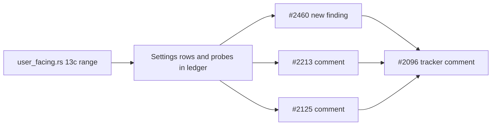

## Summary

Fills the `13c` regions of `docs/audits/security-sweep-chunk-13-config-env.md` for the second half of `src/config/user_facing.rs` (baseline L665–1396, from the focus-ranking budget to the drought reset), and files or links every finding. Documentation and issue filing only; nothing under `src/` or `tests/` changes. Version bump: not owed, the diff touches no code (CI's `version-increment` job handles any bump). Closes #2265.

- [x] Files-swept row, 18 ten-column settings rows, probe dispositions (a)–(k), doc drift, issues filed
- [x] Finding 1 filed as #2460
- [x] Comments on #2213, #2125 and #2096
- [x] Independent spec and standards review

## Spec

### Intent and Rationale

- The 13c region of the shared chunk-13 ledger was empty. The sweep records each env variable's range, invalid-input behaviour and opt-out semantics so a later reader can check them against the code.
- One security finding survived re-verification, so it is a new house-format issue. The other two items belong to existing issues, so they are comments there.

### Essential Design Decisions

- Code is cited as `file.rs::symbol` and the reader column carries no line numbers, because HEAD has drifted from baseline `b85a551` (the parent said HEAD was shorter, but it is 49 lines longer, so symbols are the only safe anchor). The range starts at `DEFAULT_FOCUS_RANKING_BUDGET_MS`; `focus_ranking_memory_margin_mb` stays in 13b.
- The ledger links #2213 (the closed planning issue the sub-issue names) and also #2276, the open issue that files the silent-opt-out class, because #2213 itself files nothing.
- #2460 is filed with `severity:low` as a proposal: the only caller who can trigger it already controls the discovery deadline.

### Undiscoverable Facts

- `307445734561825861 * 60` wraps to 44 modulo 2^64 (checked with `python3`). `Cargo.toml` sets no `overflow-checks`, so the release cdylib wraps and debug builds panic.
- The duplicate search `gh issue list --state all --search "cap_deadline_to_wall_clock in:body"` found only #2265 itself, and a search for `max_discovery_wall_clock_minutes in:body` found only #2265 and #2123.

## Evidence

- New issue #2460 (labels `security`, `lang:rust`, `confidence:high`, `severity:low`).
- Comments: #2213 (https://github.com/stSoftwareAU/NEAT-AI-Discovery/issues/2213#issuecomment-6467974556), #2125 (https://github.com/stSoftwareAU/NEAT-AI-Discovery/issues/2125#issuecomment-6467975056), #2096 (https://github.com/stSoftwareAU/NEAT-AI-Discovery/issues/2096#issuecomment-6467998495).
- Issue numbers cited as provenance, each read with `gh issue view`: #2460: 🟢 Unchecked minutes * 60 in cap_deadline_to_wall_clock …; #2276: Chunk 13a-3: file the presence-only boolean and silent guard opt-out class findings …; #2266: Thread-dump manual hint re-teaches the predictable /tmp/sample.txt path …; #2251: Chunk 11b-1: audit src/debug.rs …; #2118: Chunk 11b: audit the thread-dump and sampler stack …; #2090: Security sweep chunk 4 …; #2263, #2264: the pinning tests, merged.
- Docs sweep: the section read was the whole ledger; no other doc names the new rows. Existing doc drift found is recorded in the ledger, not fixed, because #2125 owns the reconcile.
- Dispositions were re-verified against HEAD `b2ca056` by reading `user_facing.rs`, `focus/ranking/mod.rs::FocusDeadline::resolve`, `orchestration.rs::analyze_all`, `analysis/utils/deadline.rs` and `debug/sample_capture.rs`.

## Acceptance Criteria

<!-- vibe-spec-review inputs="diff+issue-body" -->

- **met** — The ledger's `13c` section has the files-swept row, one ten-column row per env variable in the range, and a disposition for every probe (a)–(k). No placeholders are left. — evidence: `docs/audits/security-sweep-chunk-13-config-env.md` (files-swept row, 18 settings rows, "Probe dispositions (13c)") — reviewer: met
- **met** — Finding 1 is filed with the house labels and linked in the ledger. It is either a new issue or a link to an existing match. — evidence: #2460, linked in the ledger's files-swept row, probe (e) and "Issues filed" — reviewer: partial — reason: the reviewer could not run `gh` to see the labels; `gh issue create --label security --label lang:rust --label confidence:high --label severity:low` was run and returned the issue
- **met** — #2213 and #2125 each carry a comment with the detail above, linked from the ledger. — evidence: the two comment URLs under "Issues filed" in the ledger — reviewer: partial — reason: the reviewer could not read the comments; both were posted with `gh issue comment` and the URLs returned
- **met** — One comment on #2096 lists every chunk-13c finding and its issue. — evidence: https://github.com/stSoftwareAU/NEAT-AI-Discovery/issues/2096#issuecomment-6467998495 — reviewer: partial — reason: the reviewer could not read the comment; the extra doc-drift items are recorded in the ledger and left for #2125, not listed as findings
- **met** — No changes under `src/` or `tests/`. `./quality.sh` passes. — evidence: `git diff --name-only` lists the ledger and this summary only; the quality gate result is under Test Plan — reviewer: partial — reason: the reviewer had no evidence the gate was run; see Test Plan
- **unrequested** — Three extra doc-drift entries in the ledger (CONFIGURATION.md `ANALYSIS_RESERVE_FRACTION` and `SESSION_TTL_SECS` rows, the `MAX_WALL_CLOCK_MINUTES` precedence note) — reviewer: unrequested — reason: found while filling the rows; they are ledger records for #2125 to reconcile and fix nothing

## Standards Review

<!-- vibe-standards-review inputs="diff+CODING-STANDARDS.md" -->

- **violation** — Probe (b) said `analysis_reserve_fraction` falls back to 0.5 above 0.9, but the code clamps to 0.9 — evidence: `docs/audits/security-sweep-chunk-13-config-env.md:207` — reason: fixed in this diff
- **clean** — Cite code by symbol, Australian English, no Mermaid `;` in the diff, every named test and symbol exists at HEAD, no `src/` or `tests/` changes, ledger rules in `docs/audits/README.md` followed. The repository has no `CODING-STANDARDS.md`, so the reviewer used `AGENTS.md`, `CONTRIBUTING.md` and `docs/audits/README.md`.

## Test Plan

Docs-only change; no test was added or edited, and no assertion was removed. Branch outcomes: none added.

- `cargo test --test issue_2211_chunk_13_ledger_scaffold`: 6 passed after the final ledger edit.
- `cargo test --test issue_2088_sweep_ledger_contract`: 9 passed (run before the last one-sentence edit to probe (b); the scaffold test and the full gate ran after it).
- `timeout 900 ./quality.sh < /dev/null` exited 0 ("All quality checks passed!") on the final ledger text.

Not done: nothing under `src/` is fixed (#2460 owns its fix and its failing-first test), and the 13a, 13b and 13d regions are untouched.
