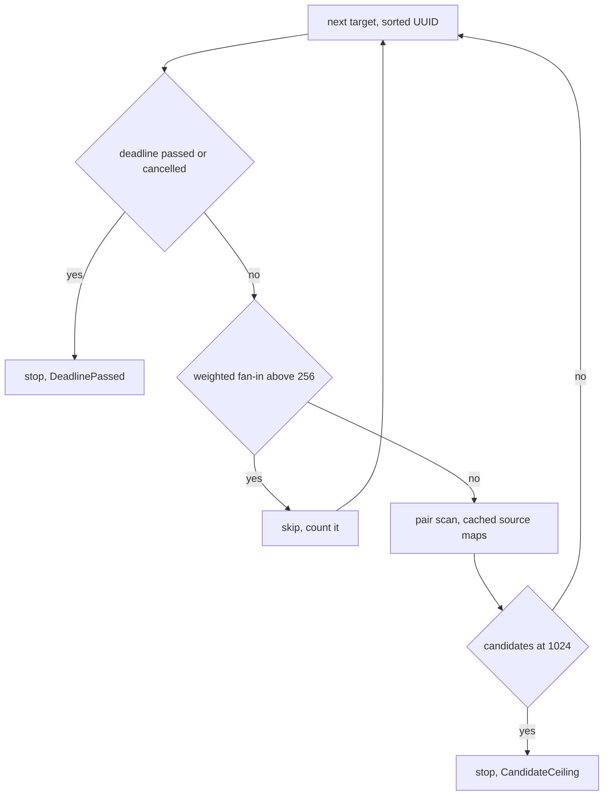

# PR Summary — Issue #2347

## Summary

`detect_symmetric_cancellation` in `src/analysis/detection/weight_coherence.rs` ran an `i < j` pair loop
over every target's fan-in. For each opposite-sign, similar-magnitude pair it
called `calculate_correlation`, which rebuilt two `obs_index → activation`
`HashMap`s from both sources' full record slices. The cost was
`O(Σ_targets k² · S)`. Nothing capped the fan-in `k` or the number of emitted
candidates, and the scan never checked the deadline. A hostile creature with
one wide-fan-in target and alternating `+w` / `-w` weights could pin a core for
as long as it liked (CWE-834).

The scan is now bounded in three ways, and the per-pair rebuild is gone:

- **Fan-in cap.** A target whose weighted fan-in exceeds
  `MAX_FANIN_FOR_CANCELLATION_SCAN` (256) is skipped before any pair work and
  counted in `skipped_high_fanin_targets`.
- **Candidate ceiling.** The scan stops after
  `MAX_SYMMETRIC_CANCELLATION_CANDIDATES` (1024) candidates with
  `ScanTruncation::CandidateCeiling`.
- **Deadline.** `deadline_passed` (which also reports host cancellation) is
  checked before each target. An elapsed deadline stops the scan with
  `ScanTruncation::DeadlinePassed`.
- **Map cache.** Each source's activation map is built at most once per scan
  and cached across pairs and targets.

The new `detect_symmetric_cancellation_with_deadline` returns a
`SymmetricCancellationScan` holding the candidates, the truncation reason and
deterministic work counters. The old `detect_symmetric_cancellation` is now a
thin no-deadline wrapper. Production dispatch (`synapse_specs.rs`) forwards the
discovery deadline and logs a `warn!` when the scan was truncated or skipped
targets, so a partial result is never shown as complete.

Closes #2347

## Spec

### Intent and Rationale

- The pair scan must finish in bounded time and memory whatever the creature
  looks like, and must stop when the analysis deadline passes or the host
  cancels.
- The fix follows the earlier pairwise fixes (#2161 / #2169 / #2190) and reuses
  the existing `ScanTruncation` enum and `deadline_passed` helper.

### Essential Design Decisions

- Wide targets are skipped outright, not truncated to their first 256 sources.
  A partial pair set would depend on fan-in order and look complete when it is
  not.
- Targets are visited in sorted UUID order, so candidate-ceiling truncation is
  deterministic.
- Work is measured with counters (`pairs_correlated`, `activation_maps_built`),
  not wall-clock time, so the tests are deterministic (precedent: #2320).
- `correlation_from_maps` keeps the exact semantics of the old
  `calculate_correlation`. Non-finite activations are still filtered, and the
  shared-sample minimum is still enforced.

### Undiscoverable Facts

- Before this change, cancellation was module-level only.
  `discovery_dispatch.rs` checks the deadline before a module's closure starts,
  and `max_candidates` truncates its output afterwards. Neither bounds the work
  while the closure is running.

## Evidence

This is a backend-only change, with no visual surface and so no screenshots.

**Security fix evidence.** The primary regression test is
`tests/issue_2347_symmetric_cancellation_growth.rs::symmetric_cancellation_work_grows_no_faster_than_the_cap_allows`.
It uses only the legacy `detect_symmetric_cancellation` wrapper and literal
numbers, so it compiles at base. The fixture is one target fed by 128, then 512,
alternating `+5.0` / `-5.0` sources with identical activations. The test asserts
that the over-cap target at fan-in 512 yields exactly 0 candidates (it is
skipped), and that candidates at fan-in 512 are at most 1024 and at most 4× the
candidates at fan-in 128. The exact-zero assertion is what pins the fan-in cap
itself: with the skip removed, the candidate ceiling alone would hold both
fan-ins at 1024 and keep the two bounds green.

- Red at base, re-run after review 5709752767 with the current version of
  the test: this PR's `tests/issue_2347_symmetric_cancellation_growth.rs`
  copied into a detached worktree of `Develop` at `9581f5b7`, run with
  `cargo test --test issue_2347_symmetric_cancellation_growth`. It fails on the
  exact-zero assertion (line 89):
  `a target with fan-in 512, over the fan-in cap of 256, must be skipped: got 65536 candidates (fan-in 128 gave 4096)`
  (`left: 65536`, `right: 0`). An earlier version of this summary quoted the
  candidate-ceiling message instead. That came from the previous version of
  the test, which did not yet have the exact-zero assertion.
- Green at head `0cf33003`: both tests in the file pass (2 passed, 0 failed).
- The control test `tests/issue_2347_symmetric_cancellation_growth.rs::fanin_under_the_cap_still_yields_candidates`
  passes at both base and head. It guards against the skip returning nothing
  everywhere.

The other eight tests (in `tests/issue_2347_symmetric_cancellation_growth_test.rs`)
cover the counters, boundary, deadline, ceiling and legacy parity. They need the
new API, so they cannot compile at base and are not part of the red-at-base
observation.

The production entry point is covered too:

- unit test `symmetric_cancellation_spec_returns_none_when_deadline_already_elapsed`
  in `src/analysis/module_dispatch_specs/synapse_specs.rs` builds the specs
  through `build_discovery_module_specs` (the production composition) and
  proves that the discovery deadline is forwarded from there, through
  `append_synapse_specs`, into the scan.
- unit test `scan_is_partial_when_high_fanin_targets_skipped` in
  `src/analysis/module_dispatch_specs/synapse_specs.rs`, together with its
  siblings, proves that a partial scan is reported and not shown as complete.

These tests (in `tests/issue_2347_symmetric_cancellation_growth_test.rs`) cover
the other bounds:

- test `activation_maps_are_cached_across_pairs_not_rebuilt_per_pair` reproduces
  the per-pair map rebuild. With the rebuild still in place it failed with
  `200 maps for 20 sources`, and it passes after the fix.
- test `fanin_at_the_cap_is_scanned_fanin_over_the_cap_is_skipped` pins the cap
  boundary.
- test `elapsed_deadline_stops_the_scan_before_any_pair_work` pins the deadline
  check.
- test `symmetric_cancellation_stops_at_the_candidate_ceiling_and_reports_it`
  pins the candidate ceiling.

The elapsed-deadline tests above pass `UNIX_EPOCH`, so they reach the check
only on the first target. The in-crate unit test
`per_target_deadline_check_stops_a_scan_that_started_before_the_deadline` (in
`src/analysis/detection/weight_coherence.rs`) shows the check runs before every
target: it lets the first target through, then reports the deadline passed,
and the scan stops after one pair. With the check moved above the `'outer` loop
it goes red (`left: None`, `right: Some(DeadlinePassed)`).

**The original trigger is closed, with no trivial bypass.** There is one pair
loop. Every way into it passes the per-target deadline check and then the
fan-in cap, which runs before any pair work or map build. So per-target pair
work is at most `256²/2` correlations, and map builds are at most one per
distinct source. The candidate ceiling bounds the emitted `Vec`. The legacy
wrapper calls the same bounded function, so it applies the same fan-in and
candidate ceilings. Spreading fan-in over many targets just under the cap
leaves every target bounded, the total bounded by the deadline, and the output
bounded by the ceiling.

**Docs sweep** — grep: `detect_symmetric_cancellation`, `MAX_FANIN_FOR_CANCELLATION_SCAN`, `MAX_SYMMETRIC_CANCELLATION_CANDIDATES`, `calculate_correlation`, `SymmetricCancellationScan`; section: `docs/discoveries/weight-coherence.md#-3-symmetric-cancellation`, `docs/DISCOVERY_TYPES.md` (Detection criteria — Symmetric cancellation), `docs/ANALYSIS_DEEP_DIVE.md` (Symmetric cancellation); updated: `docs/discoveries/weight-coherence.md`, `docs/DISCOVERY_TYPES.md`, `docs/ANALYSIS_DEEP_DIVE.md`, `docs/audits/security-sweep-chunk-08a-detection-neuron.md`

Every remaining hit on the final head, with current line numbers. The grep was
re-run on the merged tree after review 5715761259, over `*.rs` and `*.md` and
excluding this summary file:

- `docs/DISCOVERY_TYPES.md:1019`, `:1021` — still true because this diff wrote these lines to describe the fan-in cap, the candidate ceiling and the deadline (they moved from `:990` / `:992` when #2442 added lines above them).
- `docs/ANALYSIS_DEEP_DIVE.md:612`, `:613` — still true because this diff wrote these lines to describe the bounded scan.
- `docs/discoveries/weight-coherence.md:60`, `:62` — still true because this diff wrote these lines to describe the bounds and the skip count.
- `docs/audits/security-sweep-chunk-08a-detection-neuron.md:72` — the `weight_coherence.rs` file row. Its body is the audit-HEAD verdict (per-pair map rebuild in `calculate_correlation`, no deadline check, three `with_capacity` sites), which the ledger keeps as history. Because it read as current, this PR appends a **Post-finalisation note** to the row saying what #2347 changed and that the text above it describes the audited code. That follows the convention the `symmetry_breaking.rs` file row uses for #2400 (append a note, do not rewrite the audited text), so the row is now true as written.
- `docs/audits/security-sweep-chunk-08a-detection-neuron.md:171` — the pair-loop row. Its "unbounded at the audit HEAD" verdict is audit-HEAD history, followed by this diff's **Post-finalisation note** and the `yes — deadline_passed before each target` cell that `tests/issue_2294_chunk_08a_pairwise_sweep.rs` pins.
- `docs/audits/security-sweep-chunk-08a-detection-neuron.md:328` — this diff's **Post-finalisation reconciliation (#2347)** note for the removed `candidates` capacity row (merged count 81).
- `docs/audits/security-sweep-chunk-08a-detection-neuron.md:436` — the findings index row for issue #2347; still true, the issue was filed against that function.
- `docs/audits/security-sweep-chunk-08a-detection-neuron.md:543`, `:545` — the "issues filed" list, which records what #2347 reported at filing time; history of the filed issue, kept by the ledger convention (no other fixed issue in that list is rewritten).
- `docs/archive/pr-summaries/pr-summary-2294.md:10`, `pr-summary-767.md:25`, `pr-summary-770.md:5`, `pr-summary-776.md:7` — archived summaries of earlier PRs, which describe those PRs at the time; archive history, not edited.
- `src/analysis/detection/weight_coherence.rs:27`, `:31`, `:33` — the new module doc for the scan bounds.
- `src/analysis/detection/weight_coherence.rs:74`, `:78` — the two constants.
- `src/analysis/detection/weight_coherence.rs:178`, `:185` — the new result struct and its `skipped_high_fanin_targets` doc.
- `src/analysis/detection/weight_coherence.rs:411`, `:414`, `:424`, `:430` — the legacy wrapper, which still exists, still calls the bounded scan with no deadline, and whose doc says production uses the deadline entry point.
- `src/analysis/detection/weight_coherence.rs:439`, `:451`, `:453`, `:459`, `:460` — the bounded function's doc, signature and result/scan initialisation.
- `src/analysis/detection/weight_coherence.rs:512`, `:582` — the fan-in cap and candidate ceiling checks.
- `src/analysis/detection/weight_coherence.rs:734` — the `correlation_from_maps` doc, which states as history that the removed `calculate_correlation` rebuilt both maps on every call.
- `src/analysis/detection/weight_coherence.rs:944`, `:953` — calls to the bounded scan in the new in-crate test `per_target_deadline_check_stops_a_scan_that_started_before_the_deadline`.
- `src/analysis/module_dispatch_specs/synapse_specs.rs:31`, `:49`, `:54`, `:167`, `:293`, `:294` — the production call into the bounded scan, the partial-scan helper's doc and signature, and the test doc and fixture for it.
- `tests/detection/issue_437_weight_coherence_validation.rs:22`, `:289`, `:365` — still true because they import and call the legacy wrapper, which keeps its signature and results.
- `tests/detection/issue_770_weight_coherence_topology_cache.rs:11`, `:158`, `:184`, `:185` — still true because they import and name the legacy wrapper, which is kept and returns the same results with and without the cache.
- `tests/infrastructure/issue_776_hashset_hashmap_iteration.rs:9`, `:98`, `:125`, `:163` — still true because they import and name the legacy wrapper, which is kept and still produces correct results.
- `tests/issue_2294_chunk_08a_pairwise_sweep.rs:108` — the `CHECKED_SINCE_AUDIT` key for the pair-loop row; still true, the row exists under that symbol and now reads `yes — deadline_passed …`.
- `tests/issue_2347_symmetric_cancellation_growth.rs:5`, `:22`, `:78`, `:84`, `:95`, `:118` — module doc, import and calls to the legacy wrapper (the two base-compilable tests).
- `tests/issue_2347_symmetric_cancellation_growth_test.rs:2`, `:14`, `:15`, `:77`, `:78`, `:94`, `:95`, `:123`, `:148`, `:161`, `:172`, `:194`, `:197`, `:200`, `:209`, `:212`, `:225`, `:227` — module doc, imports and calls to the bounded scan; added by this diff.

## Test Plan

- **Tests added:**
  - `tests/issue_2347_symmetric_cancellation_growth.rs`, with 2 tests. These compile at base (see Evidence).
  - `tests/issue_2347_symmetric_cancellation_growth_test.rs`, with 8 tests. These need the new API.
  - One in-crate `#[serial]` unit test in the `tests` module of `src/analysis/detection/weight_coherence.rs`, `per_target_deadline_check_stops_a_scan_that_started_before_the_deadline` (review 5715761259). It scripts `deadline_passed` through `DeadlineOverrideGuard::with_sequence` and the sequence `[false, true]` over two targets, each fed by one opposite-sign, correlated pair, and asserts `DeadlinePassed`, `pairs_correlated == 1` and that the one candidate comes from `target-a`, the first target in sorted UUID order. A no-override control run in the same test shows the fixture reaches both targets (2 pairs, 2 candidates). The `UNIX_EPOCH` tests only reach the check on the first target, which the module-level dispatch gate already covered; this one shows the check stops a scan that has already started.
  - Six unit tests in the `tests` module of `src/analysis/module_dispatch_specs/synapse_specs.rs`:
    - `symmetric_cancellation_spec_returns_none_when_deadline_already_elapsed`
    - `symmetric_cancellation_spec_returns_candidates_without_deadline`
    - `scan_is_not_partial_when_complete`
    - `scan_is_partial_when_deadline_passed`
    - `scan_is_partial_when_candidate_ceiling_hit`
    - `scan_is_partial_when_high_fanin_targets_skipped`
- **Tests modified:** the three unit tests in `src/analysis/detection/weight_coherence.rs` that called the removed `calculate_correlation` now call `correlation_from_maps(&build_activation_map(..), &build_activation_map(..), ..)`. Only the call site changed.
  `tests/issue_2294_chunk_08a_pairwise_sweep.rs` now lists `weight_coherence.rs` in `CANCELLATION_FIXED_FILES` and its pair-loop row in `CHECKED_SINCE_AUDIT`, because the scan now calls `deadline_passed` itself. The contract still requires that row to exist and to read `yes — deadline_passed …`, so nothing is loosened. Alongside it, `docs/audits/security-sweep-chunk-08a-detection-neuron.md` drops the removed `detect_symmetric_cancellation` `candidates` capacity row (after merging #2430, Develop's 82 production rows become 81, and the recorded capacity figure 85 becomes 84), adds #2347 post-finalisation notes to the pair-loop row and to the `weight_coherence.rs` file row, and updates the counts. This fixed the CI `Coverage` failure in `issue_2154_chunk_08a_finalisation::every_production_capacity_site_is_cited_in_the_capacity_table`. All nine suites that read the record pass on the final head (59 tests).
- **Removed assertions:** none. Every existing assertion is kept unchanged.
- **Branch merge:** the branch merges origin's default branch, which already landed #2351, the #2348 / #2349 / #2358 deadline plumbing and #2442 (#2370). The earlier conflict in the `src/analysis/module_dispatch_specs/mod.rs` doc comment was resolved by keeping both sets of Issue lines. The #2442 and #2430 merges each conflicted in `Cargo.toml`, `Cargo.lock` and the chunk 8a ledger; the ledger was reconciled by deltas (Develop's counts plus this PR's removal of one capacity row), and the Rust scanner tests are the binding check.
- **Version bump:** `Cargo.toml` and the crate's own `Cargo.lock` entry are at `0.74.308`, above Develop's `0.74.307`. The CI auto-increment skips this branch (#2476), so the bump was made by hand.
- **Results (run on the final head):**
  - `cargo test --test issue_2347_symmetric_cancellation_growth --test issue_2347_symmetric_cancellation_growth_test` → 2 passed and 8 passed.
  - `cargo test --lib --all-features weight_coherence` → 6 passed, and `--lib symmetr` passed; the nine chunk 8a ledger suites (`issue_2088`, `2154`, `2280`, `2281`, `2282`, `2284`, `2294`, `2298`, `2300`) → 59 passed.
  - `cargo fmt --check` and `cargo clippy --lib --tests --all-features -- -D warnings` are clean.
  - The full `./quality.sh` run and the separate `cargo doc` / release build were done on an earlier head (before the #2442 merge) and were not re-run on this one; CI runs them.
  - Red at base: the primary test, as recorded in Evidence.

## Not done / risk

- The legacy wrapper `detect_symmetric_cancellation` passes `deadline = None`. It is kept for existing callers (`tests/detection/issue_437_weight_coherence_validation.rs`, `tests/detection/issue_770_weight_coherence_topology_cache.rs`, `tests/infrastructure/issue_776_hashset_hashmap_iteration.rs`). Production dispatch uses the deadline entry point.
- Wide fan-in targets (above 256) are skipped, not truncated. This is by design, so such targets contribute no candidates.
- The fan-in and candidate caps (`MAX_FANIN_FOR_CANCELLATION_SCAN`, `MAX_SYMMETRIC_CANCELLATION_CANDIDATES`) are fixed constants, not env-configurable.
- Red at base was observed only for the primary test. The other tests need the new API, so no red-at-base result exists for them.
- The mutation red-checks listed under Branch outcomes were done in the earlier session. The two marked *re-run after review 5675960755* were re-run on a later head, and the one marked *run after review 5715761259* was run on the final head.

**Branch outcomes:**
- `src/analysis/detection/weight_coherence.rs:494` — deadline elapsed (stop, `DeadlinePassed`) — test `elapsed_deadline_stops_the_scan_before_any_pair_work` (in `tests/issue_2347_symmetric_cancellation_growth_test.rs`) — flipped to never stop, test went red
- `src/analysis/detection/weight_coherence.rs:494` — deadline passes after the scan has started (stop before the second target) — unit test `per_target_deadline_check_stops_a_scan_that_started_before_the_deadline` (in `src/analysis/detection/weight_coherence.rs`) — moved the check above the `'outer` loop so it runs once, test went red (`left: None`, `right: Some(DeadlinePassed)`); restored, test green (*run after review 5715761259*)
- `src/analysis/detection/weight_coherence.rs:494` — no deadline, or deadline not reached (scan continues, no truncation) — tests `no_deadline_does_not_truncate_and_finds_candidates` and `far_future_deadline_behaves_like_no_deadline` (both in `tests/issue_2347_symmetric_cancellation_growth_test.rs`) — flipped to always stop, both tests went red
- `src/analysis/detection/weight_coherence.rs:512` — fan-in over the cap (target skipped and counted) — test `fanin_at_the_cap_is_scanned_fanin_over_the_cap_is_skipped` (in `tests/issue_2347_symmetric_cancellation_growth_test.rs`) and test `symmetric_cancellation_work_grows_no_faster_than_the_cap_allows` (in `tests/issue_2347_symmetric_cancellation_growth.rs`) — flipped to never skip, both tests went red (*re-run after review 5675960755*: the growth test now fails on its exact-zero assertion, since without the skip the ceiling alone gives 1024 at both fan-ins)
- `src/analysis/detection/weight_coherence.rs:512` — fan-in exactly at the cap (target scanned) — test `fanin_at_the_cap_is_scanned_fanin_over_the_cap_is_skipped` (in `tests/issue_2347_symmetric_cancellation_growth_test.rs`) — flipped `>` to `>=`, test went red
- `src/analysis/detection/weight_coherence.rs:546` — source map not yet cached (build it once and count it) vs. already cached (reuse it) — test `activation_maps_are_cached_across_pairs_not_rebuilt_per_pair` (in `tests/issue_2347_symmetric_cancellation_growth_test.rs`) — flipped to rebuild on every pair, test went red
- `src/analysis/detection/weight_coherence.rs:582` — candidate ceiling reached (stop, `CandidateCeiling`) — test `symmetric_cancellation_stops_at_the_candidate_ceiling_and_reports_it` (in `tests/issue_2347_symmetric_cancellation_growth_test.rs`) — flipped to never stop, test went red
- `src/analysis/detection/weight_coherence.rs:582` — below the ceiling (scan completes, no truncation) — test `candidate_ceiling_not_reported_when_the_scan_completes` (in `tests/issue_2347_symmetric_cancellation_growth_test.rs`) — flipped to always stop, test went red
- `src/analysis/module_dispatch_specs/synapse_specs.rs:38` / `:56` — partial scan (truncated or skipped targets, so `warn!` is logged) — unit tests `scan_is_partial_when_deadline_passed`, `scan_is_partial_when_candidate_ceiling_hit` and `scan_is_partial_when_high_fanin_targets_skipped` (all in `src/analysis/module_dispatch_specs/synapse_specs.rs`) — forced `symmetric_cancellation_scan_is_partial` to always return false, all three tests went red
- `src/analysis/module_dispatch_specs/synapse_specs.rs:38` / `:56` — complete scan (no log) — unit test `scan_is_not_partial_when_complete` (in `src/analysis/module_dispatch_specs/synapse_specs.rs`) — forced it to always return true, test went red
- `src/analysis/module_dispatch_specs/synapse_specs.rs:118` — production dispatch forwards the discovery deadline — unit test `symmetric_cancellation_spec_returns_none_when_deadline_already_elapsed` (paired with unit test `symmetric_cancellation_spec_returns_candidates_without_deadline`, both in `src/analysis/module_dispatch_specs/synapse_specs.rs`) — reverted `&deadline` to `&None`, the elapsed-deadline test went red
- `src/analysis/module_dispatch_specs/mod.rs:80` — `build_discovery_module_specs` hands `deadline` to `append_synapse_specs` — the same two spec unit tests, which now build the specs through `build_discovery_module_specs` — passed `None` there instead of `deadline`, the elapsed-deadline test went red (*re-run after review 5675960755*)

🤖 Generated with [Claude Code](https://claude.com/claude-code)
