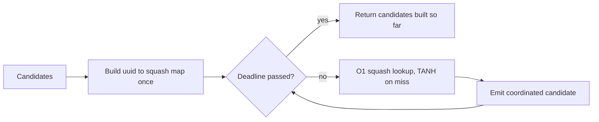

## Summary

`fanin_polarity_conflicts_to_coordinated_candidates` recovered each candidate's
squash with `creature.neurons.iter().find(..)`, once per candidate: `O(C·N)`
work (CWE-407). It now builds a `uuid -> squash` map once per call, so each
candidate costs `O(1)`, and a new `_with_deadline` entry point checks the
analysis deadline once per candidate. The dispatch spec for
`fanin_polarity_conflict_detection` passes its deadline to that entry point.
The old public function delegates with `&None`, so its signature and output are
unchanged. Closes #2350.

Version bump: `Cargo.toml` updated for this change; the merged commit records the final version.

## Spec

### Intent and Rationale

- Candidates (conflicted hidden neurons) and neurons are both bounded only by the deserialised creature, so the per-candidate scan was quadratic in creature size with no deadline check.
- A map built once is the smallest change; carrying squash on the candidate would change a public struct.

### Essential Design Decisions

- `entry(..).or_insert(..)` keeps the first neuron for a duplicated uuid, matching the old `find`. Pinned by `tests/detection/issue_641_fanin_polarity_conflict.rs::test_duplicate_target_uuid_uses_first_neuron_squash`.
- A missing uuid still falls back to `"TANH"`.
- The deadline is checked per candidate; on expiry the candidates built so far are returned (a partial result, not an error).
- The `work_observer` closure on the private converter exists so a deterministic lookup count can be asserted; production passes a no-op.
- The sibling pattern in `sentinel_gating` and `squash_weight_rescale` (issue comment) is not changed here; it is separate code with its own detectors.

### Undiscoverable Facts

- `CONTRIBUTING.md` says unit tests must not use `Instant`/`elapsed` for pass/fail. The named regression test is a ratio test anyway, following the merged `tests/issue_2358_output_conflict_converter_growth.rs`, because the fix changes no output and a ratio test is the only check that compiles and goes red against the unfixed converter. The deterministic count lives in an in-module test.

## Security Fix Evidence

Regression test: `tests/issue_2350_fanin_polarity_squash_lookup_growth.rs::squash_lookup_work_grows_linearly_with_candidates`.

- Red on the unfixed lookup: with the per-candidate `find` restored in the converter, the test failed with `t(2000)=16.59ms t(8000)=239.35ms ratio=14.42`.
- Green on the fix: `t(N)=5.99ms t(4N)=26.65ms ratio=4.45` (threshold 10; linear ~4, quadratic ~16).
- Trigger closed, no bypass: every candidate's squash now comes from the once-built map, so there is no per-candidate scan of `creature.neurons` left in the converter, and a larger creature grows the work linearly. The deadline check bounds the loop even for a hostile candidate count.

## Evidence

Docs sweep: grep `fanin_polarity_conflicts_to_coordinated_candidates`, "fan-in polarity", `append_synapse_specs`, `module_dispatch_specs`, "deadline"; read `docs/DISCOVERY_TYPES.md#fan-in-polarity-conflict-detection` and `docs/ANALYSIS_DEEP_DIVE.md` (fan-in section): neither mentions lookup cost or deadlines, so they stay true: `docs/DISCOVERY_TYPES.md:39` (table-of-contents link), `docs/DISCOVERY_TYPES.md:184` (summary-table row; source file, issue and operations unchanged), `docs/DISCOVERY_TYPES.md:1057` (section heading; the section describes detection criteria, which are unchanged), `docs/ANALYSIS_DEEP_DIVE.md:633` (section heading; same reason). Updated `docs/BENCHMARKS.md` (new bench row; suite count 43 to 44, enforced by `tests/issue_1685_doc_link_integrity.rs`). Remaining hits are historical or describe unchanged behaviour: `docs/analysis/candidate-rate-diagnosis-1777.md:277`, `docs/analysis/module-skip-attribution-1925.md:133`, `docs/PRIOR_ART.md:116`, `benches/record_arc_sharing.rs:122`, `tests/issue_1547_module_tiering.rs:5`, `src/analysis/module_dispatch_specs/mod.rs:46,108,110,906,907,947,949` (deadline docs for other modules, still true), `src/analysis/detection/fanin_polarity_conflict.rs:186` (the legacy function still converts conflicts, now by delegating).

## Test Plan

- `tests/issue_2350_fanin_polarity_squash_lookup_growth.rs`: `squash_lookup_work_grows_linearly_with_candidates` (red/green above) and `conversion_keeps_gain_order_and_inserts_each_neuron_before_its_target` (passed).
- `src/analysis/detection/fanin_polarity_conflict.rs` module `issue_2350_tests`: `squash_lookup_work_scales_linearly_at_n_and_4n` counts map builds and lookups at N and 4N (deterministic).
- `tests/detection/issue_641_fanin_polarity_conflict.rs`: `test_missing_target_neuron_falls_back_to_tanh_squash`, `test_present_target_neuron_keeps_its_squash`, `test_duplicate_target_uuid_uses_first_neuron_squash`.
- `src/analysis/module_dispatch_specs/mod.rs`: `fanin_polarity_spec_detects_conflicts_before_the_deadline`, `fanin_polarity_spec_honours_an_elapsed_deadline` (covers the `synapse_specs.rs` call site passing the deadline).
- `benches/fanin_polarity_squash_lookup.rs`: Criterion benchmark of absolute cost.
- Ran on the final head: growth test file passed; `cargo fmt`, `cargo clippy --all-targets --all-features -- -D warnings` and `tests/issue_1685_doc_link_integrity.rs` (9 tests) clean.
- `./quality.sh`: an earlier run passed lint, type checks and shellcheck stages, but the test stage exceeded the 600 s foreground cap on a cold build twice after the last docs edit, so the full gate did not finish on this head.
  <!-- vibe-quality-gate-skipped reason="test stage exceeded the foreground time cap on a cold build; CI and the worker re-run the gate" -->

Removed assertions: none (the earlier output-count test was folded into the growth test, which still asserts one candidate per conflict at N and 4N).

🤖 Generated with [Claude Code](https://claude.com/claude-code)
