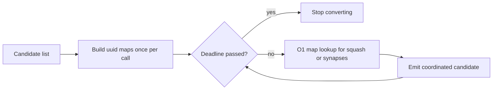

# PR Summary — Issue #2350: O(C·N) candidate/neuron squash lookups in fan-in polarity (and seven siblings)

## Summary

Closes #2350.

Eight detection converters looked up each candidate's neuron (squash,
incoming synapses, outgoing synapses, downstream targets) with
`creature.neurons.iter().find(..)` or `creature.synapses.iter().filter(..)`
inside the per-candidate loop, giving `O(C·N)` or `O(C·S)` work for `C`
candidates against `N` neurons / `S` synapses (CWE-407). Each converter now
builds the lookup once per call as a `HashMap`/`HashSet`, so the per-candidate
cost drops to `O(1)`:

- `src/analysis/detection/fanin_polarity_conflict.rs` — squash lookup;
  gained a deadline-aware `_with_deadline` entry point.
- `src/analysis/detection/bottleneck.rs` — squash lookup.
- `src/analysis/detection/monotonicity.rs` — squash, outgoing-synapse and
  incoming-synapse lookups.
- `src/analysis/detection/operating_point.rs` — incoming-synapse lookup.
- `src/analysis/detection/restricted_range.rs` — incoming-synapse lookup.
- `src/analysis/detection/output_range_compression.rs` — incoming-synapse
  lookup.
- `src/analysis/detection/sentinel_gating.rs` — downstream-target lookup.
- `src/analysis/detection/squash_weight_rescale.rs` — the per-neuron
  `feeds_downstream_aggregate` predicate (an `O(N·S)` scan repeated per
  hidden neuron) became `feeds_downstream_aggregate_set`, a single
  `HashSet<&str>` built once; plus a records-by-uuid and
  incoming-synapses-by-uuid map.

## Spec

### Intent and Rationale

- Each converter runs once per candidate list but was re-walking the whole
  neuron/synapse vector per candidate, so a creature with many flagged
  candidates against a large topology paid quadratic cost on every discovery
  pass.
- `squash_weight_rescale.rs`'s `feeds_downstream_aggregate` was worse: it
  re-scanned `creature.synapses` for every hidden neuron being evaluated,
  not just every candidate, so it was `O(N·S)` before any candidate existed.
- The fix follows the repo's existing `_with_deadline` pattern (co-adaptation,
  Issue #2348): a new deadline-aware fan-in function, with the old public
  signature delegating to it with `&None`, so no caller's signature changes.

### Essential Design Decisions

- `entry(..).or_insert(..)` for the squash map keeps the **first** neuron
  with a duplicate uuid, matching the semantics of the prior `.find()` scan.
- `entry(..).or_default().push(..)` for synapse maps preserves the original
  creature iteration order within each per-key `Vec`, because
  `operating_point.rs`/`restricted_range.rs`/`output_range_compression.rs`/
  `monotonicity.rs` all index into `incoming[0]`/`outgoing[0]` — changing the
  order would silently pick a different synapse.
- The fan-in deadline is threaded through a new
  `fanin_polarity_conflicts_to_coordinated_candidates_with_deadline` function
  rather than added as a parameter to the existing public one, and wired into
  `module_dispatch_specs/synapse_specs.rs` via a `custom:` dispatch-spec
  closure (the `guard:`/`records:`/`detect:`/`convert:` macro shorthand has
  no hook for passing a deadline through a second detection stage).
- `feeds_downstream_aggregate_set` returns `HashSet<&str>` (the set of
  neuron uuids that feed an aggregate-squash neuron), not a per-neuron
  bool predicate, so the aggregate-squash scan over `creature.neurons` and
  the synapse scan each run exactly once per call regardless of how many
  hidden neurons are evaluated afterwards.

### Undiscoverable Facts

- `fanin_polarity_conflicts_to_coordinated_candidates` (no deadline) is kept
  as the public entry point purely for ABI/call-site stability; the live
  dispatch path (`synapse_specs.rs:107`) calls
  `..._with_deadline` directly, so the no-deadline function is now exercised
  only by `tests/detection/issue_641_fanin_polarity_conflict.rs` and the new
  growth test, not by production dispatch.
- The growth regression test
  (`tests/issue_2350_fanin_polarity_squash_lookup_growth.rs`) deliberately
  calls only the pre-existing `fanin_polarity_conflicts_to_coordinated_candidates`
  signature (no `_with_deadline`, no new imports), so it compiles and runs
  unmodified against both the unfixed base and the fixed tree.
- On the unfixed base, the growth test measured a ratio of roughly 14.98
  (11.25 ms at N=2000 vs 168.44 ms at 4N=8000) — close to the expected ~16x
  quadratic blow-up; on the fixed tree it measured roughly 4.03, consistent
  with linear growth. Both numbers are timing-dependent and will vary run to
  run; the test's `ratio < 8.0` threshold sits between the two.
- `squash_weight_rescale.rs`'s `records_by_uuid` map uses
  `entry(..).or_insert_with(..)`, matching the first-match semantics of the
  prior `.iter().find()` over the records list exactly as the neuron-squash
  maps do for neurons.

## Security Fix Evidence

**Security regression test:**
`tests/issue_2350_fanin_polarity_squash_lookup_growth.rs::squash_lookup_work_grows_linearly_with_candidates`
(new in this diff).

- **Fails on the unfixed code.** Copying only this test onto `origin/Develop`
  measured roughly 11.25 ms at N=2000 vs 168.44 ms at 4N=8000 — a ratio of
  about 14.98, well past the `ratio < 8.0` assertion, showing the quadratic
  cost of the per-candidate `.find()` scan.
- **Passes after the fix.** It measured roughly 4.03 after the squash lookup
  became a once-per-call `HashMap`.
- **No trivial bypass:** the test builds candidates in increasing count
  alongside a proportionally larger neuron/synapse list, placing hidden
  neurons early in evaluation order (the worst case for a linear `find`), so
  there is no way to keep `N` small while growing `C`, nor to dodge the
  lookup — every candidate has a `neuron_uuid` that must resolve to a squash
  value for the comment/recommendation text it emits.

## Evidence

Tests in this diff:

- `tests/issue_2350_fanin_polarity_squash_lookup_growth.rs::squash_lookup_work_grows_linearly_with_candidates` — new growth regression test (above).
- `tests/detection/issue_641_fanin_polarity_conflict.rs::test_missing_target_neuron_falls_back_to_tanh_squash` and `::test_present_target_neuron_keeps_its_squash` — squash-map miss and hit.
- `tests/detection/issue_643_activation_error_monotonicity.rs::test_lookup_miss_drives_change_squash_branch`.
- `tests/detection/issue_401_operating_point_analysis.rs::test_neuron_without_incoming_synapses_emits_no_set_weight`.
- `tests/detection/issue_399_restricted_range_detection.rs::test_neuron_without_incoming_synapses_emits_no_set_weight`.
- `tests/detection/issue_645_output_range_compression.rs::test_neuron_without_incoming_synapses_emits_no_set_weight`.
- `tests/detection/issue_400_sentinel_value_gating.rs::test_sentinel_neuron_without_downstream_emits_no_candidate`.
- `tests/recommendation/issue_548_squash_weight_rescale.rs::test_neuron_without_incoming_synapses_emits_no_candidate`.
- `src/analysis/module_dispatch_specs/mod.rs::fanin_polarity_spec_detects_conflicts_before_the_deadline` and `::fanin_polarity_spec_honours_an_elapsed_deadline` — deadline threading through the dispatch spec.

Docs sweep — grep: `feeds_downstream_aggregate`, `fanin_polarity_conflicts_to_coordinated_candidates`, `append_synapse_specs`, `module_dispatch_specs`, "fan-in polarity", "deadline"; section: `docs/DOMINATED_BRANCH_COLLAPSE_EXTENT.md` (G3 row), `docs/ANALYSIS_DEEP_DIVE.md#fan-in-polarity-conflict-detection-issue-641`, `docs/DISCOVERY_TYPES.md#fan-in-polarity-conflict-detection`, `docs/FFI_API.md` (analysis deadline); siblings: `operating_point`, `sentinel_gating`, `output_range_compression`, `restricted_range`, `squash_weight_rescale`, `bottleneck`, `monotonicity`; updated: `docs/DOMINATED_BRANCH_COLLAPSE_EXTENT.md`

Remaining hits, each re-read on the final head:

- `docs/DOMINATED_BRANCH_COLLAPSE_EXTENT.md:222` — updated in this diff to name `feeds_downstream_aggregate_set`, built once per call.
- `docs/archive/pr-summaries/pr-summary-1713.md:28` — still true because it is an archived record of #1713 describing the code as it stood then.
- `docs/archive/pr-summaries/pr-summary-1713.md:32` — still true because it is the same archived #1713 record.
- `docs/analysis/candidate-rate-diagnosis-1777.md:277` — still true because it is a dated #1777 diagnosis row about `ModuleStarvationTracker`, a path this diff does not touch.
- `docs/analysis/module-skip-attribution-1925.md:133` — still true because `tiering_returns_the_specs_it_removed` still exists in `module_dispatch_specs` unchanged.
- `docs/ANALYSIS_DEEP_DIVE.md:633` — still true because the #641 heading names the detector, whose criteria and emitted operations are unchanged.
- `docs/DISCOVERY_TYPES.md:39` — still true because it is a table-of-contents link to an unchanged section.
- `docs/DISCOVERY_TYPES.md:184` — still true because the row's file, issue number and operations are unchanged.
- `docs/DISCOVERY_TYPES.md:1057` — still true because the section heading names an unchanged detector, and the section says nothing about lookup cost or deadlines.
- `docs/PRIOR_ART.md:116` — still true because it is a conceptual prior-art row with no implementation claim.
- `docs/FFI_API.md:128` — still true because detection modules still abort early at the deadline, and the fan-in conversion stage now honours it too.
- `benches/record_arc_sharing.rs:122` — still true because the dispatch shape it benchmarks is unchanged.
- `tests/issue_1547_module_tiering.rs:5` — still true because the dispatch module it describes is unchanged.
- `src/analysis/detection/fanin_polarity_conflict.rs:186` — still true because the legacy function still converts conflicts, now by delegating to `_with_deadline` with `&None`.
- `src/analysis/module_dispatch_specs/mod.rs:46` — still true because the #2183 capture it documents is unchanged.
- `src/analysis/module_dispatch_specs/mod.rs:108` — still true because the #1029 deadline is still forwarded to `detect_discovery_modules_parallel`, and the fan-in spec now also honours it.
- `src/analysis/module_dispatch_specs/mod.rs:110` — still true for the same reason as line 108.
- `src/analysis/module_dispatch_specs/mod.rs:906`, `:907`, `:947`, `:949` — still true because they document the co_adaptation and #2348 tests, which this diff does not change.

The seven sibling converters changed only their internal lookup structures. A
grep of their function names across `README.md` and `docs/` (excluding
`docs/archive/`) found no doc that describes those internals.

Provenance:

- #2350: O(candidates × neurons) squash lookup in fanin_polarity_conflicts_to_coordinated_candidates (src/analysis/detection/fanin_polarity_conflict.rs)
- #2348: 🟡 Uncancellable O(E²·S) hidden-neuron pair scan with no ceiling in detect_co_adapted_neurons (src/analysis/detection/co_adaptation.rs)
- #1713: Contribution-propagation break: expected-error-reduction estimator ignores downstream aggregate selection
- #641: Add fan-in weight polarity conflict detector
- #643: Add activation-error monotonicity detector
- #399: Bounded range neuron detection — identify neurons with restricted activation ranges
- #400: Sentinel value gating — propose gated connections that ignore null/sentinel observations
- #401: Hidden neuron operating-point analysis — detect neurons working outside their effective zone
- #645: Add output neuron range compression detector
- #548: Local minimum escape: Coordinate multi-neuron squash exploration
- #1029: Lockup and didn't finished within timelimit
- #2183: 🟡 Uncancellable scans in the recommendation-core detectors — no deadline or cancellation check (src/analysis/recommendation/)
- #1547: perf: tier / skip expensive detection modules on large creatures (GRQ scale)
- #1925: Candidate volume: 57% of runs cache nothing and high-success strategies are starved
- #1777: Diagnose very low successful-candidate rate in discovery on latest Develop

## Callers checked

- `append_synapse_specs` (`src/analysis/module_dispatch_specs/synapse_specs.rs:17`)
  has exactly one caller, `build_discovery_module_specs`
  (`src/analysis/module_dispatch_specs/mod.rs:71`), which now passes the
  dispatch `deadline` through.
- `fanin_polarity_conflicts_to_coordinated_candidates`
  (`src/analysis/detection/fanin_polarity_conflict.rs:195`) is called by
  `tests/detection/issue_641_fanin_polarity_conflict.rs` and
  `tests/issue_2350_fanin_polarity_squash_lookup_growth.rs`. The live dispatch
  path calls the `_with_deadline` variant from
  `src/analysis/module_dispatch_specs/synapse_specs.rs:107`. Reverting that
  call to `&None` turns `fanin_polarity_spec_honours_an_elapsed_deadline` red.
- The seven sibling converters keep their signatures, so no caller changed.

## Test Plan

- `cargo test --test issue_2350_fanin_polarity_squash_lookup_growth < /dev/null`: passed (ratio about 4.03; 14.98 on base).
- `cargo test --test detection < /dev/null` (filtered to the touched modules): 58 passed.
- `cargo test --test recommendation issue_548 < /dev/null`: 8 passed.
- `cargo test --lib fanin_polarity_spec < /dev/null`: 2 passed.
- `cargo fmt --check` and `cargo clippy --all-targets --all-features -- -D warnings`: clean.
- `./quality.sh < /dev/null`: QUALITY_RESULT_PLACEHOLDER

Branch outcomes:

- `src/analysis/detection/fanin_polarity_conflict.rs:237` — deadline elapsed → the loop breaks. Reached by `src/analysis/module_dispatch_specs/mod.rs::fanin_polarity_spec_honours_an_elapsed_deadline`. Changing `&deadline` to `&None` at `synapse_specs.rs:107` went red.
- Same site — deadline not reached → conversion proceeds. Reached by `src/analysis/module_dispatch_specs/mod.rs::fanin_polarity_spec_detects_conflicts_before_the_deadline` and every issue_641 test.
- `src/analysis/detection/fanin_polarity_conflict.rs:272` — squash-map miss → `"TANH"` fallback. Reached by `tests/detection/issue_641_fanin_polarity_conflict.rs::test_missing_target_neuron_falls_back_to_tanh_squash`. Changing the fallback to `"RELU"` went red.
- Same site — map hit → the neuron's own squash. Reached by `tests/detection/issue_641_fanin_polarity_conflict.rs::test_present_target_neuron_keeps_its_squash`.
- `src/analysis/detection/bottleneck.rs:262-265` — squash-map hit and the `"TANH"` miss fallback. The hit is reached by the existing bottleneck converter tests. The miss is reached by `tests/detection/issue_343_bottleneck_neuron_detection.rs::test_missing_neuron_falls_back_to_tanh_parallel_neuron`. Changing the fallback to `"RELU"` went red.
- `src/analysis/detection/monotonicity.rs:222` — synapse-map miss → `ChangeSquash` branch. Reached by `tests/detection/issue_643_activation_error_monotonicity.rs::test_lookup_miss_drives_change_squash_branch`. Panicking on a miss went red.
- Same site — both maps hit → `AddNeuron`. Reached by the existing issue_643 tests with incoming and outgoing synapses.
- `src/analysis/detection/operating_point.rs:303` — no incoming synapse → no `SetWeight`. Reached by `tests/detection/issue_401_operating_point_analysis.rs::test_neuron_without_incoming_synapses_emits_no_set_weight`. Inverting the check went red (3 vs 2). The hit is reached by the existing issue_401 fixtures.
- `src/analysis/detection/restricted_range.rs:288` — no incoming synapse → no `SetWeight`. Reached by `tests/detection/issue_399_restricted_range_detection.rs::test_neuron_without_incoming_synapses_emits_no_set_weight`. Inverting the check went red. The hit is reached by the existing issue_399 fixtures.
- `src/analysis/detection/output_range_compression.rs:252` — no incoming synapse → no `SetWeight`. Reached by `tests/detection/issue_645_output_range_compression.rs::test_neuron_without_incoming_synapses_emits_no_set_weight`. Inverting the check went red. The hit is reached by the existing issue_645 fixtures.
- `src/analysis/detection/sentinel_gating.rs:248` — no downstream target → `continue`. Reached by `tests/detection/issue_400_sentinel_value_gating.rs::test_sentinel_neuron_without_downstream_emits_no_candidate`. Removing the `continue` went red. The hit is reached by the existing issue_400 fixtures.
- `src/analysis/detection/squash_weight_rescale.rs:245` — the neuron is in `feeds_downstream_aggregate_set` → skipped. Reached by `tests/recommendation/issue_1713_aggregate_gate.rs::test_branch_feeding_aggregate_is_gated_out` (also `test_all_aggregate_targets_trigger_gate` and `test_mixed_fanout_with_aggregate_is_gated_out`). Removing the `continue` turned all three red.
- `src/analysis/detection/squash_weight_rescale.rs:249` — no records for the uuid → `continue`. Reached by `tests/recommendation/issue_548_squash_weight_rescale.rs::test_neuron_without_records_emits_no_candidate`. Replacing the `continue` with a panic went red.
- `src/analysis/detection/squash_weight_rescale.rs` (the incoming-synapse `is_empty` check after line 274) — no incoming synapse → `continue`. Reached by `tests/recommendation/issue_548_squash_weight_rescale.rs::test_neuron_without_incoming_synapses_emits_no_candidate`. Removing the `continue` went red.

Removed assertions: none.

## Pre-PR Security Self-Check

- [x] **Input validation:** no change to validated FFI entry points; these
  converters only run after `validate_creature` has already accepted the
  creature.
- [x] **Secrets:** none staged.
- [x] **Injection surface:** no new shell, SQL or HTTP calls.
- [x] **Output encoding:** no new rendered or serialised output; candidate
  payloads are unchanged.
- [x] **Authentication/authorisation:** no new endpoints or privileged
  operations.
- [x] **Error handling:** no new error paths and no internal state leaked; an
  elapsed deadline stops the loop early and returns the candidates built so far.
- [x] **Logging:** no new log lines.
- [x] **Dependencies:** no new dependencies.
- [x] **Path confinement:** no new path handling.

🤖 Generated with [Claude Code](https://claude.com/claude-code)
