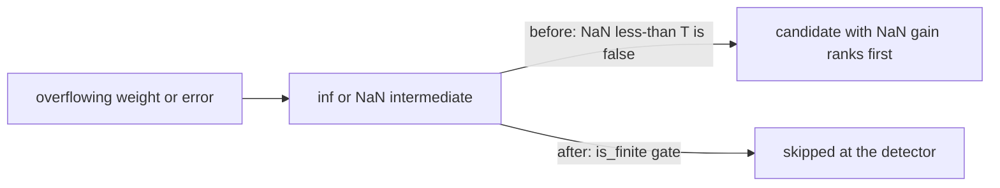

# PR Summary — Issue #2351: reject non-finite gains at the detector gates

## Summary

Closes #2351

Overflowing f32 synapse weights, errors or activations produced `inf`/`NaN`
intermediates in several detectors under `src/analysis/detection/`. Every
comparison with `NaN` is false, so `x < THRESHOLD` "skip" gates failed open and
emitted candidates whose gain was `NaN` or `inf`. Those rank first under the
converters' descending `total_cmp` sort and so crowd finite candidates out of the
`max_candidates` window before the late `reject_non_finite_gains` filter (#1367)
runs. Each detector now rejects a non-finite intermediate at its own gate.

- Core sites: `symmetry_breaking.rs` (NaN cosine similarity),
  `fanin_polarity_conflict.rs` (inf sums / NaN conflict score),
  `weight_coherence.rs` (inf ratio).
- Sibling sites with the same fail-open shape: `output_conflict.rs`,
  `compound_degradation.rs`, `topology.rs` (two gates), `bottleneck.rs`,
  `low_impact_neuron.rs`, `activation_mismatch.rs`, `bias_perturbation.rs`,
  `bimodal_neuron.rs`, `dormant_synapse.rs`,
  `high_error_squash_exploration.rs`, `noise_signal.rs`,
  `oscillating_neuron.rs`.

## Spec

### Intent and Rationale

- A gate written `if x < T { continue }` lets `NaN` through, so each gate now
  reads `if !x.is_finite() || x < T { continue }` (or the detector's equivalent).
- Rejecting at the source keeps non-finite candidates out of the ranked window,
  which the post-truncation filter cannot do.
- Finite inputs behave exactly as before; each detector has a finite-input
  control test.

### Essential Design Decisions

- Guards sit on the earliest intermediate that can go non-finite (similarity,
  sums, ratio, mean), plus the derived gain where a finite input can still
  overflow on summation (`output_conflict` `harmful_mean`, `bimodal` means).
- `bimodal_neuron` drops a single non-finite value rather than discarding the
  neuron, so one bad record is not fatal.
- `reject_non_finite_gains` in `candidate_aggregation.rs` is unchanged and stays
  as defence in depth.

### Undiscoverable Facts

- `output_squash_mismatch.rs` is deliberately untouched — it is tracked by #2381.
- `opposing_synapse.rs`, `hard_sample_cluster.rs` and `redundant_path.rs` were
  excluded by the issue.

## Evidence

- Required test:
  `tests/issue_2351_pairwise_detectors_non_finite_gain.rs::overflowing_weights_emit_no_non_finite_candidate`
  (symmetry, fan-in polarity and weight coherence) and
  `overflowing_output_errors_emit_no_non_finite_output_conflict`.
- Siblings: `tests/issue_2351_sibling_detectors_non_finite_gain_a.rs` (7 tests)
  and `tests/issue_2351_sibling_detectors_non_finite_gain_b.rs` (14 tests,
  including finite-input controls).

Docs sweep — grep: `non-finite|is_finite|fail.open`, each changed detector name
and `reject_non_finite_gains` over `README.md`, `docs/` and `src/`; section:
every hit's surrounding paragraph; siblings: `opposing_synapse`,
`output_squash_mismatch`, `hard_sample_cluster`, `redundant_path`; updated: none.

- `docs/COST_FUNCTION_NOTES.md:67-68` — still true: it says a non-finite error
  entry is skipped by every consumer, and the detectors now do that at their own
  gate. `:136-138` and `:336` are the `output_conflict.rs` rows (presence, length
  check, residual accumulator) and its consumer-list entry; they describe the
  input checks, which are unchanged, and the new finiteness checks sit after
  them in `output_conflict.rs`.
- `docs/DISCOVERY_TYPES.md:180`, `:184`, `:198`, `:201` — registry table rows
  (detector source file, issue, operations); none of those change. `:2024`
  describes weight validation in `calculate_optimal_outgoing_weight`, which this
  change does not touch.
- `docs/IMPACT_CALCULATION.md:416-456` — costOfGrowth handling and removal-candidate
  non-finite guards, a path this change does not touch.
- `src/analysis/candidate_aggregation.rs:155-159` — `reject_non_finite_gains`
  retains only candidates with a finite gain; unchanged and still runs.
- `src/analysis/synapse/post_processing.rs:69`, `:92` and
  `src/analysis/remove_neuron_drought.rs:139` — they reference or call
  `reject_non_finite_gains`, which is unchanged.

Provenance:

- #1367: reject non-finite gains in candidate aggregation
- #2381: output_squash_mismatch non-finite gain (excluded here)

## Test Plan

- Each regression test was run against the unfixed detectors and failed (for
  example, symmetry similarity `NaN` gave a `NaN` gain, and `output_conflict`
  means `[-0.5, inf, 0.0]` gave an `inf` gain). 16 of the 18 non-control tests
  were red before the fix. The other two, the bimodal ±3e38 and single −inf
  cases, are evidenced only by the red-flip of their guards.
- After the fix, all new tests pass, as do the `detection` (503),
  `recommendation` (249), `focus` (187), `infrastructure` (223) and `issue_2349`
  (7) suites and the lib `detection::` tests (38).
- `cargo fmt` and `cargo clippy -D warnings` are clean.

Branch outcomes:

- `src/analysis/detection/symmetry_breaking.rs:306` — non-finite similarity
  skipped — `overflowing_weights_emit_no_non_finite_candidate` — flip red.
- `src/analysis/detection/fanin_polarity_conflict.rs:157-159` — non-finite
  sum/score skipped — `overflowing_weights_emit_no_non_finite_candidate` — flip
  red.
- `src/analysis/detection/weight_coherence.rs:220` — inf ratio skipped —
  `overflowing_weights_emit_no_non_finite_candidate` — flip red.
- `src/analysis/detection/output_conflict.rs:151-153` and `:189-191` — non-finite
  means/harmful mean skipped —
  `overflowing_output_errors_emit_no_non_finite_output_conflict` — flip red.
- `src/analysis/detection/compound_degradation.rs:303` —
  `overflowing_errors_emit_no_non_finite_compound_correction` — flip red.
- `src/analysis/detection/topology.rs:219` —
  `non_finite_errors_emit_no_non_finite_long_path_gain` — flip red.
- `src/analysis/detection/topology.rs:281` —
  `non_finite_errors_emit_no_non_finite_imbalance_gain` — flip red.
- `src/analysis/detection/bottleneck.rs:171` —
  `overflowing_errors_emit_no_non_finite_bottleneck_gain` — flip red.
- `src/analysis/detection/low_impact_neuron.rs:137` —
  `nan_activations_emit_no_non_finite_low_impact_candidate` — flip red.
- `src/analysis/detection/activation_mismatch.rs:216` —
  `non_finite_activations_emit_no_non_finite_squash_gain` — flip red.
- `src/analysis/detection/bias_perturbation.rs:184` —
  `non_finite_errors_emit_no_non_finite_bias_perturbation_gain` — flip red.
- `src/analysis/detection/bimodal_neuron.rs:129` — non-finite value dropped —
  `bimodal_single_non_finite_value_is_dropped_not_fatal` — flip red.
- `src/analysis/detection/bimodal_neuron.rs:143-145` — non-finite gain or means
  skipped — `bimodal_overflowing_finite_values_do_not_emit_non_finite_bias` —
  flip red.
- `src/analysis/detection/dormant_synapse.rs:135` —
  `dormant_inf_weight_times_zero_activation_does_not_emit_nan_gain`,
  `dormant_nan_activation_does_not_emit_nan_gain` — flip red.
- `src/analysis/detection/high_error_squash_exploration.rs:184` —
  `high_error_squash_aggregate_current_squash_does_not_emit_nan_gain` — flip
  red.
- `src/analysis/detection/noise_signal.rs:274` —
  `noise_non_finite_source_activation_does_not_emit_nan_gain` — flip red.
- `src/analysis/detection/oscillating_neuron.rs:115` —
  `oscillating_nan_activation_does_not_emit_nan_gain`,
  `oscillating_overflowing_mean_does_not_emit_infinite_gain` — flip red.
- Finite (pass-through) outcome of every gate — the `*_finite_input_still_emits_candidate`
  controls and the existing `detection` suite — green.

Removed assertions: none.

Callers and entry points checked: each changed detector is reached through its
public `detect_*` function, which the new tests call directly; the FFI and
aggregation paths that call them are unchanged and covered by the existing
`detection` and `recommendation` suites.

## Security self-check

- Input validation: the change adds finiteness checks; it accepts no new input.
- Secrets: none staged. Injection, output encoding, auth: no new surface.
- Error handling: non-finite values are skipped, never reported as a gain.
- Dependencies: none added or bumped.

## Security-fix evidence

- Test file: `tests/issue_2351_pairwise_detectors_non_finite_gain.rs`.
- Test: `tests/issue_2351_pairwise_detectors_non_finite_gain.rs::overflowing_weights_emit_no_non_finite_candidate`.
- It fails on the unfixed code (a `NaN` gain is emitted) and passes after the fix.
- The trigger is closed at each gate. There is no trivial bypass: `inf`, `-inf`
  and `NaN` all fail `is_finite()`, and every sibling detector with the same
  comparison shape carries the same guard.

🤖 Generated with [Claude Code](https://claude.com/claude-code)
