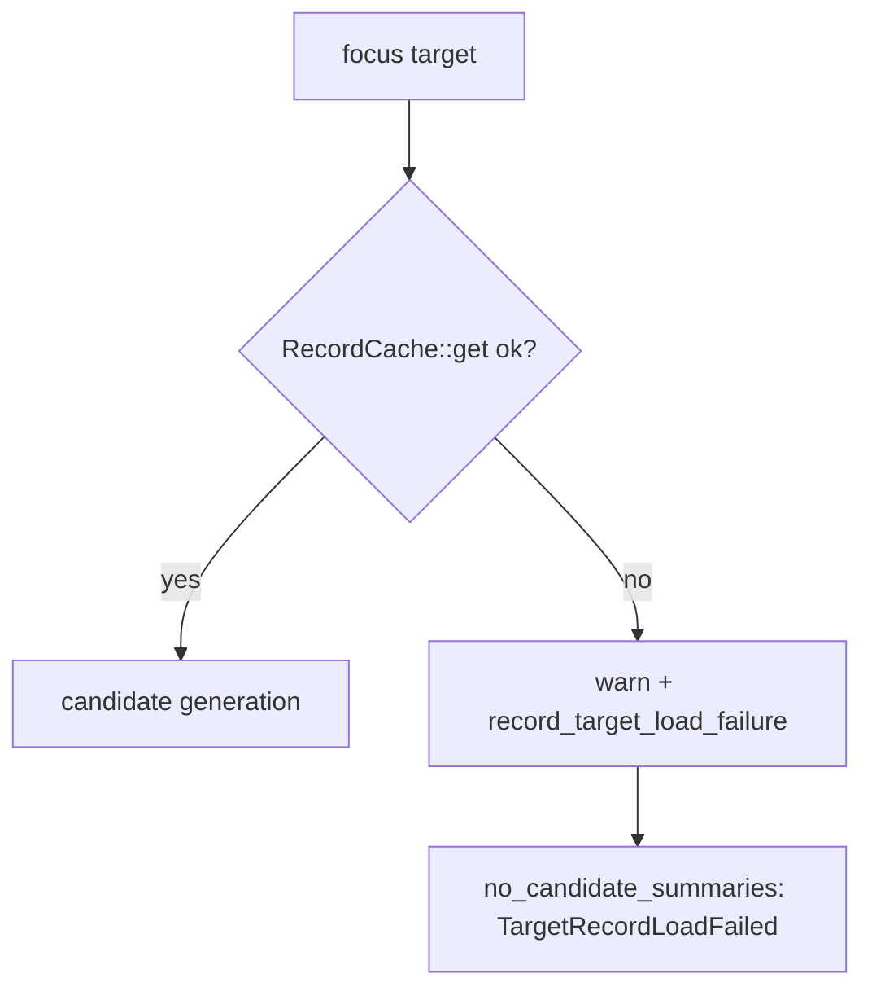

# PR Summary — Issue #2352

## Summary

Closes #2352

`analyze_neurons_with_cache_and_gpu_queue` dropped a focus target silently when
`RecordCache::get(target_uuid)` failed: the `Err` arm logged only under
`cfg!(debug_assertions)`, returned `Ok(error_acc)` and never touched
`NeuronDiagnostics`, so `no_candidate_summaries` misreported the target as
`NoEligibleSources`. The failure is now recorded in `NeuronDiagnostics`,
logged at `warn` in every build profile, and surfaced as a new
`NeuronNoCandidateReason::TargetRecordLoadFailed`
(`target_record_load_failed`).

- [x] Extract the target-load step (`load_target_records`) so a GPU-free test can drive it
- [x] Record the failure in `NeuronDiagnostics` and report a distinct reason
- [x] Unconditional `tracing::warn!`
- [x] Wire the reason through orchestration, FFI responses, starvation classification
- [x] Regression test, unit tests, docs
- [x] `Cargo.toml` patch bump 0.74.283 → 0.74.284

## Spec

### Intent and Rationale

A cache load failure (for example a corrupt parquet partition) is an
infrastructure fault, not a lack of eligible sources. Reporting it as
`NoEligibleSources` sends operators down the wrong drought-playbook branch. The
`RecordCache` `OnceLock` memoises the `Err` for the whole `analyze_all` call, so
every later lookup of the same target fails identically; the failure must be
visible once, loudly, and attributed correctly. This mirrors the synapse-side
precedent `SynapseNoCandidateReason::NoTargetRecords` (Issue #1101).

### Essential Design Decisions

- New reason `TargetRecordLoadFailed` is checked after the input/hidden/constant
  filter reasons and before `NoEligibleSources`, so a filtered target keeps its
  more specific filter reason.
- `load_target_records` is `pub(crate)` and unconditional-`warn!`; the
  GPU-free test reaches it via `src/analysis/neuron_target_load_harness.rs`,
  gated by the existing `regression-harness` feature (Issue #1877) with a
  `[[test]] required-features` entry, so no new public API or config surface.
- `mark_skipped_filters` was extracted and moved to run right after
  `NeuronDiagnostics::new`, so the filter reasons are recorded before any early
  return from a failed load. This is a small reordering beyond the issue text
  and is needed for the precedence above to hold on the failure path.
- `target_record_load_failed` is added to `UPSTREAM_REJECTION_REASONS` in
  `candidate_starvation.rs`, since it is not a candidate-quality signal.

### Undiscoverable Facts

- `./quality.sh` failed at rustdoc on base `Develop` before any change of mine:
  `src/config/user_facing.rs:56` linked (`[...]`) the private
  `MAX_GPU_RETRY_LIMIT` (introduced by #2402). It is fixed here with a
  one-line change to plain code formatting because it blocks the gate.
- `NeuronDiagnostics` lives in a private module, so the test harness exposes a
  small outcome struct rather than the diagnostics type.

## Evidence

Security-fix evidence:
`tests/issue_2352_neuron_target_load_failure_surfaced.rs::neuron_target_load_failure_is_not_reported_as_no_eligible_sources`
fails on the unfixed code (reason is `NoEligibleSources`) and passes after the
fix (reason is `TargetRecordLoadFailed`). The original trigger is closed with no
trivial bypass, by static reasoning: the only `RecordCache::get(target_uuid)`
`Err` path in the neuron analysis now goes through `load_target_records`, which
always records the failure and always emits `warn!`, and
`no_candidate_summaries` consults that flag before the `NoEligibleSources` branch.

Quality gate: `timeout 900 ./quality.sh < /dev/null` → "All quality checks
passed!" (exit 0).

Reviews: independent standards review found no violations; independent spec
review found all four issue requirements met. Optional note: `focus_order` is
now cloned (`prep.focus_order.clone()`) so the early `mark_skipped_filters` can
borrow `prep`.

Docs sweep:
- grep: `NoEligibleSources`, `no_eligible_sources`, `ConstantNeuronFiltered`, `constant_neuron_filtered`
- section: updated `docs/DROUGHT_PLAYBOOK.md` (new `target_record_load_failed` row) and `docs/ANALYSIS_DEEP_DIVE.md` (precedence paragraph); left unchanged and still true: `DROUGHT_PLAYBOOK.md:108` (JSON example), `:200` (Mermaid label), `:453` (prose), `docs/FFI_API.md:651` (JSON example), `docs/analysis/rejection-diagnosis-1737.md:150` (historical), `ANALYSIS_DEEP_DIVE.md:947` (existing `constant_neuron_filtered` row); README and CONTRIBUTING have no hits
- siblings: `NoEligibleSources`, `no_eligible_sources`, `ConstantNeuronFiltered`, `constant_neuron_filtered`

## Test Plan

- `cargo test --test issue_2352_neuron_target_load_failure_surfaced --features regression-harness`: 3 passed
  - `neuron_target_load_failure_is_not_reported_as_no_eligible_sources`
  - `neuron_target_load_failure_is_counted`
  - `successful_target_load_is_not_reported_as_failed` (control)
- Unit tests in `src/analysis/implementation_tests/diagnostics_tests.rs`; `--lib diagnostics` 69 passed, `--test analysis` 652 passed, `--test infrastructure` 223 passed (includes doc contract tests).
- Red-check: with `diagnostics.record_target_load_failure(...)` removed from the `Err` arm, the two behavioural tests fail (`left: NoEligibleSources, right: TargetRecordLoadFailed`) and the control still passes; line restored.

Branch outcomes:
- `src/analysis/neuron/mod.rs` `load_target_records` Ok → `Some(records)`: `successful_target_load_is_not_reported_as_failed`; forcing the failure branch makes it red.
- `src/analysis/neuron/mod.rs` `load_target_records` Err → warn + record + `None`: `neuron_target_load_failure_is_counted` and `neuron_target_load_failure_is_not_reported_as_no_eligible_sources`; removing the record call turned both red.
- `src/analysis/diagnostics/neuron_tracking.rs` `no_candidate_summaries` `target_load_failed` → `TargetRecordLoadFailed`: `neuron_target_load_failure_is_not_reported_as_no_eligible_sources`; dropping the check turned it red.
- `src/analysis/diagnostics/neuron_tracking.rs` `emit_logs` `target_load_failed` warn branch: exempt (untestable): log output emission only, tracing capture is not staged in the suite (searched `tests/` and `src/analysis/implementation_tests/` for `emit_logs` callers).

No dependency bumps; `deno.lock` not applicable.
