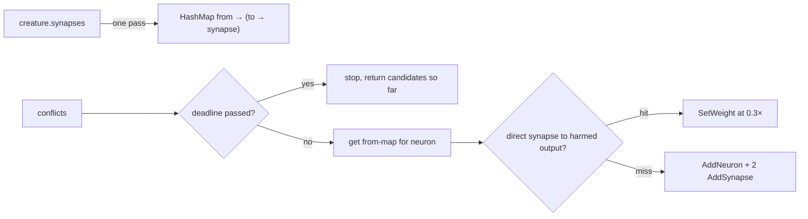

# Index synapses once in output-conflict candidate conversion (CWE-407)

Closes #2358

- [x] Replace the per-conflict `creature.synapses` filter and per-output `find` with a single synapse index
- [x] Thread the analysis deadline into the conversion and check it once per conflict
- [x] Regression growth test plus deadline and duplicate-synapse tests
- [x] Version bump 0.74.285 → 0.74.286

## Spec

### Intent and Rationale

`output_conflicts_to_coordinated_candidates` (`src/analysis/detection/output_conflict.rs`)
filtered all of `creature.synapses` once per conflict, then ran a linear `find` over
that neuron's outgoing synapses once per harmed output. Total work was
O(conflicts × synapses), and an outsized creature could make the conversion stall
analysis (CWE-407). The synapses are now grouped once by `from_uuid` → `to_uuid`, so
each lookup is O(1) and the total work is O(synapses + conflicts).

### Essential Design Decisions

- **First duplicate wins.** The map is filled with `entry(..).or_insert(s)`, which
  matches the old `find` (first match in iteration order) when a creature carries
  duplicate `(from, to)` synapses. `duplicate_synapse_pair_uses_first_weight` pins it.
- **Deadline, not a cap.** The conversion now takes `deadline: &Option<SystemTime>`
  and calls `deadline_passed` once per conflict, the same pattern the #2183
  fan-in/multi-hop detectors use. The only production caller
  (`module_dispatch_specs/structural_specs.rs`) forwards its existing deadline.
  Output is otherwise unchanged.
- **Ratio timing test.** CONTRIBUTING.md discourages timing assertions in tests.
  This test is a deliberate departure: the issue names it, and the defect has no
  wrong output, only a wrong growth rate. It compares t(4N)/t(N) using the best of
  five runs, never a wall-clock constant.

### Undiscoverable Facts

- Unfixed ratio t(4000)/t(1000): 14.35, 14.42, 14.33 (≈13 ms → ≈193 ms).
  Fixed: 4.05–4.06 (≈3 ms → ≈12 ms). The threshold of 10 sits between the
  linear (~4) and quadratic (~16) regimes.

## Evidence

Regression test
`tests/issue_2358_output_conflict_converter_growth.rs::conflict_conversion_work_grows_linearly_with_conflicts`:
fails against unfixed code, passes after fix (ratio ≈14.4 on the base code, ≈4.05
after). The rescan is gone rather than bounded, so the original trigger is closed, no
trivial bypass: every conflict does O(1) map lookups however many synapses the
creature has.

- `cargo test --test issue_2358_output_conflict_converter_growth` — 3/3 pass
- `cargo test --test detection issue_639` — 11/11 pass
- `cargo fmt --all -- --check`, `cargo clippy --all-targets -- -D warnings`,
  `cargo doc --no-deps` — clean
- `./quality.sh < /dev/null` — all quality checks passed

**Docs sweep** — grep: `output_conflicts_to_coordinated_candidates`, `deadline` in
`src/analysis/module_dispatch_specs/`, `output.conflict` in `README.md` and `docs/`;
section: `deadline` field docs in `module_dispatch_specs/mod.rs`; siblings: the
"#2183 multi-hop/fan-in/gradient", "#2348 co-adaptation" and "#2349
symmetry-breaking" deadline notes; updated: `src/analysis/module_dispatch_specs/mod.rs:51`,
`src/analysis/module_dispatch_specs/structural_specs.rs:19-21`, the converter's doc
comment in `src/analysis/detection/output_conflict.rs`; still true: `README.md` and
`docs/` do not describe the converter's internals, so none needed changes.

## Test Plan

Tests in `tests/issue_2358_output_conflict_converter_growth.rs`:

- `conflict_conversion_work_grows_linearly_with_conflicts`: checks correctness on N=1000
  (one candidate per conflict, SetWeight at 0.3× for odd i, AddNeuron + 2 AddSynapse for
  even i), then asserts that the t(4N)/t(N) ratio is below 10. It is red on the unfixed
  code (≈14.4).
- `conflict_conversion_stops_at_passed_deadline`: with a passed deadline the result is
  empty.
- `duplicate_synapse_pair_uses_first_weight`: with duplicate weights 2.0 and 7.0 the
  result is 0.6.

Call sites checked: `src/analysis/module_dispatch_specs/structural_specs.rs` (the only
production caller, now passing `&deadline`), and
`tests/detection/issue_639_output_conflict_detection.rs` (passes `&None`).

**Branch outcomes:**

- `src/analysis/detection/output_conflict.rs:256`, deadline passed → `conflict_conversion_stops_at_passed_deadline`. Removing the `break` went red.
- `src/analysis/detection/output_conflict.rs:256`, deadline not passed → `conflict_conversion_work_grows_linearly_with_conflicts` and `duplicate_synapse_pair_uses_first_weight`. Forcing a `break` empties the output, so both go red.
- `src/analysis/detection/output_conflict.rs:287`, map hit → SetWeight at 0.3× in `conflict_conversion_work_grows_linearly_with_conflicts` (odd i). Forcing a miss turns the operation into AddNeuron, which goes red.
- `src/analysis/detection/output_conflict.rs:295`, map miss → AddNeuron + 2 AddSynapse in `conflict_conversion_work_grows_linearly_with_conflicts` (even i).
- `src/analysis/detection/output_conflict.rs:250`, `or_insert` on a duplicate pair (first wins) → `duplicate_synapse_pair_uses_first_weight`. Replacing it with `insert_entry` (last wins) went red.

## Pre-PR Security Self-Check

- [x] Input validation: no new external input. The creature still passes through the existing `validate_creature` at the FFI boundary.
- [x] Secrets: no secrets, keys or hidden files staged.
- [x] Injection surface: none added.
- [x] Output encoding: unchanged.
- [x] Authentication/authorisation: not applicable.
- [x] Error handling: a passed deadline stops the conversion early, matching sibling detectors.
- [x] Dependencies: none added.
- [x] Path confinement: not applicable.
