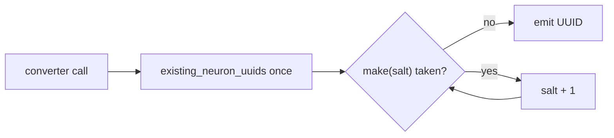

# PR Summary — Issue #2359

## Summary

Closes #2359

Synthetic `AddNeuron` UUIDs (`hsc-…`, `ocs-…`, `bp-…`, `{uuid}-split-lower`,
`gate-bounded-{uuid}`) were derived only from a hash or a fixed pattern. They
were never checked against the neurons the creature already has, so a candidate
could name an existing neuron (CWE-694). Each converter now builds the set of
existing UUIDs once per call. On a collision it re-salts the UUID, so the
candidate is not dropped. Version bumped from 0.74.286 to 0.74.287.

## Spec

### Intent and Rationale

- An emitted `AddNeuron` must never reuse a UUID the creature already has. A
  reused UUID would make NEAT-AI alias or overwrite an existing neuron.
- Re-salting keeps the candidate, so the fix does not suppress anything. The
  pipeline already over-suppresses (`docs/analysis/candidate-rate-diagnosis-1777.md`).

### Essential Design Decisions

- There is one shared helper pair in `src/analysis/detection/helpers.rs`:
  - `existing_neuron_uuids` builds a `HashSet<&str>` once per call.
  - `first_free_neuron_uuid` tries salt 0, 1, 2, … and keeps the first free UUID.
- The helper is used at all five sites: hard_sample_cluster, output_conflict,
  bottleneck, bimodal_neuron and bounded_range.
- Salt 0 reproduces the legacy UUID byte-for-byte, so creatures with no
  collision see no change in output.
- `AddSynapse` and `SetWeight` operations reference the chosen UUID, not the
  legacy one.

### Undiscoverable Facts

- Golden salt-0 values were captured from the unfixed base d82e793:
  `hsc-c386a0579d407bd5`, `ocs-ec07650c78436186` and `bp-178b654c0ea8cf1b`.
- The salted forms are:
  - FNV: `key|{salt}`
  - bimodal: `{uuid}-split-lower-{n}`
  - bounded range: `gate-bounded-{uuid}-{n}`

## Evidence

- **Regression test:**
  `tests/issue_2359_synthetic_add_neuron_uuid_collision.rs::emitted_add_neuron_never_reuses_an_existing_neuron_uuid`.
  - It fails against the unfixed code and passes after the fix: with the
    helper bypassed (mutations 1 and 2a/2b) it went red.
  - The original trigger is closed, no trivial bypass: every one of the five
    `AddNeuron` emitters goes through `first_free_neuron_uuid`, and each has
    its own collision test.
- No existing assertions were removed. The existing test files were only
  updated for the new `creature` argument at call sites.
- **Docs sweep:**
  - `grep: hard_sample_neuron_uuid|split_neuron_uuid|split-lower|gate-bounded|build_record_map|weighted_confidence across README.md CONTRIBUTING.md AGENTS.md docs src`
  - `section: README, CONTRIBUTING, AGENTS, docs/ (no hits outside archive), src/analysis/detection/*`
  - `siblings: "build_record_map", "weighted_confidence"`
  - `updated: helpers.rs module-doc table rows, bimodal_neuron.rs and bounded_range.rs doc comments`
- **Kept hits:**
  - `src/analysis/detection/helpers.rs:16`: still true because the module-doc
    table row lists `existing_neuron_uuids`.
  - `src/analysis/detection/helpers.rs:17`: still true because the table row
    lists `first_free_neuron_uuid`.
  - `src/analysis/detection/low_impact_neuron.rs:182`: still true because the
    #941 `weighted_confidence` comment is unaffected.
  - `src/analysis/detection/dead_neuron.rs:210`: still true for the same reason.
  - `src/analysis/detection/bounded_range.rs:206`: still true for the same reason.
  - `src/analysis/detection/bounded_range.rs:243`: still true because it
    documents the new `gate-bounded-{uuid}-{n}` re-salt.
  - `src/analysis/detection/bimodal_neuron.rs:270`: still true because it
    documents the new `{uuid}-split-lower-{n}` re-salt.

## Test Plan

- [x] Run `cargo test --test issue_2359_synthetic_add_neuron_uuid_collision`: 7/7 pass.
- [x] Run the helper tests in `tests/detection/issue_941_detection_helpers.rs`: they pass.
- [x] `cargo clippy -D warnings` and `cargo fmt --check` are clean.
- [x] Run `./quality.sh < /dev/null`.

Branch outcomes:

- `src/analysis/detection/helpers.rs:241`, UUID free, so the salt-0 UUID is
  returned.
  - Reached by `tests/detection/issue_941_detection_helpers.rs::first_free_neuron_uuid_returns_salt_zero_when_free`
    and `tests/issue_2359_synthetic_add_neuron_uuid_collision.rs::legacy_uuid_kept_when_no_collision`.
  - Flip: starting at salt 1 went red.
- `src/analysis/detection/helpers.rs:241`, UUID taken, so the next salt is tried.
  - Reached by `first_free_neuron_uuid_skips_one_collision`,
    `first_free_neuron_uuid_skips_two_collisions` and
    `emitted_add_neuron_never_reuses_an_existing_neuron_uuid`.
  - Flip: always returning `make(0)` went red.
- `src/analysis/detection/helpers.rs:245`, all u32 salts exhausted.
  - exempt (untestable): needs a creature holding 4,294,967,296 colliding
    neurons, which is beyond any test host's memory.
  - Harness search: grep of `tests/` for `first_free_neuron_uuid` finds only
    `tests/detection/issue_941_detection_helpers.rs` and
    `tests/issue_2359_synthetic_add_neuron_uuid_collision.rs`. Both use sets
    of three entries or fewer.
- `src/analysis/detection/hard_sample_cluster.rs:322`, `salt == 0` gives the
  legacy key.
  - Reached by `legacy_fnv_uuids_match_pre_fix_values`.
  - Flip to `false`: went red.
- `src/analysis/detection/hard_sample_cluster.rs:322`, salt > 0 gives the
  salted key.
  - Reached by `emitted_add_neuron_never_reuses_an_existing_neuron_uuid`.
  - Flip (helper bypassed): went red.
- `src/analysis/detection/output_conflict.rs:207`, `salt == 0` gives the
  legacy key.
  - Reached by `legacy_fnv_uuids_match_pre_fix_values`.
  - Flip to `false`: went red.
- `src/analysis/detection/output_conflict.rs:207`, salt > 0 gives the salted key.
  - Reached by `emitted_add_neuron_never_reuses_an_existing_neuron_uuid`.
  - Flip (helper bypassed): went red.
- `src/analysis/detection/bottleneck.rs:207`, `salt == 0` gives the legacy key.
  - Reached by `legacy_fnv_uuids_match_pre_fix_values`.
  - Flip to `false`: went red.
- `src/analysis/detection/bottleneck.rs:207`, salt > 0 gives the salted key.
  - Reached by `bottleneck_parallel_neuron_never_reuses_an_existing_neuron_uuid`.
  - Flip (helper bypassed): went red.
- `src/analysis/detection/bimodal_neuron.rs:288`, salt 0 gives
  `{uuid}-split-lower`.
  - Reached by `legacy_uuid_kept_when_no_collision`.
  - Flip (helper starting at salt 1): went red.
- `src/analysis/detection/bimodal_neuron.rs:288`, salt > 0 gives
  `{uuid}-split-lower-{n}`.
  - Reached by `bimodal_split_neuron_never_reuses_an_existing_neuron_uuid`.
  - Flip (helper bypassed): went red.
- `src/analysis/detection/bounded_range.rs:262`, salt 0 gives
  `gate-bounded-{uuid}`.
  - Reached by `legacy_uuid_kept_when_no_collision`.
  - Flip (helper starting at salt 1): went red.
- `src/analysis/detection/bounded_range.rs:262`, salt > 0 gives
  `gate-bounded-{uuid}-{n}`.
  - Reached by `bounded_range_gate_neuron_never_reuses_an_existing_neuron_uuid`.
  - Flip (helper bypassed, or `AddSynapse` targeting the legacy UUID): went red.

## Security Self-Check

- [x] Input validation: the only input is the existing `CreatureJson`, which
  is already validated at the FFI boundary.
- [x] No secrets, shell, SQL or path handling were added.
