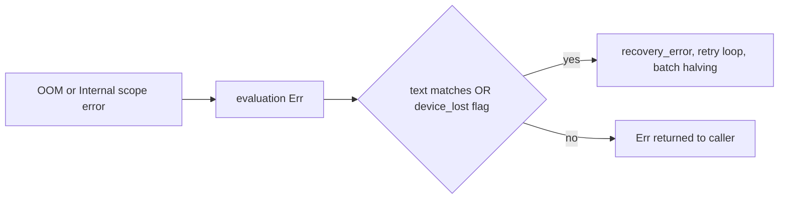

## Summary

wgpu 30 reports a lost GPU device as an opaque `BufferAsyncError`, a poll panic or an uncaptured-error panic, so the text-only `is_device_lost_error` / `is_memory_exhaustion_error` classifiers never entered device-lost recovery (#647) or batch halving (#1083). Recovery is now routed by source as well as by text. Closes #2363.

Version bump: `Cargo.toml` `version` updated for this change; the merged commit records the final version.

- `GpuAnalyzer::new` registers `Device::set_device_lost_callback`, which sets an `Arc<AtomicBool>` exposed as `RequestEvaluator::device_lost()`.
- `execute_request` (all five request arms) enters recovery when `is_device_lost_error(e) || analyzer.device_lost()`. A flag-only failure is re-tagged `GPU device lost: …` so the retry loop classifies it.
- Each production evaluation runs inside `push_error_scope(OutOfMemory)` and `push_error_scope(Internal)`; a popped error becomes a typed `Err` (`GPU out of memory:`, `GPU internal error:`, else `GPU device error:`) instead of reaching wgpu's panicking default handler.
- Both matchers also accept wgpu-core's `"Not enough memory left."`.
- `docs/GPU_GUIDE.md` documents the behaviour.

## Spec

### Intent and Rationale

- The issue's suggested fix is to classify by source: a device-lost flag plus error scopes, so recovery no longer depends on wgpu's error wording.

### Essential Design Decisions

- A failure while the flag is set always routes to recovery, because after loss wgpu-core keeps the device lost for good.
- A captured scope error takes precedence over an `Ok` result, since a batch that hit a device error cannot be trusted.
- Not done: the poll-path panic (`Device::poll`, wgpu `handle_error_fatal`) is not converted to an `Err`; it remains the #2361 panic-handling path. The error scopes cover buffer creation OOM only.

### Undiscoverable Facts

- `tests/issue_2245_gpu_device_lost_classification.rs`, named in the issue, does not exist at the base, so no existing pin had to flip.

## Security Fix Evidence

- Cited regression test: `tests/gpu/issue_2363_device_lost_classification_test.rs::not_enough_memory_left_is_device_lost` (companion: `not_enough_memory_left_is_memory_exhaustion`). It uses only the existing public classifiers.
- Red at base: with `src/analysis/gpu/queue/recovery.rs` restored to `origin/HEAD`, `cargo test --test gpu issue_2363` fails 2 of 3 (`not_enough_memory_left_is_device_lost`, `not_enough_memory_left_is_memory_exhaustion`: "expected device-lost classification for: Helpful batch buffer creation failed: Not enough memory left."). Green at head: 3 passed.
- Flag routing is covered by `src/analysis/gpu/queue/device_lost_flag_test.rs::flagged_opaque_map_error_enters_recovery` (and one test per request kind) on the `FakeGpuEvaluator` harness, with the unflagged control `unflagged_opaque_map_error_reaches_caller_unchanged`. These use the new `device_lost()` trait method, so they do not compile at base.
- Original trigger closed: a lost device that returns the opaque map error now sets the callback flag, so `routes_to_recovery` is true and the request enters the retry loop; wgpu-core's out-of-memory wording and wgpu's `Out of Memory` scope error match both memory classifiers. A device-loss reason that wgpu reports only by panic on the poll path is not covered here (see Essential Design Decisions).

## Evidence

## Test Plan

- `cargo test --lib analysis::gpu::queue`: 106 passed.
- `cargo test --test gpu issue_2363`: 3 passed at head; 2 failed with `recovery.rs` restored to base.
- `cargo clippy --all-targets --all-features -- -D warnings` and `cargo fmt --all`: clean.
- New tests: `tests/gpu/issue_2363_device_lost_classification_test.rs`, `src/analysis/gpu/queue/device_lost_flag_test.rs`, unit tests in `recovery.rs`, `execution.rs`, `executor.rs`.
