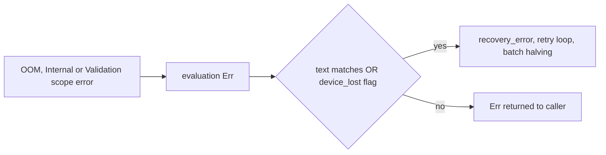

## Summary

wgpu 30 reports a lost GPU device as an opaque `BufferAsyncError`, a poll panic or an uncaptured-error panic, so the text-only `is_device_lost_error` / `is_memory_exhaustion_error` classifiers never entered device-lost recovery (#647) or batch halving (#1083). Recovery is now routed by source as well as by text. Closes #2363.

Version bump: `Cargo.toml` and the crate's `Cargo.lock` entry are updated for this change; the merged commit records the final version.

- `GpuAnalyzer::new` registers `Device::set_device_lost_callback`, which sets an `Arc<AtomicBool>` exposed as `RequestEvaluator::device_lost()`.
- `execute_request` (all five request arms) enters recovery when `is_device_lost_error(e) || analyzer.device_lost()` (`routes_to_recovery`). A flag-only failure is re-tagged `GPU device lost: …` (`recovery_error`) so the retry loop classifies it. The #2365 budget-timeout reclassification (`reclassify_budget_timeout`) still runs first in each arm.
- Each production evaluation runs inside `push_error_scope` for `Validation` (outermost), `OutOfMemory` and `Internal`; a popped error becomes a typed `Err` (`GPU out of memory:`, `GPU internal error:`, else `GPU device error:`) instead of reaching wgpu's panicking default handler. Precedence when several were captured: out-of-memory, then internal, then validation (`select_scoped_error`).
- Both matchers also accept wgpu-core's `"Not enough memory left."`.
- `docs/GPU_GUIDE.md` documents the behaviour; the chunk 9 audit record ledgers the new test-only file.

This is a redo of the closed PRs #2433 and #2456, rebuilt on the current `Develop`. It carries their source, tests and docs, and it changes **no dependency**: `Cargo.toml` / `Cargo.lock` differ from `Develop` only by the crate version (the earlier branches' unrelated `parquet`/`arrow` bump, which reviewers rejected, is not carried).

## Spec

### Intent and Rationale

- The issue's suggested fix is to classify by source: a device-lost flag plus error scopes, so recovery no longer depends on wgpu's error wording.

### Essential Design Decisions

- A failure while the flag is set always routes to recovery, because after loss wgpu-core keeps the device lost for good. Recovery builds a new analyser through the factory, which carries a fresh flag.
- A captured scope error takes precedence over an `Ok` result, since a batch that hit a device error cannot be trusted.
- Not done: the poll-path panic (`Device::poll`, wgpu `handle_error_fatal`) is not converted to an `Err`; it remains the #2361 panic-handling path. The error scopes cover errors wgpu raises on the evaluating thread (buffer-creation out-of-memory and the follow-on validation errors from the invalid buffer it returns).

### Undiscoverable Facts

- `tests/issue_2245_gpu_device_lost_classification.rs` exists at the base and pinned today's behaviour. This PR flips only its `DeviceError::OutOfMemory` ("Not enough memory left.") assertions in `device_loss_reported_through_the_map_callback_is_not_classified` to `true`, as the issue requires. Its `BufferAsyncError` assertions deliberately stay `false`: the opaque text is routed by the device-lost flag, not by text.

## Security Fix Evidence

- Cited regression test: `tests/issue_2363_device_lost_classification.rs::not_enough_memory_left_is_device_lost` (companion: `not_enough_memory_left_is_memory_exhaustion`). It uses only the existing public classifiers.
- Red at base: with `src/analysis/gpu/queue/recovery.rs` restored to `origin/Develop`, `cargo test --test issue_2363_device_lost_classification` fails `not_enough_memory_left_is_device_lost` and `not_enough_memory_left_is_memory_exhaustion` (1 passed, 2 failed); `tests/issue_2245_gpu_device_lost_classification.rs::device_loss_reported_through_the_map_callback_is_not_classified` also fails there. Green at head: 3 and 5 passed respectively.
- Flag routing is also covered by tests in `src/analysis/gpu/queue/device_lost_flag_test.rs` (one per request kind, plus an unflagged control) on the `FakeGpuEvaluator` harness. They need the new `device_lost()` trait method, so they cannot build at the base and are supporting coverage, not the cited regression test.
- Original trigger closed: a lost device that returns the opaque map error now sets the callback flag, so `routes_to_recovery` is true and the request enters the retry loop; wgpu-core's out-of-memory wording and wgpu's `Out of Memory` scope error match both memory classifiers. A device-loss reason that wgpu reports only by panic on the poll path is not covered here (see Essential Design Decisions).

## Evidence

## Test Plan

- `cargo test --lib analysis::gpu`: 211 passed, 0 failed (run at head).
- `cargo test --test issue_2363_device_lost_classification --test issue_2245_gpu_device_lost_classification`: 3 and 5 passed at head; red with `recovery.rs` restored to `Develop` (see Security Fix Evidence).
- Edited existing test `tests/issue_2245_gpu_device_lost_classification.rs::device_loss_reported_through_the_map_callback_is_not_classified`: the `core_oom` assertions flip from `!is_device_lost_error` / `!is_memory_exhaustion_error` to positive; they go red with `recovery.rs` restored to `Develop`. The `BufferAsyncError` assertions are unchanged.
- `select_scoped_error` precedence: `out_of_memory_outranks_internal_and_validation`, `internal_outranks_validation` and `validation_alone_is_reported_and_none_is_none` in `src/analysis/gpu/queue/executor.rs`.
- GPU-gated, in `src/analysis/gpu/queue/executor.rs`: `invalid_buffer_use_inside_scopes_returns_err_not_panic` and `real_analyzer_device_lost_flag_follows_the_device_lost_callback`. **Not run on a GPU**: this worker has no GPU, so both skip and pass vacuously; their GPU behaviour is unverified here.
- `./quality.sh` (full gate, including clippy, fmt, tests, release build): passed at head (`✅ All quality checks passed!`, exit 0).
- New test files: `tests/issue_2363_device_lost_classification.rs`, `src/analysis/gpu/queue/device_lost_flag_test.rs`; unit tests in `recovery.rs`, `execution.rs`, `executor.rs`.
- Break-the-guard checks per individual flag-routing arm were not repeated in this redo (carried from #2433/#2456).
