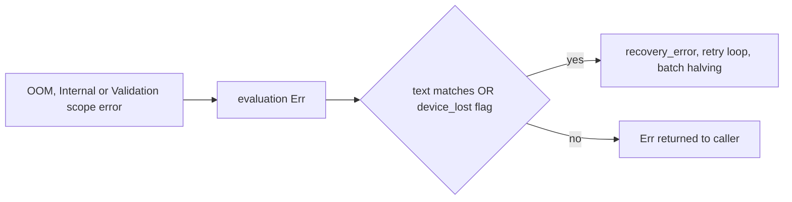

## Summary

wgpu 30 reports a lost GPU device as an opaque `BufferAsyncError`, a poll panic or an uncaptured-error panic, so the text-only `is_device_lost_error` / `is_memory_exhaustion_error` classifiers never entered device-lost recovery (#647) or batch halving (#1083). Recovery is now routed by source as well as by text. Closes #2363.

Version bump: `Cargo.toml` `version` updated for this change; the merged commit records the final version.

- `GpuAnalyzer::new` registers `Device::set_device_lost_callback`, which sets an `Arc<AtomicBool>` exposed as `RequestEvaluator::device_lost()`.
- `execute_request` (all five request arms) enters recovery when `is_device_lost_error(e) || analyzer.device_lost()`. A flag-only failure is re-tagged `GPU device lost: …` so the retry loop classifies it.
- Each production evaluation runs inside `push_error_scope` for `Validation` (outermost), `OutOfMemory` and `Internal`; a popped error becomes a typed `Err` (`GPU out of memory:`, `GPU internal error:`, else `GPU device error:`) instead of reaching wgpu's panicking default handler. Precedence when several were captured: out-of-memory, then internal, then validation (`select_scoped_error`).
- Both matchers also accept wgpu-core's `"Not enough memory left."`.
- `docs/GPU_GUIDE.md` documents the behaviour.

This is a redo of the closed PR #2433, rebuilt on `Develop`. Relative to `Develop` (`0fdc998`), `Cargo.toml` and `Cargo.lock` now change only by the crate version. The manifest requests `parquet`/`arrow` 60.0 and the lockfile retains all 14 parquet/arrow packages at 60.0.0, with Develop's zstd-free feature list. The unrelated 60.1 bump has been reverted, rather than regenerated as a new dependency upgrade.

Merging also closes #2432 through the retained `Fixes #2432` trailer in commit `608ad7d` (confirmed with `gh pr view 2456 --json commits`). The advisory removal is already present on Develop, so this PR adds no dependency advisory fix. Published history has not been rewritten.

## Spec

### Intent and Rationale

- The issue's suggested fix is to classify by source: a device-lost flag plus error scopes, so recovery no longer depends on wgpu's error wording.

### Essential Design Decisions

- A failure while the flag is set always routes to recovery, because after loss wgpu-core keeps the device lost for good. Recovery builds a new analyser through the factory, which carries a fresh flag.
- A captured scope error takes precedence over an `Ok` result, since a batch that hit a device error cannot be trusted.
- Not done: the poll-path panic (`Device::poll`, wgpu `handle_error_fatal`) is not converted to an `Err`; it remains the #2361 panic-handling path. The error scopes cover errors wgpu raises on the evaluating thread (buffer-creation out-of-memory and the follow-on validation errors from the invalid buffer it returns).
- The zstd RUSTSEC advisories were removed on `Develop` (zstd-free `parquet` features); the merge keeps that feature list.

### Undiscoverable Facts

- `tests/issue_2245_gpu_device_lost_classification.rs` exists on the base (`Develop`, `0fdc998`). In `device_loss_reported_through_the_map_callback_is_not_classified`, both `core_oom` assertions flip from false to true as required by #2363. The `BufferAsyncError` assertions deliberately remain false: the text classifiers still reject the opaque map error, while the device-lost flag routes it to recovery (`execution.rs::routes_to_recovery`, covered by `src/analysis/gpu/queue/device_lost_flag_test.rs`). The existing test name refers to those map-callback text assertions.

## Security Fix Evidence

- Cited regression test: `tests/issue_2363_device_lost_classification.rs::not_enough_memory_left_is_device_lost` (companion: `not_enough_memory_left_is_memory_exhaustion`). It uses only the existing public classifiers.
- Red with base classifiers: temporarily restoring `src/analysis/gpu/queue/recovery.rs` from `Develop` (`0fdc998`) and running `cargo test --locked --all-features --no-fail-fast --test issue_2245_gpu_device_lost_classification --test issue_2363_device_lost_classification` gives `tests/issue_2245_gpu_device_lost_classification.rs` (5 tests at head): 4 passed, 1 failed at `assertion failed: is_device_lost_error(&core_oom)`. `tests/issue_2363_device_lost_classification.rs` (3 tests at head): 1 passed, 2 failed (`not_enough_memory_left_is_device_lost`, `not_enough_memory_left_is_memory_exhaustion`: "expected device-lost classification for: Helpful batch buffer creation failed: Not enough memory left."). Both files pass with the head classifiers restored.
- Flag routing is also covered by tests in `device_lost_flag_test.rs` (one per request kind, plus an unflagged control) on the `FakeGpuEvaluator` harness. They need the new `device_lost()` trait method, so they cannot build at the base and are supporting coverage, not the cited regression test.
- Original trigger closed: a lost device that returns the opaque map error now sets the callback flag, so `routes_to_recovery` is true and the request enters the retry loop; wgpu-core's out-of-memory wording and wgpu's `Out of Memory` scope error match both memory classifiers. A device-loss reason that wgpu reports only by panic on the poll path is not covered here (see Essential Design Decisions).

## Evidence

- Review correction: `parquet`, `arrow`, `arrow-arith`, `arrow-array`, `arrow-buffer`, `arrow-cast`, `arrow-cmp`, `arrow-data`, `arrow-ipc`, `arrow-ord`, `arrow-row`, `arrow-schema`, `arrow-select` and `arrow-string` restored from 60.1.0 to Develop's 60.0.0. Every external lockfile entry matches Develop, and neither lockfile includes `zstd`, `zstd-safe` or `zstd-sys`.
- #2432: security: RUSTSEC-2026-0391/-0398/-0403/-0410 zstd, zstd-safe and zstd-sys via parquet 59.3.0 fail cargo audit (title and open state verified with `gh issue view 2432 --json title,state`).

## Test Plan

- `cargo test --locked --all-features --test issue_2245_gpu_device_lost_classification --test issue_2363_device_lost_classification`: `tests/issue_2245_gpu_device_lost_classification.rs` (5 tests at head), all passed; `tests/issue_2363_device_lost_classification.rs` (3 tests at head), all passed.
- `select_scoped_error` precedence: `out_of_memory_outranks_internal_and_validation`, `internal_outranks_validation` and `validation_alone_is_reported_and_none_is_none` in `src/analysis/gpu/queue/executor.rs` (carried from PR #2433, where flipping the precedence to `validation.or(internal).or(oom)` turned the first two red).
- GPU-gated, in `src/analysis/gpu/queue/executor.rs`: `invalid_buffer_use_inside_scopes_returns_err_not_panic` and `real_analyzer_device_lost_flag_follows_the_device_lost_callback`. **Not run on a GPU**: this worker has no GPU, so both skip (`Skipping test: no GPU available`) and pass vacuously; their GPU behaviour is unverified here.
- `cargo clippy --all-targets --all-features -- -D warnings` and `cargo fmt --all --check`: clean at head.
- Modified integration test: `tests/issue_2245_gpu_device_lost_classification.rs`, including the changed `core_oom` assertions and unchanged opaque-map-error assertions.
- New test files: `tests/issue_2363_device_lost_classification.rs`, `src/analysis/gpu/queue/device_lost_flag_test.rs`. Added or modified unit tests and fixtures: `src/analysis/gpu/queue/recovery.rs`, `src/analysis/gpu/queue/execution.rs`, `src/analysis/gpu/queue/executor.rs`, `src/analysis/gpu/queue/stale_skip_tests.rs` and `src/analysis/gpu/none_field_tests.rs`.

- Full gate at the restored dependency set: `timeout 900 ./quality.sh < /dev/null` exited 124 during library tests. Bash syntax, ShellCheck, install pinning, summary layout, `cargo deny check`, debug build, formatting, Clippy and all-target type checks passed. The complete test suite, documentation build and release build were not completed. This replaces the obsolete zstd advisory-failure report.
