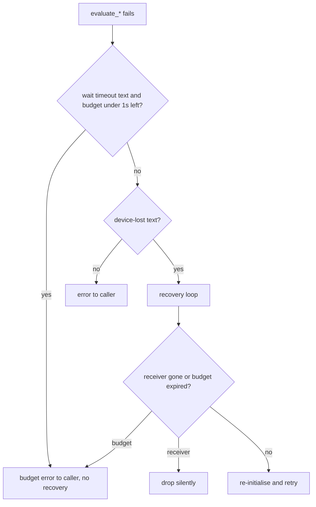

## Summary

A GPU map wait or poll that times out because the request's time budget ran
out is now answered as a budget error instead of being treated as device loss.
The recovery loop also stops once the budget expires between attempts. Closes
#2365.

Version bump: `Cargo.toml` version updated for this change; the merged commit
records the final version.

## Spec

### Intent and Rationale

- The crate's own wait-timeout text ("… timed out after Xs. The GPU driver may be unresponsive.") matches `is_device_lost_error`, so a slow-but-healthy GPU was torn down and re-initialised up to `retry_limit` times for a request with no time left.
- Fixed in the worker loop (`execute_request`) rather than by rewording the `device.rs` messages, so genuine wedges on unbounded or time-rich budgets still reach recovery.

### Essential Design Decisions

- A wait that timed out on the budget always leaves less than one second behind (waits truncate to whole seconds; polls are capped at the remaining budget). `GpuTimeBudget::is_exhausted_for_waits` therefore means "bounded and under 1 s left". Unbounded budgets are never reclassified.
- Only wait-timeout text (`is_wait_timeout_error`, "timed out after") is reclassified. Genuine device-lost errors keep routing to recovery even when the budget is spent.
- The replacement error text matches neither `is_device_lost_error` nor `is_memory_exhaustion_error`; the original cause is logged at warn.
- The retry loop now uses `stale_reason` (receiver gone or budget expired) before each attempt; an expired budget answers the caller with a budget error.

### Undiscoverable Facts

- Trade-off accepted: a real driver wedge that happens to consume the whole budget is no longer re-initialised, because the caller's own timeout is about to fire (the budget sits 5 s inside it) and recovery could not deliver a result in time.

## Evidence

Security-fix evidence (CWE-754, improper check for unusual conditions).

- **Regression tests:**
  - `src/analysis/gpu/queue/stale_skip_tests.rs::budget_capped_map_timeout_is_not_device_loss`
  - `src/analysis/gpu/queue/stale_skip_tests.rs::recovery_stops_when_budget_expires_between_attempts`
- **Red at base:** with the base `execution.rs` restored and the new tests kept, the first fails with `left: 3, right: 0` (three `factory.create` re-initialisations) and the second with `left: 3, right: 1`. At head both pass.
- **Original trigger closed, no trivial bypass:** the trigger was a map wait or poll timing out on the budget, matching the device-lost text. All five `execute_request` arms now pass the result through `reclassify_budget_timeout` before the `is_device_lost_error` check, so that text no longer reaches recovery when the budget is spent. A wait capped by the budget always leaves under 1 s, so the check cannot be missed by truncation. If a retry gets that far anyway, the new per-attempt `stale_reason` check ends recovery. Controls (`unbounded_map_timeout_still_recovers_as_wedge`, `bounded_budget_with_time_left_map_timeout_still_recovers`) show real wedges still recover. Residual: a recovery re-initialisation already in progress when the budget expires finishes that one attempt.

Docs: `docs/GPU_GUIDE.md` (stale-skip paragraph, flowchart node, new "Budget-capped wait timeouts" paragraph).

## Test Plan

- Added `budget.rs` unit tests (`unbounded_budget_is_never_exhausted_for_waits`, `bounded_budget_with_five_seconds_left_is_not_exhausted_for_waits`, `bounded_budget_with_half_a_second_left_is_exhausted_for_waits`, `bounded_budget_past_deadline_is_exhausted_for_waits`), `recovery.rs` tests (`test_is_wait_timeout_error_matches_crate_wait_messages`, `test_is_wait_timeout_error_ignores_device_loss`) and `execution.rs` tests (`reclassify_*`).
- Added loop-level tests in `src/analysis/gpu/queue/stale_skip_tests.rs`: `budget_capped_map_timeout_is_not_device_loss`, `unbounded_map_timeout_still_recovers_as_wedge`, `bounded_budget_with_time_left_map_timeout_still_recovers`, `recovery_stops_when_budget_expires_between_attempts`, `budget_capped_timeout_reclassified_in_every_arm` (all five request kinds).
- Red checks: base `execution.rs` → the two regression tests fail as above. The unbounded and time-left controls guard the reclassification condition operands (`is_wait_timeout_error`, `is_exhausted_for_waits`); `reclassify_leaves_device_loss_alone_when_budget_spent` guards the text operand.
- `cargo fmt --all -- --check`: passed. `cargo clippy --all-targets --all-features --offline -- -D warnings`: passed. `cargo test --lib --offline analysis::gpu`: 180 passed, 0 failed.
- No existing assertions were removed or edited.
- Entry points checked: `execute_request` arms HelpfulBatch, HarmfulBatch, ReluEval, ActivationEval, ActivationBatchEval (all covered by `budget_capped_timeout_reclassified_in_every_arm`); the retry loop (`recovery_stops_when_budget_expires_between_attempts`).
- `recovery_stops_when_budget_expires_between_attempts` spends about 1 s of real clock because `GpuTimeBudget` is `Instant`-based; it asserts `create_count == 1`, so it is vacuous if `NEAT_AI_DISCOVERY_GPU_RETRY_LIMIT` is set to 1 or less (default 3).
- `./quality.sh` ran and stopped at `cargo deny` advisories for the locked `zstd-sys 2.1.0` (RUSTSEC, via `parquet`), which this branch does not touch. The merge with `Develop` now carries the base's fix (parquet without the `zstd` feature, `zstd` dropped from `Cargo.lock`), so that advisory no longer applies; CI runs the full gate on the merge. The test stage did not run in the gate; the targeted tests above did.

<!-- vibe-quality-gate-skipped reason="./quality.sh fails at cargo deny advisories on locked zstd-sys 2.1.0 (pre-existing on base, no dependency change in this PR); targeted fmt, clippy and tests were run instead; CI runs the full gate" -->

Not done: no real-device wedge test (fake evaluator only); the `poll_device_until_idle` post-batch poll path is covered by the same text match, not by a dedicated test.
