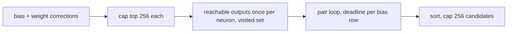

## Summary

Bounds and makes cancellable the `combine_corrections` pair scan in `src/analysis/detection/compound_degradation.rs` (CWE-400). Closes #2367.

- `reachable_outputs` now keeps a visited set, so each call is O(V+E) rather than one frontier entry per path.
- Each distinct bias neuron's and weight target's reachable-output set is computed once, before the pair loop, instead of twice per pair.
- Only the strongest 256 bias and 256 weight corrections (by estimated improvement) enter the pair loop (at most 65,536 pairs), and at most 256 candidates are emitted.
- New `detect_compound_bias_weight_degradations_with_deadline` checks the analysis deadline and global cancellation once per precomputed neuron and once per bias row, returning partial results with a `ScanTruncation` reason. The structural dispatch spec now calls it with the discovery deadline and logs any truncation. The old function keeps its signature and delegates with no deadline.
- Version bump: `Cargo.toml` and `Cargo.lock` updated for this change; the merged commit records the final version.

## Spec

### Intent and Rationale

- The issue's suggested fix: a visited set, precomputed reachable sets, a bounded candidate list and a deadline in the pair loop. All four are implemented; the ceilings follow the Issue #2348 co-adaptation precedent (256).

### Essential Design Decisions

- The correction caps apply only when exceeded, and keep the strongest by `estimated_improvement`; below the caps, output is unchanged. Above them the scan is deliberately lossy (reported as `CandidateCeiling`).
- When the deadline fires while reachable sets are still being precomputed, no pair has been evaluated, so the result is empty with `DeadlinePassed`. When the deadline and a ceiling both apply, `DeadlinePassed` wins.
- The visited set does not change which outputs are found: a node's first (shortest-distance) expansion has the most remaining depth.

### Undiscoverable Facts

- `detect_weight_corrections` sums over `HashMap` iteration, so tied candidates may differ by an ULP between calls. This predates the change and was left alone; the unit test compares by key with a tolerance.

## Evidence

Backend-only change; no UI files touched.

## Security Fix Evidence

- **Regression test**: `tests/issue_2367_compound_degradation_scan_bounds.rs::compound_candidates_grow_no_faster_than_linear_in_neuron_count`. It uses only the pre-existing public API. Against the base production files it fails: `got 576 candidates at H=24 and 9216 candidates at 4H=96`. At head both are capped at 256 and it passes.
- **Original trigger closed**: the per-pair path enumeration is gone (sets are computed once, with a visited set), the pair space is capped at 256×256, the emitted vector is capped at 256, and the deadline is checked per bias row. A larger creature cannot enlarge any of those bounds, so no equivalent bypass remains through B, W or F. The residual cost is O(V+E) per precomputed neuron, at most 512 neurons.

## Test Plan

- Added `tests/issue_2367_compound_degradation_scan_bounds.rs::compound_candidates_grow_no_faster_than_linear_in_neuron_count`: passed at head; red at base (counts above).
- Added in `src/analysis/detection/compound_degradation_tests.rs`: `reachable_outputs_matches_naive_path_enumeration_on_dense_layered_dag`, `elapsed_deadline_truncates_scan_with_deadline_passed`, `outer_row_deadline_check_keeps_candidates_from_completed_rows`, `candidate_ceiling_caps_emitted_candidates_and_reports_truncation`, `far_future_deadline_matches_unbounded_scan_without_truncation`. `cargo test --lib compound_degradation`: 5 passed.
- Mutation checks: deleting the per-row deadline check turns `outer_row_deadline_check_keeps_candidates_from_completed_rows` red; deleting the candidate `truncate` turns `candidate_ceiling_caps_emitted_candidates_and_reports_truncation` red.
- Not guarded by a test: the visited set itself. It does not change the result (equivalence test passes either way), and no work-count seam exists; its effect is covered only by reasoning and the growth test's candidate caps.
- Existing callers re-run and passing: `cargo test --test synapse issue_929`, `--test issue_2351_sibling_detectors_non_finite_gain_a`, `--test detection issue_1249`. `cargo fmt --all --check` and `cargo clippy --all-targets -- -D warnings` are clean.
- Callers of the changed function: `detect_compound_bias_weight_degradations` (delegates, no deadline) and the structural dispatch spec in `structural_specs.rs` (now passes the deadline). Docs: `docs/DISCOVERY_TYPES.md` (Compound Degradation Detection) updated; no other doc describes the pair scan.

<!-- vibe-quality-gate-skipped reason="./quality.sh stops at cargo deny advisories (RUSTSEC-2026-0391/-0398/-0403/-0410 on zstd-sys 2.1.0 via parquet), already present on the base branch; this change touches no dependency. Targeted fmt, clippy and tests were run instead; CI runs the full gate." -->
