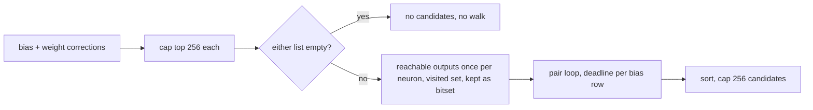

## Summary

Bounds and makes cancellable the `combine_corrections` pair scan in `src/analysis/detection/compound_degradation.rs` (CWE-400). Closes #2367.

- `reachable_outputs` now keeps a visited set, so each call is O(V+E) rather than one frontier entry per path.
- Each distinct bias neuron's and weight target's reachable-output set is computed once, before the pair loop, instead of twice per pair.
- The precomputed reachable sets are kept as output bitsets over a dense output index (`OutputBitset`). Each bitset's words are allocated once, to exactly their length (at most O / 64 + 1 words), so at most 512 × (O / 64 + 1) × 8 bytes, about 64 bytes per output neuron, are retained, rather than one `HashSet<&str>` of output UUIDs per neuron. O is the number of output-typed neurons in `creature.neurons`, which `validate_creature` does not cap (it bounds only the declared `creature.output`), so the bound is linear in the deserialised neuron list. The precompute is skipped entirely when either correction list is empty (reviews 5711058306 and 5711830474).
- Only the strongest 256 bias and 256 weight corrections (by estimated improvement) enter the pair loop (at most 65,536 pairs), and at most 256 candidates are emitted.
- New `detect_compound_bias_weight_degradations_with_deadline` checks the analysis deadline and global cancellation once per precomputed neuron and once per bias row, returning partial results with a `ScanTruncation` reason. The structural dispatch spec now calls it with the discovery deadline and logs any truncation. The old function keeps its signature and delegates with no deadline.
- The chunk 8a audit record (`docs/audits/security-sweep-chunk-08a-detection-neuron.md`) gains a row for the new `#[cfg(test)]` module `compound_degradation_tests.rs` (its Lines cell is the file's current length). Its `compound_degradation.rs` file row and `reachable_outputs` traversal row now carry a "Fixed in #2367" / post-finalisation note, and the traversal row's cancellation column reads `yes — deadline_passed before each precomputed call and each bias row`. The file row's note also records the bitset memory bound and the empty-list skip. The bitset's one allocation, `vec![0u64; max / 64 - offset + 1]` in `OutputBitset::from_outputs`, is a new production capacity site, so it gets its own `capacity` row (`compound_degradation.rs::from_outputs`, binding `words`): production capacity rows 82 → 83 and capacity hits 85 → 86 on the base it was written against, as the binding Rust scanner `is_capacity_site` counts them (82 rows and 85 hits after the fourth Develop merge, see the Test Plan). The `compound_degradation_tests.rs` row's Lines cell is updated to the file's current length (709).
- Version bump: `Cargo.toml` and the crate's own `Cargo.lock` entry are at `0.74.304`, above Develop's `0.74.302`. CI's auto-increment skips a branch that already has an auto-increment commit (#2476), so the bump was made by hand. `0.74.303` and `0.74.305` are taken by the open #2426 and #2428, which needed the same fix.

## Spec

### Intent and Rationale

- The issue's suggested fix: a visited set, precomputed reachable sets, a bounded candidate list and a deadline in the pair loop. All four are implemented; the ceilings follow the Issue #2348 co-adaptation precedent (256).

### Essential Design Decisions

- The correction caps apply only when exceeded, and keep the strongest by `estimated_improvement`; below the caps, output is unchanged. Above them the scan is deliberately lossy (reported as `CandidateCeiling`).
- When the deadline fires while reachable sets are still being precomputed, no pair has been evaluated, so the result is empty with `DeadlinePassed`. When the deadline and a ceiling both apply, `DeadlinePassed` wins.
- When either correction list is empty no pair can exist, so the scan returns no candidates without walking the graph or checking the deadline; `CandidateCeiling` is still reported if the other list was capped.
- Each reachable set is packed into a bitset as soon as its walk finishes, and the walk's transient hash set is dropped, so only the bitsets stay alive through the pair loop. A bitset stores only the words from its first to its last set word. `OutputBitset::from_outputs` finds the lowest and highest index first and allocates the word vector once with `vec![0u64; n]`, so its capacity equals its length whatever order the outputs arrive in. A word-by-word `resize` would have left up to twice the length reserved. Clippy's `slow_vector_initialization` rules out `Vec::new()` plus one `resize`, so the `vec!` form is used and recorded in the chunk 8a capacity table.
- The visited set does not change which outputs are found: a node's first (shortest-distance) expansion has the most remaining depth.

### Undiscoverable Facts

- `detect_weight_corrections` sums over `HashMap` iteration, so tied candidates may differ by an ULP between calls. This predates the change and was left alone; the unit test compares by key with a tolerance.

## Evidence

Backend-only change; no UI files touched.

## Security Fix Evidence

- **Regression test**: `tests/issue_2367_compound_degradation_scan_bounds.rs::compound_candidates_grow_no_faster_than_linear_in_neuron_count`. It uses only the pre-existing public API. Against the base production files it fails: `got 576 candidates at H=24 and 9216 candidates at 4H=96`. At head both are capped at 256 and it passes.
- **Original trigger closed**: the per-pair path enumeration is gone (sets are computed once, with a visited set), the pair space is capped at 256×256, the emitted vector is capped at 256, and the deadline is checked per bias row. A larger creature cannot enlarge any of those bounds, so no equivalent bypass remains through B, W or F. The residual cost is O(V+E) time per precomputed neuron (at most 512), plus retained memory. Each precomputed reachable set is kept as an output bitset over a dense output index, allocated once to exactly its length, so at most 512 × (O / 64 + 1) × 8 bytes stay alive through the pair loop, where O is the number of output-typed neurons in `creature.neurons`. `validate_creature` does not cap O: it bounds only the declared `creature.output`, and nothing ties the two (review 5712820542). The bound is therefore relative to the input: about 64 bytes per listed output neuron, linear in the deserialised neuron list, against roughly 35 bytes per output per precomputed neuron (up to about 18 KB per listed output) for the previous per-neuron hash sets. Each walk's transient hash set (O(V)) is dropped before the next walk. When either correction list is empty no walk is made at all.

## Test Plan

- Added `tests/issue_2367_compound_degradation_scan_bounds.rs::compound_candidates_grow_no_faster_than_linear_in_neuron_count`: passed at head; red at base (counts above).
- Added in `src/analysis/detection/compound_degradation_tests.rs`: `reachable_outputs_matches_naive_path_enumeration_on_dense_layered_dag`, `elapsed_deadline_truncates_scan_with_deadline_passed`, `outer_row_deadline_check_keeps_candidates_from_completed_rows`, `candidate_ceiling_caps_emitted_candidates_and_reports_truncation`, `far_future_deadline_matches_unbounded_scan_without_truncation`, plus (review 5706413040 and 5674953020) `reachable_outputs_pushes_grow_linearly_with_fan_out`, `candidate_ceiling_keeps_the_strongest_candidates`, `bias_correction_cap_keeps_the_strongest_and_reports_candidate_ceiling` and `weight_correction_cap_keeps_the_strongest_and_reports_candidate_ceiling`.
- Added (reviews 5711058306 and 5711830474) in the same file:
  - `scan_with_no_weight_corrections_does_no_reachable_walk` counts walks through the private `detect_compound_bias_weight_degradations_observed` seam: 5 walks with weight corrections, 0 without, with 4 bias corrections still detected.
  - `output_bitset_intersects_matches_hash_set_intersection` checks `OutputBitset::intersects` against `HashSet` intersection. It asserts both the length and the capacity of every bitset are at most O / 64 + 1 words. It also packs bits 192, 256 and 0 in that order and asserts capacity equals the length of 5 words and that the result does not depend on the order.
  - Mutation checks: removing the empty-list skip turns the first red (4 walks); changing `&` to `|` in `intersects` turns the second red; restoring the word-by-word `resize` turns the second red (`bitset capacity 8 exceeds 5 words`).
- Added `src/analysis/module_dispatch_specs/structural_specs_issue_2367_tests.rs::compound_degradation_spec_stops_at_elapsed_deadline`. It builds the specs with `append_structural_specs`, runs the registered `compound_bias_weight_degradation_detection` closure with no deadline (candidates found) and with `UNIX_EPOCH` (`None`), following the #2346 precedent.
- Mutation checks: deleting the per-row deadline check turns `outer_row_deadline_check_keeps_candidates_from_completed_rows` red; deleting the candidate `truncate` turns `candidate_ceiling_caps_emitted_candidates_and_reports_truncation` red. Re-run on an earlier head:
  - Making `visited.insert(down)` always push turns `reachable_outputs_pushes_grow_linearly_with_fan_out` red. It counts frontier pushes through the private `reachable_outputs_observed` seam at fan-out 4 and 16: 3N + 1 with the visited set, about N³ without it.
  - Truncating before the sort turns `candidate_ceiling_keeps_the_strongest_candidates` red. That test compares the weakest kept candidate with the 257th of all 576 reference pairs.
  - Disabling the bias cap turns `bias_correction_cap_keeps_the_strongest_and_reports_candidate_ceiling` red (300 bias corrections; only `h0`, the weakest, and `h299`, the strongest, are connected; 2 candidates, all `h299`).
  - Disabling the weight cap turns `weight_correction_cap_keeps_the_strongest_and_reports_candidate_ceiling` red (300 weight corrections; the one bias neuron pairs only with `w0`, strong, and `w299`, weak; 1 candidate, `w0`).
  - Passing `&None` in the structural spec turns `compound_degradation_spec_stops_at_elapsed_deadline` red.
- Existing tests edited (no assertion loosened), because this PR adds the `#[cfg(test)]` file `compound_degradation_tests.rs` under `src/analysis/detection`:
  - `tests/issue_2154_chunk_08a_finalisation.rs`: `EXPECTED_FILE_COUNT` 53 → 54 (55 after the Develop merge, see below).
  - `tests/issue_2280_chunk_08a_ledger_scaffold.rs`: `ROW_COUNT` 53 → 54 (55 after the Develop merge), and the new file added to the graph section's expected list.
  - `tests/issue_2282_chunk_08a_graph_sweep.rs`: `TEST_ONLY_ROWS` added, so the graph section holds exactly `SWEPT` plus `compound_degradation_tests.rs` (9 rows; 10 after the Develop merge, with #2374's `redundant_path_deadline_tests.rs`).
- Develop merge (bringing in #2374, which added `redundant_path_deadline_tests.rs` to the same ledger): the conflicts in the audit record and `tests/issue_2282_chunk_08a_graph_sweep.rs` were resolved by keeping both sides: both `#[cfg(test)]` file rows, #2367's `reachable_outputs` traversal note with #2374's capped `detect_redundant_paths_observed` capacity row, and both `TEST_ONLY_ROWS` entries (`SWEPT` was already the same on both sides). Both sides had moved the file count 53 → 54, so git auto-merged it at 54. It is now 55 in `EXPECTED_FILE_COUNT`, `ROW_COUNT` (the test is renamed `files_swept_has_exactly_55_rows`) and the record's Outcome line. Capacity counts were reconciled as deltas on Develop's figures: production rows stay 82, because #2367 adds no production site, and capacity hits go 84 → 85 for the test-only sized `vec!` override sequence in `compound_degradation_tests.rs`, counted the way the binding Rust scanner `is_capacity_site` counts it. The record notes that its printed shell ERE under-counts sized `vec!` forms like it.
- Second Develop merge (bringing in #2429): only the crate version conflicted in `Cargo.toml` / `Cargo.lock`; 0.74.299 was kept. #2429 does not touch the chunk 8a record.
- Third Develop merge (bringing in #2377): only the crate version conflicted in `Cargo.toml` / `Cargo.lock` (Develop at 0.74.298, this branch at 0.74.299); 0.74.299 was kept. #2377 touches `bias_perturbation.rs`, `error_plateau.rs`, `output_squash_mismatch.rs`, `squash_weight_rescale.rs` and the chunk 8a record, none of which this PR edits in conflict.
- Fourth Develop merge (bringing in #2370, which replaced the dead-neuron DFS and added `dead_neuron_deadline_tests.rs`): the crate version conflicted in `Cargo.toml` / `Cargo.lock` (Develop at 0.74.302, this branch at 0.74.299); the merge kept 0.74.302, and a follow-up commit bumped it to 0.74.304 so the branch is again above Develop. In the chunk 8a record Develop's `dead_neuron.rs` rows (post-finalisation remediation, SCC `explore` traversal row) were kept with #2367's `compound_degradation.rs` rows, `reachable_outputs` note and `from_outputs` capacity row. The merged inventory is 56 files and 82 production capacity rows (85 hits with the three test-only ones), so `EXPECTED_FILE_COUNT` and `ROW_COUNT` are now 56 (the scaffold test is renamed `files_swept_has_exactly_56_rows`).
- Re-run on the current head: all eight `tests/issue_2*_chunk_08a_*.rs` suites (50 tests), `--test issue_2367_compound_degradation_scan_bounds` (1), `--lib --all-features -- compound_degradation structural_specs` (14), `--test synapse issue_929` (4), `cargo fmt --all -- --check`, and `cargo clippy --lib --tests --all-features -- -D warnings`, all passing.
- Callers of the changed function: `detect_compound_bias_weight_degradations` (delegates, no deadline) and the structural dispatch spec in `structural_specs.rs` (now passes the deadline). Docs: `docs/DISCOVERY_TYPES.md` (Compound Degradation Detection) and the chunk 8a audit record (`docs/audits/security-sweep-chunk-08a-detection-neuron.md`, file and traversal rows) updated.

<!-- vibe-quality-gate-skipped reason="full ./quality.sh not re-run at the current head: the validating container has no GPU and no cargo-deny; cargo fmt --check, cargo clippy --lib --tests --all-features -D warnings, the compound-degradation unit tests, the issue_929 and issue_2367 integration tests and the chunk 8a record suites were run instead; CI runs the full gate" -->
