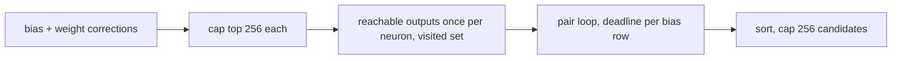

## Summary

Bounds and makes cancellable the `combine_corrections` pair scan in `src/analysis/detection/compound_degradation.rs` (CWE-400). Closes #2367.

- `reachable_outputs` now keeps a visited set, so each call is O(V+E) rather than one frontier entry per path.
- Each distinct bias neuron's and weight target's reachable-output set is computed once, before the pair loop, instead of twice per pair.
- Only the strongest 256 bias and 256 weight corrections (by estimated improvement) enter the pair loop (at most 65,536 pairs), and at most 256 candidates are emitted.
- New `detect_compound_bias_weight_degradations_with_deadline` checks the analysis deadline and global cancellation once per precomputed neuron and once per bias row, returning partial results with a `ScanTruncation` reason. The structural dispatch spec now calls it with the discovery deadline and logs any truncation. The old function keeps its signature and delegates with no deadline.
- The chunk 8a audit record (`docs/audits/security-sweep-chunk-08a-detection-neuron.md`) gains a row for the new `#[cfg(test)]` module `compound_degradation_tests.rs`. Its `compound_degradation.rs` file row and `reachable_outputs` traversal row now carry a "Fixed in #2367" / post-finalisation note, and the traversal row's cancellation column reads `yes — deadline_passed before each precomputed call and each bias row`.
- Version bump: `Cargo.toml` and the crate's own `Cargo.lock` entry are at `0.74.299`, above Develop's `0.74.295`. The Develop merge left the branch level with Develop, and CI's auto-increment skips a branch that already has an auto-increment commit (#2476), so the bump was made by hand. `0.74.296`–`0.74.298` are taken by #2426, #2429 and #2442, which needed the same fix.

## Spec

### Intent and Rationale

- The issue's suggested fix: a visited set, precomputed reachable sets, a bounded candidate list and a deadline in the pair loop. All four are implemented; the ceilings follow the Issue #2348 co-adaptation precedent (256).

### Essential Design Decisions

- The correction caps apply only when exceeded, and keep the strongest by `estimated_improvement`; below the caps, output is unchanged. Above them the scan is deliberately lossy (reported as `CandidateCeiling`).
- When the deadline fires while reachable sets are still being precomputed, no pair has been evaluated, so the result is empty with `DeadlinePassed`. When the deadline and a ceiling both apply, `DeadlinePassed` wins.
- The visited set does not change which outputs are found: a node's first (shortest-distance) expansion has the most remaining depth.

### Undiscoverable Facts

- `detect_weight_corrections` sums over `HashMap` iteration, so tied candidates may differ by an ULP between calls. This predates the change and was left alone; the unit test compares by key with a tolerance.

## Evidence

Backend-only change; no UI files touched.

## Security Fix Evidence

- **Regression test**: `tests/issue_2367_compound_degradation_scan_bounds.rs::compound_candidates_grow_no_faster_than_linear_in_neuron_count`. It uses only the pre-existing public API. Against the base production files it fails: `got 576 candidates at H=24 and 9216 candidates at 4H=96`. At head both are capped at 256 and it passes.
- **Original trigger closed**: the per-pair path enumeration is gone (sets are computed once, with a visited set), the pair space is capped at 256×256, the emitted vector is capped at 256, and the deadline is checked per bias row. A larger creature cannot enlarge any of those bounds, so no equivalent bypass remains through B, W or F. The residual cost is O(V+E) per precomputed neuron, at most 512 neurons.

## Test Plan

- Added `tests/issue_2367_compound_degradation_scan_bounds.rs::compound_candidates_grow_no_faster_than_linear_in_neuron_count`: passed at head; red at base (counts above).
- Added in `src/analysis/detection/compound_degradation_tests.rs`: `reachable_outputs_matches_naive_path_enumeration_on_dense_layered_dag`, `elapsed_deadline_truncates_scan_with_deadline_passed`, `outer_row_deadline_check_keeps_candidates_from_completed_rows`, `candidate_ceiling_caps_emitted_candidates_and_reports_truncation`, `far_future_deadline_matches_unbounded_scan_without_truncation`, plus (review 5706413040 and 5674953020) `reachable_outputs_pushes_grow_linearly_with_fan_out`, `candidate_ceiling_keeps_the_strongest_candidates`, `bias_correction_cap_keeps_the_strongest_and_reports_candidate_ceiling` and `weight_correction_cap_keeps_the_strongest_and_reports_candidate_ceiling`.
- Added `src/analysis/module_dispatch_specs/structural_specs_issue_2367_tests.rs::compound_degradation_spec_stops_at_elapsed_deadline`. It builds the specs with `append_structural_specs`, runs the registered `compound_bias_weight_degradation_detection` closure with no deadline (candidates found) and with `UNIX_EPOCH` (`None`), following the #2346 precedent. `cargo test --lib --all-features compound_degradation`: 10 passed.
- Mutation checks: deleting the per-row deadline check turns `outer_row_deadline_check_keeps_candidates_from_completed_rows` red; deleting the candidate `truncate` turns `candidate_ceiling_caps_emitted_candidates_and_reports_truncation` red. Re-run on the current head:
  - Making `visited.insert(down)` always push turns `reachable_outputs_pushes_grow_linearly_with_fan_out` red. It counts frontier pushes through the private `reachable_outputs_observed` seam at fan-out 4 and 16: 3N + 1 with the visited set, about N³ without it.
  - Truncating before the sort turns `candidate_ceiling_keeps_the_strongest_candidates` red. That test compares the weakest kept candidate with the 257th of all 576 reference pairs.
  - Disabling the bias cap turns `bias_correction_cap_keeps_the_strongest_and_reports_candidate_ceiling` red (300 bias corrections; only `h0`, the weakest, and `h299`, the strongest, are connected; 2 candidates, all `h299`).
  - Disabling the weight cap turns `weight_correction_cap_keeps_the_strongest_and_reports_candidate_ceiling` red (300 weight corrections; the one bias neuron pairs only with `w0`, strong, and `w299`, weak; 1 candidate, `w0`).
  - Passing `&None` in the structural spec turns `compound_degradation_spec_stops_at_elapsed_deadline` red.
- Existing tests edited (no assertion loosened), because this PR adds the `#[cfg(test)]` file `compound_degradation_tests.rs` under `src/analysis/detection`:
  - `tests/issue_2154_chunk_08a_finalisation.rs`: `EXPECTED_FILE_COUNT` 53 → 54 (55 after the Develop merge, see below).
  - `tests/issue_2280_chunk_08a_ledger_scaffold.rs`: `ROW_COUNT` 53 → 54 (55 after the Develop merge), and the new file added to the graph section's expected list.
  - `tests/issue_2282_chunk_08a_graph_sweep.rs`: `TEST_ONLY_ROWS` added, so the graph section holds exactly `SWEPT` plus `compound_degradation_tests.rs` (9 rows; 10 after the Develop merge, with #2374's `redundant_path_deadline_tests.rs`).
- Develop merge (bringing in #2374, which added `redundant_path_deadline_tests.rs` to the same ledger): the conflicts in the audit record and `tests/issue_2282_chunk_08a_graph_sweep.rs` were resolved by keeping both sides: both `#[cfg(test)]` file rows, #2367's `reachable_outputs` traversal note with #2374's capped `detect_redundant_paths_observed` capacity row, and both `TEST_ONLY_ROWS` entries (`SWEPT` was already the same on both sides). Both sides had moved the file count 53 → 54, so git auto-merged it at 54. It is now 55 in `EXPECTED_FILE_COUNT`, `ROW_COUNT` (the test is renamed `files_swept_has_exactly_55_rows`) and the record's Outcome line. Capacity counts were reconciled as deltas on Develop's figures: production rows stay 82, because #2367 adds no production site, and capacity hits go 84 → 85 for the test-only sized `vec!` override sequence in `compound_degradation_tests.rs`, counted the way the binding Rust scanner `is_capacity_site` counts it. The record notes that its printed shell ERE under-counts sized `vec!` forms like it. Re-run after the merge: all eight `tests/issue_2*_chunk_08a_*.rs` suites (50 tests), `--test issue_2367_compound_degradation_scan_bounds` (1), `--test issue_2374_redundant_path_pair_scan` (1) and `--test issue_2374_redundant_path_scan_bounds` (8), `--lib -- compound_degradation redundant_path structural_specs` (25), `cargo fmt --all -- --check`, and `cargo clippy --lib --tests --all-features -- -D warnings`, all passing.

  All eight suites that read the audit record pass.
- Existing callers re-run and passing: `cargo test --test synapse issue_929`, `--test issue_2351_sibling_detectors_non_finite_gain_a`, `--test detection issue_1249`. `cargo fmt --all --check` and `cargo clippy --all-targets -- -D warnings` are clean. On the current head: `cargo test --test synapse issue_929` (4 passed), `--test issue_2367_compound_degradation_scan_bounds` (1 passed), and `cargo clippy --lib --tests --all-features -- -D warnings` clean.
- Callers of the changed function: `detect_compound_bias_weight_degradations` (delegates, no deadline) and the structural dispatch spec in `structural_specs.rs` (now passes the deadline). Docs: `docs/DISCOVERY_TYPES.md` (Compound Degradation Detection) and the chunk 8a audit record (`docs/audits/security-sweep-chunk-08a-detection-neuron.md`, file and traversal rows) updated.

<!-- vibe-quality-gate-skipped reason="full ./quality.sh not re-run at the current head: the validating container has no GPU and no cargo-deny; cargo fmt --check, cargo clippy --lib --tests --all-features -D warnings, the compound-degradation unit tests, the issue_929 and issue_2367 integration tests and the chunk 8a record suites were run instead; CI runs the full gate" -->
