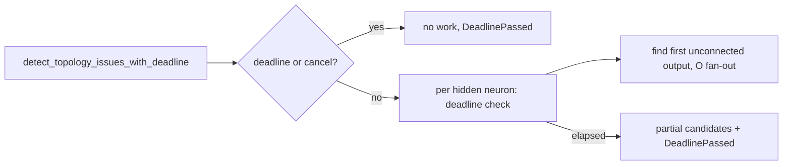

## Summary

Bounds and makes cancellable the topology detector `detect_topology_issues` (CWE-834). Closes #2369.

- The long-path loop found the nearest unconnected output with `filter(..).min_by_key(..)`, which scans every output for every qualified hidden neuron (O(H·O)). It now uses `find`, which stops at the first unconnected output, so each neuron costs O(its fan-out).
- New `detect_topology_issues_with_deadline` checks the analysis deadline and global cancellation before the scan, once per qualified hidden neuron in the long-path loop and once per starved neuron in the imbalance loop. On a hit it returns the partial candidates with `ScanTruncation::DeadlinePassed` (`TopologyScan::truncation`); a truncated long-path loop skips the imbalance detection. `detect_topology_issues` keeps its signature and delegates with `&None`.
- The `topology_structure_analysis` dispatch spec (`src/analysis/module_dispatch_specs/structural_specs.rs`) passes the discovery deadline and logs a `tracing::warn!` on truncation.
- Docs: `docs/DISCOVERY_TYPES.md` (Topology-Aware Structure Analysis, "Scan bounds").
- Version bump: `Cargo.toml` updated for this change; the merged commit records the final version.

## Spec

### Intent and Rationale

- The `min_by_key` scan is the genuine quadratic; the fix removes it at the root rather than capping outputs.
- The deadline check follows the #2346 / #2358 precedent (`_with_deadline` variant, thin wrapper, dispatch-spec logging).

### Essential Design Decisions

- All outputs are seeded at BFS distance 0, so every `min_by_key` key was equal and it returned the first unconnected output in set-iteration order; `find` returns the same element.
- The starved-neuron `input_uuids.iter().find(..)` is left as is: it already stops at the first unconnected input, so it costs at most fan-in + 1 per neuron. The issue's O(H·I) claim for it does not hold, and the ratio test shows only the output scan was quadratic. No `HashSet` was added.
- `detect_topology_issues` now stops on global cancellation (`deadline_passed(&None)` consults the cancellation flag); this is intended.

### Undiscoverable Facts

- None.

## Evidence

Ratio test on the unfixed code (`.min_by_key`, N=1000 then 4N): t(N)=554ms, t(4N)=8.85s, ratio 15.96 (three runs: 15.96, 15.86, 15.90). With the mutation `find` reverted to `min_by_key` at the final N=500: ratio 15.54. At head: ratio 4.04, 3.96, 4.05, 4.09 (linear).

## Security Fix Evidence

- Regression test: `tests/issue_2369_topology_scan_growth.rs::long_path_scan_grows_linearly_with_outputs`. It uses only the pre-existing public API, so it compiles against the base. Red at base (ratio ~16 against a limit of 10), green at head (ratio ~4).
- Cancellation tests: `src/analysis/detection/topology_deadline_tests.rs` and `src/analysis/module_dispatch_specs/structural_specs_issue_2369_tests.rs::topology_spec_stops_at_elapsed_deadline`.
- Original trigger closed: the per-neuron nearest-output search no longer visits all outputs (it stops at the first unconnected one, within fan-out + 1 steps), and every loop in the detector now checks the deadline and global cancellation each iteration. The only other per-neuron scan, the input lookup, already exits at the first unconnected input. No other loop over outputs or inputs remains in `detect_topology_issues_with_deadline`; the remaining work is O(V+E) setup (cache, BFS, mean errors) that the dispatcher already bounds at module level.

## Test Plan

- `tests/issue_2369_topology_scan_growth.rs::long_path_scan_grows_linearly_with_outputs` (new): correctness check on the N run, then best-of-three timing at N and 4N, ratio < 10. Passed at head. Mutation: revert `.find` to `.min_by_key` → red (ratio 15.54).
- `src/analysis/detection/topology_deadline_tests.rs` (new, all `#[serial]`, scripted via `DeadlineOverrideGuard`):
  - `elapsed_deadline_up_front_returns_no_candidates_and_reports_truncation`: delete the up-front check → red.
  - `long_path_loop_deadline_check_keeps_partial_candidates`: delete the long-path per-neuron check → red.
  - `imbalance_loop_deadline_check_keeps_partial_candidates`: delete the imbalance per-neuron check → red.
  - `far_future_deadline_matches_unbounded_scan_without_truncation`: same candidates as the unbounded wrapper.
- `src/analysis/module_dispatch_specs/structural_specs_issue_2369_tests.rs::topology_spec_stops_at_elapsed_deadline` (new): invokes the registered spec. Revert the closure to `detect_topology_issues` → red.
- No existing test was edited or had assertions removed.
- Callers of `detect_topology_issues` checked and passing: `tests/recommendation/issue_422_topology_aware_discovery.rs` (13 pass), `tests/issue_2351_sibling_detectors_non_finite_gain_a.rs` (7 pass), `tests/infrastructure/issue_754_topology_cache.rs` (6 pass), and the dispatch spec (now the deadline variant).
- `cargo fmt --check` and `cargo clippy --all-targets -- -D warnings` clean; `cargo test --lib topology` 10 passed; `cargo test --lib structural_specs` 2 passed.
- Not done: the issue's `starved_scan_grows_linearly` test (the starved scan was never super-linear, see Design Decisions). A test that the skip target is the only unconnected output is impossible, since a long-path neuron (more than 3 hops) has no synapse to any output.
- `./quality.sh` stops at `cargo deny` on RUSTSEC-2026-0391/-0398/-0403/-0410 (zstd-sys 2.1.0 via parquet), which is not caused by this branch; no dependency changed. Later gate stages were not reached locally.

<!-- vibe-quality-gate-skipped reason="cargo deny advisories fail on base-inherited zstd-sys; later gate stages not reached locally, CI runs the full gate" -->
