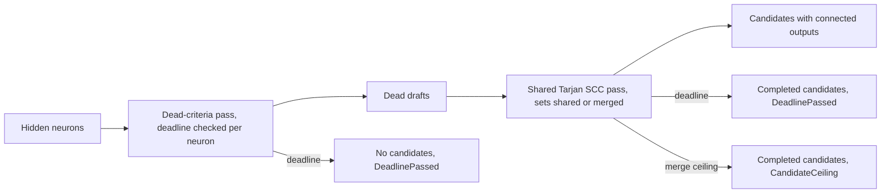

# PR Summary — Issue #2370

## Summary

`detect_dead_neurons` no longer runs one allocating depth-first search per dead
hidden neuron. Connected outputs for all dead neurons now come from one shared,
iterative Tarjan strongly-connected-component pass. Its cost is O(V + E) plus the
size of the output sets it merges, with two bounds: the analysis deadline and
global cancellation are checked on every walk iteration (and every 4,096 merged
elements), and the distinct output ids kept across merges are capped at
`MAX_REACHABILITY_MERGE_WORK` (8,000,000). A component that
adds no direct outputs and has a single closed successor shares that successor's
set without copying it, so a long live chain above a wide fan-out costs no
per-component copy. The discovery spec uses the deadline-aware variant and logs a
warning when a scan stops early. Version bump: `Cargo.toml` and `Cargo.lock`
updated for this change; the merged commit records the final version. Closes
#2370.

## Spec

### Intent and Rationale

- The old code did a full DFS with fresh `HashSet`/`Vec` allocations for each of
  D dead neurons (O(D·(V+E)) CPU and allocation) with no deadline check; the
  hidden-neuron and synapse counts are uncapped.
- Tarjan SCC (not a plain reverse-topological memo) keeps the old DFS's cycle
  tolerance: a corrupt creature with cycles still terminates and gives each
  neuron in a cycle the same reachable outputs.
- Review of the first attempt (PR #2435) found that copying each closed
  successor's output set into every intermediate component made memory O(live
  components × outputs). Set sharing plus a merged-work ceiling fixes that.

### Essential Design Decisions

- `detect_dead_neurons` keeps its signature and delegates with no deadline;
  `detect_dead_neurons_with_deadline` and `detect_dead_neurons_observed` follow
  the `symmetry_breaking` precedent (`DeadNeuronScan { candidates, truncation }`).
- Stop during the hidden-neuron statistics pass returns no candidates (outputs
  cannot be computed for a partial scan, so fail closed). Stop during the
  reachability pass keeps only candidates whose outputs completed.
- Hitting the merged-work ceiling reports `ScanTruncation::CandidateCeiling`
  (the existing "work ceiling reached" variant; no new variant added). Merges
  remove duplicates as they go (a per-node stamp marks ids the component already
  kept), and the ceiling is charged once per id kept, so it bounds the memo's
  memory exactly. Successors that all reach the same outputs cost the output
  count, not out-degree × outputs (review 5689671957). The time spent scanning
  duplicate ids is bounded by a deadline check every
  `MERGE_DEADLINE_CHECK_INTERVAL` (4,096) merged elements.
  A ladder-shaped graph (each node feeds its own output and the next node) needs
  quadratic distinct sets and stops at the ceiling instead of exhausting memory.
- `detect_dead_neurons_observed` takes the ceiling and a step observer so tests
  can count work and force the ceiling; production passes the constant and a
  no-op observer through `detect_dead_neurons_with_deadline`.
- No wall-clock test: the repo's CONTRIBUTING.md keeps timing out of unit tests,
  so the regression guard counts reachability steps.

### Undiscoverable Facts

- `hidden_uuids` is a `HashSet`, so root order (and the order of equal-confidence
  candidates) is arbitrary; tests compare candidates sorted by UUID. A stop
  between roots is still tested deterministically, on two separate, identically
  shaped dead roots, which take the same walk whichever comes first.
- The crate installs its own `#[global_allocator]`, so a test binary cannot add a
  counting allocator; an allocation-bytes guard that also compiles on the base
  branch was not possible.

## Evidence

Backend-only change; no visual surface is affected.

Security Fix Evidence

- Regression test:
  `tests/issue_2370_dead_neuron_reachability.rs::reachability_grows_linearly_with_dead_count`
  runs the same dead chain at N=64 and N=256 and counts reachability steps through
  the `detect_dead_neurons_observed` observer: 128 and 512 steps (exactly 4x).
  Resetting the memo per dead neuron (the old per-neuron work profile) gives a
  roughly 16x growth and turns the test red. Against the base branch the test file
  does not compile, because `detect_dead_neurons_observed` does not exist there;
  that is the base-branch failure, not a runtime red.
- Memory regression test:
  `tests/issue_2370_dead_neuron_reachability.rs::live_chain_above_wide_fan_out_does_not_copy_sets_per_component`
  (one dead root, a live chain, then 64 outputs: 256 steps at N=64, 640 at N=256;
  disabling the sharing branch gave 17,024 steps and turned it red against its
  `N × outputs` bound of 16,384).
- The original trigger is closed with no equivalent bypass: the per-neuron DFS
  and its per-call allocations are removed, so reachability work no longer
  multiplies by the dead count; cycles are handled by the SCC pass (tested), the
  walk uses an explicit stack (a 20,000-deep chain is tested), the deadline and
  cancellation are checked once per walk iteration and once per hidden neuron,
  and merged output-set work is capped, so a hostile fan-out stops at
  `CandidateCeiling` rather than exhausting memory. Remaining retained memory is
  bounded by the 8,000,000-element ceiling plus the candidates' own output lists.

## Test Plan

- Added `tests/issue_2370_dead_neuron_reachability.rs` (11 tests, all pass):
  `reachability_grows_linearly_with_dead_count`,
  `live_chain_above_wide_fan_out_does_not_copy_sets_per_component`,
  `merge_ceiling_stops_the_scan_and_reports_candidate_ceiling`,
  `deep_chain_does_not_overflow_the_stack`,
  `cycle_among_dead_neurons_terminates_with_correct_outputs`,
  `matches_a_reference_traversal_on_a_branching_graph`,
  `elapsed_deadline_stops_the_scan_and_reports_truncation`,
  `far_future_deadline_does_not_truncate`,
  `without_a_cache_and_with_a_cache_agree`,
  `dense_fan_out_with_duplicate_successor_sets_stays_under_the_merge_ceiling`
  (one dead `d` → 200 live L0 → 200 live L1 → 200 outputs, 80,200 synapses, on
  the production path: `d` keeps all 200 outputs with no truncation),
  `merge_ceiling_stop_keeps_the_candidate_completed_before_it` (two separate
  dead roots, ceiling 1: one candidate with its own output, plus
  `CandidateCeiling`).
- Added `src/analysis/detection/dead_neuron_deadline_tests.rs` (3 in-crate tests):
  `phase_one_deadline_check_truncates_and_returns_no_candidates`,
  `reachability_deadline_check_stops_mid_scan` and
  `reachability_deadline_stop_keeps_the_completed_candidate` (two roots,
  sequence `[false; 5]` then `true`: one completed candidate plus
  `DeadlinePassed`). Their sequence-scripted deadline
  seam makes each check the one that stops the scan.
- Red checks run: resetting the memo per root turned
  `reachability_grows_linearly_with_dead_count` red. Disabling the set-sharing
  branch in `close()` turned `live_chain_above_wide_fan_out_does_not_copy_sets_per_component`
  red (17,024 steps against 16,384); its `4n < 6n` assertion did not fail, the
  `N × outputs` bound is the discriminating one. Disabling the hidden-neuron
  deadline check turned both deadline unit tests red; disabling the walk's
  deadline check turned `reachability_deadline_check_stops_mid_scan` red.
  The ceiling test uses a ceiling of 1 against `usize::MAX` and the production
  ceiling on the same graph, so only the ceiling distinguishes the outcomes; I did
  not separately break the ceiling comparison.
- Red checks for review 5689671957: charging the ceiling for every scanned
  element instead of every kept id (the old upper-bound behaviour) turned
  `dense_fan_out_with_duplicate_successor_sets_stays_under_the_merge_ceiling`
  red. Clearing the completed candidates on a reachability stop turned
  `merge_ceiling_stop_keeps_the_candidate_completed_before_it` and
  `reachability_deadline_stop_keeps_the_completed_candidate` red. After the fix:
  `--test issue_2370_dead_neuron_reachability` 11 passed, `--lib dead_neuron`
  3 passed, `--test detection dead` 19, `--test analysis dead` 16,
  `--test infrastructure topology` 6, the eight chunk-08a record suites all
  pass, and `cargo clippy --lib --tests --all-features -- -D warnings` is clean.
- Removed from the first attempt: the wall-clock test
  `scan_time_grows_linearly_with_dead_count` (CONTRIBUTING.md forbids timing
  assertions in tests); the step-count tests above replace it.
- Existing dead-neuron suites re-run and pass: `tests/detection/issue_341_*`
  (`--test detection dead`, 19 passed), `tests/analysis/issue_424_*` and
  `issue_481_*` (`--test analysis dead`, 16 passed),
  `tests/infrastructure/issue_754_topology_cache.rs` (`--test infrastructure
  topology`, 6 passed).
- Not covered by a test: the discovery spec in `neuron_specs.rs` passing
  `&deadline`. I searched the tests that reach spec construction
  (`tests/detection/issue_571_co_adaptation_detection.rs`,
  `src/analysis/module_dispatch_specs/mod.rs`); none runs a spec with an elapsed
  deadline, so the `detect:` block is `exempt (untestable)`: no existing harness
  can stage an elapsed deadline through the dispatch.
- Docs: `docs/DISCOVERY_TYPES.md` "Dead Neuron Detection" has a
  `Scan bounds (Issue #2370)` paragraph describing the shared pass, the set
  sharing, the merged-work cap and both truncation reasons;
  `docs/discoveries/dead-neuron.md` and `docs/ANALYSIS_DEEP_DIVE.md` were read and
  have no reachability claims. The module docs in `dead_neuron.rs` were updated to
  match.
- Coverage reconciliation: updated `docs/audits/security-sweep-chunk-08a-detection-neuron.md`
  for the added deadline test module (54 files), the three current capacity
  sites and the shared SCC traversal. Updated the three existing ledger contracts,
  `tests/issue_2154_chunk_08a_finalisation.rs`,
  `tests/issue_2280_chunk_08a_ledger_scaffold.rs` and
  `tests/issue_2282_chunk_08a_graph_sweep.rs`, without changing their scanners.
  The finalisation suite reproduced the CI failure (6 passed, 2 failed) before
  the correction; all eight suites reading this record now pass (50 tests).
  Reverting the file-count
  update, removing the new graph inventory entry or ledger row, misnaming either
  SCC capacity binding, restoring the deleted traversal expectation, and
  misnaming the SCC traversal row each made the corresponding contract red.
  Restoring the scaffold count to 53 or removing its new section entry each
  made its corresponding contract red too. All three copies of the inventory
  rule were updated together.
- Twin-rule search: the deadline-aware scan pattern mirrors
  `detect_symmetric_neurons_*` and `detect_co_adapted_neurons_with_deadline`; no
  shared matcher was changed.
- Dependencies: the `parquet` and `arrow` manifest requirements advance from
  60.0 to 60.1. `Develop` already resolves both to 60.1 and carries the zstd
  advisory fix, so neither is a lockfile dependency change in the merged diff.
  Cargo regenerated the lockfile from the base's resolved graph and the merged
  manifest, retaining its dependency versions and updating only the crate version.
- Merge reconciliation: retained #2368's skip-connection remediation alongside
  #2370's dead-neuron remediation in the audit ledger. The combined inventory is
  54 files and 81 production capacity sites (78 minus one for #2370, plus four
  for #2368). No source conflict required a behaviour change.
- Merge validation: the existing graph ledger suite (5 tests) and scaffold suite
  (6 tests) passed, compiled directly with `rustc --test` and
  `CARGO_MANIFEST_DIR` set to the repository root. `cargo metadata` successfully
  reconciled the lockfile; the index has no unmerged paths and
  `git diff --cached --check` passed. The full quality gate and detector suites
  were not rerun during conflict resolution, as required by merge mode.
- Current CI-fix validation: `timeout 900 ./quality.sh < /dev/null` passed
  shell syntax, ShellCheck, cargo-install pinning, PR-summary layout,
  `cargo deny check`, the debug build, formatting, Clippy and type checks.
  It exited 124 while compiling the full test suite, before executing it.
  After the final scaffold update, targeted Clippy on all three edited test
  targets passed with warnings denied, as did `cargo fmt --all -- --check`.
  The documentation and release-build stages were not reached. Instrumented
  coverage generation and upload were not run locally.
<!-- vibe-quality-gate-skipped reason="full ./quality.sh reached its 900-second timeout during test compilation; targeted audit suites and red checks are recorded above" -->
