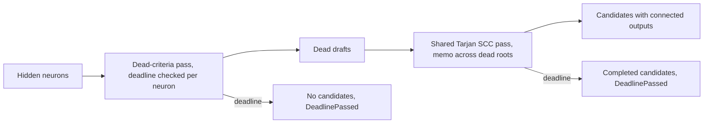

# PR Summary — Issue #2370

## Summary

`detect_dead_neurons` no longer runs one allocating depth-first search per dead
hidden neuron. Connected outputs for all dead neurons now come from one shared,
memoised, iterative Tarjan strongly-connected-component pass (O(V + E) plus the
size of the output sets), and the pass stops at the analysis deadline or on
global cancellation. The discovery spec uses the new deadline-aware variant and
logs a warning when a scan stops early. Version bump: `Cargo.toml` and
`Cargo.lock` updated for this change; the merged commit records the final
version. Closes #2370.

## Spec

### Intent and Rationale

- The old code did a full DFS with fresh `HashSet`/`Vec` allocations for each of
  D dead neurons (O(D·(V+E)) CPU and allocation) with no deadline check; the
  hidden-neuron and synapse counts are uncapped.
- Tarjan SCC (not a plain reverse-topological memo) keeps the old DFS's cycle
  tolerance: a corrupt creature with cycles still terminates and gives each
  neuron in a cycle the same reachable outputs.

### Essential Design Decisions

- `detect_dead_neurons` keeps its signature and delegates with no deadline;
  `detect_dead_neurons_with_deadline` and `detect_dead_neurons_observed` follow
  the `symmetry_breaking` precedent (`DeadNeuronScan { candidates, truncation }`).
- Stop during the hidden-neuron statistics pass returns no candidates (outputs
  cannot be computed for a partial scan, so fail closed). Stop during the
  reachability pass keeps only candidates whose outputs completed.
- The `on_reachability_step` observer is called once per edge examined and once
  per set element merged; it is the production no-op closure in
  `detect_dead_neurons_with_deadline`, and lets the regression test count work
  rather than time it.

### Undiscoverable Facts

- `hidden_uuids` is a `HashSet`, so root order (and the order of equal-confidence
  candidates) is arbitrary; tests compare candidates sorted by UUID.

## Evidence

Backend-only change; no visual surface is affected.

Security Fix Evidence

- Regression test:
  `tests/issue_2370_dead_neuron_reachability.rs::reachability_grows_linearly_with_dead_count`
  counts reachability steps on an N=64 and an N=256 dead chain.
- Against the fixed code: 191 and 767 steps (4.02×, linear). With the shared memo
  deliberately reset before every dead neuron (the old per-neuron-search work
  profile), the same test fails: 6176 and 98432 steps (15.9×). On the base branch
  itself the test file does not compile, because `detect_dead_neurons_observed`
  does not exist there; the behavioural red above is the discriminating run.
- The original trigger is closed with no equivalent bypass: the per-neuron DFS
  and its per-call allocations are removed, so reachability work no longer
  multiplies by the dead count; cycles are handled by the SCC pass (tested), the
  walk uses an explicit stack (a 20,000-deep chain is tested), and the deadline
  and cancellation are checked once per walk iteration and once per hidden
  neuron. Remaining cost is O(V + E) plus output-set sizes, which are bounded by
  the output width (capped by `validate_creature`).

## Test Plan

- Added `tests/issue_2370_dead_neuron_reachability.rs` (7 tests, all pass):
  `reachability_grows_linearly_with_dead_count`,
  `deep_chain_does_not_overflow_the_stack`,
  `cycle_among_dead_neurons_terminates_with_correct_outputs`,
  `matches_a_reference_traversal_on_a_branching_graph`,
  `elapsed_deadline_stops_the_scan_and_reports_truncation`,
  `far_future_deadline_does_not_truncate`,
  `without_a_cache_and_with_a_cache_agree`.
- Added `src/analysis/detection/dead_neuron_deadline_tests.rs` (2 in-crate tests):
  `phase_one_deadline_check_truncates_and_returns_no_candidates` and
  `reachability_deadline_check_stops_mid_scan`. Their sequence-scripted deadline
  seam makes each check the one that stops the scan.
- Red checks run: resetting the memo per root turned
  `reachability_grows_linearly_with_dead_count` red (15.9×). Disabling the
  hidden-neuron deadline check turned both deadline unit tests red. Disabling the
  walk's deadline check turned `reachability_deadline_check_stops_mid_scan` red
  (the other stayed green, as expected).
- Existing dead-neuron suites re-run and pass: `tests/detection/issue_341_*`,
  `tests/infrastructure/issue_754_topology_cache.rs`, `tests/analysis/issue_424_*`,
  `tests/analysis/issue_481_*`.
- Not covered by a test: the discovery spec in `neuron_specs.rs` passing
  `&deadline` (`detect_dead_neurons_with_deadline` vs the legacy call). I searched
  the tests that reach spec construction (`tests/detection/issue_571_co_adaptation_detection.rs`,
  `src/analysis/module_dispatch_specs/mod.rs`); none runs a spec with an elapsed
  deadline, so `neuron_specs.rs` `detect:` block is
  `exempt (untestable)`: no existing harness can stage an elapsed deadline through the dispatch.
  A mid-reachability stop that keeps *completed* candidates is likewise not
  separately asserted; the chain fixture cannot complete a root in two iterations.
- Docs: `docs/DISCOVERY_TYPES.md` "Dead Neuron Detection" gained a
  `Scan bounds (Issue #2370)` paragraph; `docs/discoveries/dead-neuron.md` and
  `docs/ANALYSIS_DEEP_DIVE.md` were read and have no reachability claims.
- Twin-rule search: the deadline-aware scan pattern mirrors
  `detect_symmetric_neurons_*` and `detect_co_adapted_neurons_with_deadline`; no
  shared matcher was changed.
- Quality gate: see the note below.
