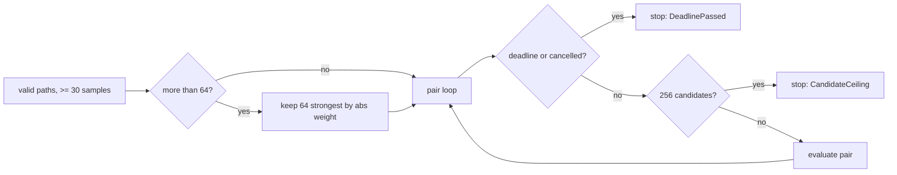

## Summary

`detect_redundant_paths` ran an uncancellable O(P²·S) pair loop over a target's incoming paths and grew its candidate `Vec` to P(P−1)/2 entries (CWE-834). The scan is now bounded three ways: only the 64 strongest incoming paths by `|weight|` are compared (at most 2,016 pairs), at most 256 candidates are emitted, and the analysis deadline and global cancellation flag are checked before every pair. Partial results are returned and a warning is logged on early stop. Closes #2374.

Version bump: `Cargo.toml` updated for this change; the merged commit records the final version.

## Spec

### Intent and Rationale

- The pair scan's cost and candidate count were bounded only by a target's fan-in, which `validate_creature` does not cap; a hostile model could make one target run millions of O(S) pair evaluations and materialise millions of candidates.
- The fix follows the repository's existing pair-scan precedent (`co_adaptation.rs`, `symmetry_breaking.rs`): a public `_with_deadline` variant, an `_observed` core taking a per-pair callback, a ceiling, and `ScanTruncation`.

### Essential Design Decisions

- `detect_redundant_paths` keeps its signature and delegates with no deadline, so existing callers and tests are unchanged; only `candidate_selection.rs` passes `ctx.deadline`.
- The fan-in cap keeps the strongest paths by `|existing_weight|` (the issue's suggested top-k), then restores original order so tie-breaking is unchanged for fan-ins at or under the cap. Under the cap, behaviour is identical to before.
- The deadline check precedes the ceiling check. A tie at one pair boundary reports `DeadlinePassed`; no test pins that order (see Test Plan).
- `paths_skipped` is reported separately from `truncation` (as `eligible_skipped` is in co-adaptation) and is logged by the caller.

### Undiscoverable Facts

- The production caller is `candidate_selection.rs::detect_redundant_path_candidates`; `NEAT_AI_DISCOVERY_MAX_SOURCES_PER_TARGET` is unset by default, so nothing else bounds P.

## Evidence

Backend-only change; no UI files touched.

Original trigger is closed with no trivial bypass: the only production caller of the pair loop is `detect_redundant_path_candidates`, which now goes through `detect_redundant_paths_observed`. In that function the pair loop runs over at most `MAX_REDUNDANT_PATH_FAN_IN` (64) paths, so P cannot exceed 64 whatever the fan-in; the candidate `Vec` cannot exceed `MAX_REDUNDANT_PATH_CANDIDATES` (256) because the check precedes every evaluation; and the deadline/cancel check precedes every pair. A large fan-in of near-identical sources, the original attack input, now costs at most 2,016 pair evaluations and 256 candidates. No other path reaches `evaluate_pair_for_redundancy`.

Regression test: `tests/issue_2374_redundant_path_pair_scan.rs::pair_scan_grows_linearly_with_fan_in`. It uses only the pre-existing `detect_redundant_paths` API, so it compiles and runs on the base branch. Against the unfixed `redundant_path.rs` and `candidate_selection.rs` it fails at runtime: `16 paths gave 120 candidates, 64 paths gave 2016 (limit 480)`. At the head it passes (120 and 256).

## Test Plan

Added (all pass at the head):

- `tests/issue_2374_redundant_path_pair_scan.rs::pair_scan_grows_linearly_with_fan_in`: candidates at 4P paths are at most 4× those at P, with a positive control that P=16 yields candidates.
- `tests/issue_2374_redundant_path_scan_bounds.rs` (8 tests at head): `candidate_ceiling_stops_the_scan`, `fan_in_cap_bounds_pair_evaluations`, `fan_in_cap_keeps_the_strongest_weights`, its positive control, `fan_in_cap_ranks_by_absolute_weight` (strongest pair is -0.9/-0.8 among 200 positive 0.02 paths, `paths_skipped == 138`), `under_the_cap_nothing_is_skipped`, `far_future_deadline_matches_no_deadline`, `elapsed_deadline_returns_deadline_passed`.
- `src/analysis/detection/redundant_path_deadline_tests.rs` (2 `#[serial]` tests): `pair_loop_deadline_check_stops_a_scan_that_started_before_the_deadline`, `no_deadline_override_leaves_full_scan_untouched`.

Existing tests edited (no assertion is loosened). The first three change because this PR adds the `#[cfg(test)]`-only `src/analysis/detection/redundant_path_deadline_tests.rs`, one more in-scope file:

- `tests/issue_2154_chunk_08a_finalisation.rs`: `EXPECTED_FILE_COUNT` 53 → 54; the module doc names `redundant_path_deadline_tests.rs`. The exact ledger-row-to-disk-file match is kept.
- `tests/issue_2280_chunk_08a_ledger_scaffold.rs`: `ROW_COUNT` 53 → 54, the new file added to the graph `SECTIONS` list, and the test renamed `files_swept_has_exactly_53_rows` → `files_swept_has_exactly_54_rows`. The exact row and section membership checks now also require the new row.
- `tests/issue_2282_chunk_08a_graph_sweep.rs`: adds `TEST_ONLY_ROWS`; `graph_section_holds_exactly_the_eight_swept_rows` now expects `SWEPT` plus that one row (9 rows) as an exact set and count. The capacity-site and traversal checks still iterate `SWEPT` only, so nothing they checked is dropped. The test name still says "eight" (cosmetic).
- `src/analysis/implementation_tests/gain_floor_tests.rs` (commit `dfe64b5`, a CI-flake fix): `#[serial]` added to `neuron_floor_drops_only_below_threshold_candidates`, `synapse_floor_drops_only_below_threshold_candidates`, `neuron_floor_keeps_pool_intact_when_all_above_floor` and `counter_increments_on_floor_drops`, plus a comment block. `env_override_controls_floor` / `env_override_clamps_above_ceiling` change `NEAT_AI_DISCOVERY_MIN_EXPECTED_GAIN` process-wide, so an unserialised reader could see the transient override. No assertion or expected value changed.

The 11 existing `redundant_path` unit tests pass unchanged.

Red checks (one guard broken at a time, then restored):

- Whole change reverted (test A): red, 120 vs 2016.
- Deadline block deleted: `pair_loop_deadline_check_stops_a_scan_that_started_before_the_deadline` and `elapsed_deadline_returns_deadline_passed` red.
- Candidate-ceiling block deleted: `candidate_ceiling_stops_the_scan` (2016 vs 256) and `pair_scan_grows_linearly_with_fan_in` red.
- Weight sort removed (cap keeps first 64 by position): `fan_in_cap_keeps_the_strongest_weights` red.
- `.abs()` dropped from the sort (signed `b.existing_weight.total_cmp(&a.existing_weight)`): `fan_in_cap_ranks_by_absolute_weight` red (`the strongest-|weight| pair must survive the fan-in cap even when negative (Issue #2374); got []`); the other 7 tests stay green, which is why this case was added.
- Fan-in cap disabled: `fan_in_cap_bounds_pair_evaluations` (19900 vs 2016) and `fan_in_cap_keeps_the_strongest_weights` red.
- Ceiling check moved before the deadline check: no test goes red. The order matters only when both fire at the same pair; this is pinned by no test.

Commands run on `dfe64b5`: `cargo test --lib --all-features gain_floor` (11 passed), `cargo test --all-features --test issue_2374_redundant_path_scan_bounds` (8 passed) and `--test issue_2374_redundant_path_pair_scan` (1 passed). Run before `dfe64b5` (the gain-floor change touched no production code): the chunk-08a ledger tests `issue_2154_chunk_08a_finalisation`, `issue_2280_chunk_08a_ledger_scaffold`, `issue_2282_chunk_08a_graph_sweep`, `issue_2294_chunk_08a_pairwise_sweep`, `issue_2298_chunk_08a_per_neuron_b_sweep`, `issue_2300_chunk_08a_neuron_sweep` (all passed). Earlier in the PR (before the Develop merges, production code unchanged since): `cargo test --lib redundant_path` (13 passed), `cargo test --test issue_2374_redundant_path_pair_scan` (1 passed), `cargo fmt --check`, `cargo clippy --all-targets --all-features -- -D warnings` and `RUSTDOCFLAGS='-D warnings' cargo doc --no-deps --all-features` (clean).

Entry points: `candidate_selection.rs::detect_redundant_path_candidates` now passes `&ctx.deadline`. `candidate_selection.rs:detect_redundant_path_candidates` `&ctx.deadline` argument is `exempt (untestable)`: `TargetAnalysisContext` is built only in `src/analysis/synapse/orchestration.rs`, and a grep of `src` and `tests` for `TargetAnalysisContext` finds no test that constructs it, so no existing harness can drive the function with an elapsed deadline. The deadline behaviour itself is tested at `detect_redundant_paths_observed`.

Callers of the changed function: `detect_redundant_paths` (unchanged signature, unit and integration tests exercise it) and `detect_redundant_path_candidates` (switched to the deadline variant).

Docs updated: `docs/audits/security-sweep-chunk-08a-detection-neuron.md` (redundant-path capacity, traversal and pair-loop rows now carry the #2374 post-finalisation note and `yes — deadline_passed before every pair`; the live-grep reconciliation paragraph says 80 hits, 78 production plus one in each of the two test-only modules), `docs/DISCOVERY_TYPES.md` (Redundant Path Pruning), `docs/ANALYSIS_DEEP_DIVE.md` (Redundant Path Pruning with Renormalisation), `docs/discoveries/redundant-path.md` (new "Scan Bounds" section). Existing sentences saying the scan covered "all" incoming sources were reworded.

<!-- vibe-quality-gate-skipped reason="the full ./quality.sh takes about 15 minutes, longer than the 10-minute cap on a single foreground command in this run; the targeted checks above were run instead, and CI runs the full gate" -->

Not run: the full `./quality.sh` and `cargo test --tests --all-features`.
