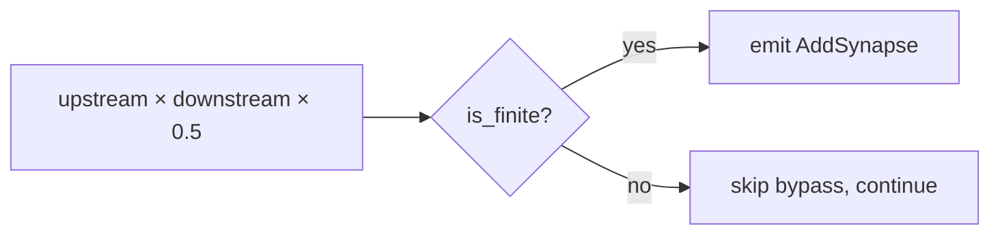

## Summary

`bottleneck_neurons_to_coordinated_candidates` computed the bypass weight as
`upstream_weight * downstream_weight * 0.5` in `f32` and emitted an
`AddSynapse` regardless of the result. Two finite weights whose product
exceeds `f32::MAX` (e.g. `2e19 × 2e19`) gave a `±∞` weight under a finite gain,
which neither gain gate (`reject_non_finite_gains`, #2167) inspected before
this change, because both tested only the gain. The
converter now skips any bypass whose weight is not finite. The shared gate
`reject_non_finite_gains` also drops any coordinated candidate carrying a
non-finite `AddSynapse` / `SetWeight` weight or `AddNeuron` / `SetBias` bias,
which fixes the nine sibling sites recorded in the issue comments. Closes #2375.

Version bump: `Cargo.toml` and `Cargo.lock` updated for this change; the merged
commit records the final version.

## Spec

### Intent and Rationale

- The fix is at the point the weight is computed, so no `±∞` weight can reach the gain gates or the FFI response (`serde_json` would serialise it as `null`).
- Skipping rather than clamping: a clamped weight would be a made-up value the data never implied, and the other bypass targets of the same bottleneck are unaffected.

### Essential Design Decisions

- Only the bypass branch needs the check. The parallel-neuron branch only halves finite weights (`weight * 0.5`), so it cannot overflow.
- The nine sibling overflow sites recorded in the issue comments (`bias_perturbation.rs::compute_regime_shift_bias`, `bounded_range.rs`, `error_plateau.rs::compute_bias_adjustment`, `observation_utilisation.rs`, `operating_point.rs`, `output_range_compression.rs`, `restricted_range.rs`, `sentinel_gating.rs`, `squash_weight_rescale.rs`) are fixed by the shared gate the issue suggests, not by editing each detector. `reject_non_finite_gains` (`src/analysis/candidate_aggregation.rs`) now also drops a candidate whose operations carry a non-finite weight or bias. It already runs in `merge_coordinated_structural_replacements`, in `reject_non_finite_and_rank_coordinated_candidates` and in `apply_final_coordinated_gain_floor`, which `orchestration.rs` runs unconditionally on the synapse result, so every detector's candidates pass it. Drops are counted under the existing `non_finite_gain` rejection reason.

### Undiscoverable Facts

- `validate_creature` validates biases (#2133) but not synapse weights, so finite-but-huge weights reach the converter.

## Evidence

Security-fix evidence:

- Test identifier: `tests/issue_2375_bottleneck_bypass_weight_finite.rs::bypass_weight_is_never_non_finite`
  (also `negative_weight_overflow_is_dropped`, `finite_bypass_is_still_emitted_for_non_overflowing_downstream`,
  `ordinary_weights_unchanged`).
- Red on base: with `src/analysis/detection/bottleneck.rs` restored to the base commit,
  `cargo test --test issue_2375_bottleneck_bypass_weight_finite` gave 3 failed, 1 passed
  (`AddSynapse weight must be finite, got inf` and `got -inf`; the unchanged-ordinary-weights control passes on both).
- Green at head: the same command gives 4 passed.
- Original trigger closed: the attack input (two finite synapse weights with an overflowing product on a bottleneck neuron) now fails the `bypass_weight.is_finite()` check and the loop `continue`s. The check covers `+∞`, `−∞` and NaN, and runs on the value that is emitted, so no equivalent bypass remains in this converter. The nine sibling sites are covered by the shared gate (see Essential Design Decisions and the Test Plan).

Docs updated: `docs/DISCOVERY_TYPES.md` and `docs/ANALYSIS_DEEP_DIVE.md` (bottleneck "Add bypass synapse" text),
the doc comment on `bottleneck_neurons_to_coordinated_candidates`, the doc comments on `reject_non_finite_gains` and `REJECTION_NON_FINITE_GAIN` (plus its rendered description), and the chunk 8a audit ledger entry for #2375 and its four sibling-site entries (now recorded as fixed).

## Test Plan

- Added `tests/issue_2375_bottleneck_bypass_weight_finite.rs` (4 tests, all passing at head): overflow to `+∞`, overflow to `−∞`, a finite sibling bypass still emitted with weight `8e18`, ordinary weights unchanged at `0.2`. Each overflow test asserts the precondition that `h-bn` is flagged with `addBypassSynapse`, so it cannot pass vacuously.
- Branch outcome of the new `!bypass_weight.is_finite()` condition: true (dropped) is reached by the overflow tests; false (emitted) by `finite_bypass_is_still_emitted_for_non_overflowing_downstream` and `ordinary_weights_unchanged`.
- Red check: restoring base `bottleneck.rs` turns three of the four tests red (see Evidence).
- `rustfmt --edition 2024 --check` on the touched Rust files: clean. `RUSTC_WORKSPACE_WRAPPER=clippy-driver cargo check --all-targets --all-features`: no warnings.
- Added `tests/issue_2375_non_finite_operation_parameter_gate.rs` (4 tests, all passing at head): every parameterised operation kind (`AddSynapse`, `SetWeight`, `AddNeuron`, `SetBias`) is dropped for `+∞`, `−∞` and NaN under a finite gain with a finite control kept; a bad parameter in a later operation drops the candidate while candidates with only parameter-less operations survive in order; `reject_non_finite_and_rank_coordinated_candidates` delegates to the same check; `apply_final_coordinated_gain_floor` drops the candidate and records it under `non_finite_gain`. Red check: removing the `c.operations.iter().all(operation_parameters_are_finite)` operand from `reject_non_finite_gains` turned all 4 red; restored, all 4 pass. The nine sibling detectors are covered through the gate, not by a per-detector overflow test.
- Branch outcomes of `operation_parameters_are_finite`: weight arm and bias arm are both reached by `every_parameterised_operation_kind_is_gated` (one kind per arm member, finite and non-finite); the parameter-less arm by `bad_parameter_in_later_operation_drops_candidate_and_keeps_order`.
- Existing callers of `reject_non_finite_gains` (checked, behaviour for finite operations unchanged): `apply_final_coordinated_gain_floor`, `merge_coordinated_structural_replacements`, `reject_non_finite_and_rank_coordinated_candidates`; `tests/issue_1367_non_finite_gain_rejection.rs` and `tests/issue_2167_post_processing_non_finite_gain_ranking_test.rs` pass, and `cargo test --lib` gave 1699 passed, 0 failed, 3 ignored.
- Existing callers of the converter: `tests/detection/issue_343_bottleneck_neuron_detection.rs` calls it with ordinary weights; `cargo test --test detection bottleneck` gave 13 passed. The seven `chunk_08a` audit-ledger pinning suites plus `issue_2154_chunk_08a_finalisation` also pass after the ledger edit.
- The full `./quality.sh` gate was not run end to end: its clippy step uses the `cargo-clippy` proxy, which refuses the pinned 1.99.0 toolchain in this environment. CI runs the same checks.

<!-- vibe-quality-gate-skipped reason="cargo-clippy proxy refuses toolchain 1.99.0 in the worker environment; targeted tests, rustfmt and clippy-driver check were run instead; CI runs the full gate" -->
