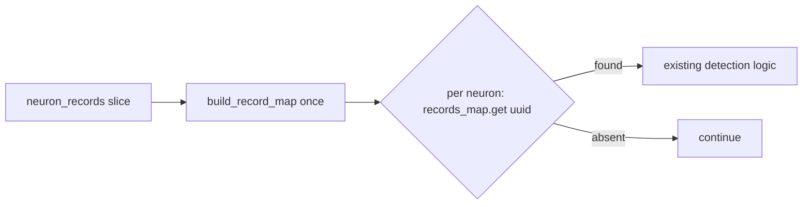

## Summary

Replaces the per-neuron linear `neuron_records.iter().find(|(u, _)| u == uuid)` scan with a one-off `helpers::build_record_map` plus an O(1) `get` in four detectors, so the record lookup is O(N + R) instead of O(N · R) (CWE-407). Closes #2377.

Detectors changed (`src/analysis/detection/`):

- `bias_perturbation.rs::detect_bias_perturbation_candidates` and `error_plateau.rs::detect_error_plateaus` (the two sites named in the issue).
- `output_squash_mismatch.rs::detect_output_squash_mismatches_with_cost_hint` and `squash_weight_rescale.rs::detect_squash_weight_rescale_candidates` (the same scan, added by the trusted sibling comments on the issue from the `per-neuron-b` sweep).

Version bump: `Cargo.toml` and the `Cargo.lock` root entry updated for this change; the merged commit records the final version. No dependency changes.

## Spec

### Intent and Rationale

- The scan ran for every neuron before any filter, so a large creature paid O(H²) / O(O²) string comparisons per pass with no deadline check. The siblings (`activation_mismatch.rs`, `bimodal_neuron.rs`, `dormant_synapse.rs`) already use `build_record_map`; reusing it keeps one owner for the lookup.

### Essential Design Decisions

- `build_record_map` collects into a `HashMap`, so a duplicate UUID in `neuron_records` now resolves to the last entry where `find` returned the first. The record loaders emit one entry per neuron, so duplicates do not occur on the production path; the shared helper is left unchanged so the other callers keep their behaviour.
- `topology_diversification.rs` items in the sibling comment are a different fix (graph lookups, not a records-slice scan) and are not part of this change.

### Undiscoverable Facts

- The test is a ratio test (`t(4N)/t(N)`, best of five), following `tests/issue_2358_output_conflict_converter_growth.rs`. The detectors compare `String` UUIDs, so there is no seam to count comparisons deterministically.

## Evidence

Security-fix evidence:

- Regression test: `tests/issue_2377_per_neuron_record_lookup_linear.rs::bias_perturbation_record_lookup_grows_linearly` (siblings `error_plateau_record_lookup_grows_linearly`, `output_squash_record_lookup_grows_linearly`, `squash_weight_rescale_record_lookup_grows_linearly` in the same file).
- Red on base: with `src/` restored to `Develop`, three runs of the file gave `4 failed` each, ratios 17.7 to 18.8 (limit 10; linear is about 4, quadratic about 16), e.g. `bias_perturbation: t(N)=12.385083ms t(4N)=228.574375ms ratio=18.46`.
- Green at head: all four pass, ratios about 3 to 5.
- Original trigger closed: the per-neuron `find` no longer exists in any of the four functions. Each builds the map once before the loop and does a hash `get` per neuron, so no input shape (many neurons, many record entries) makes the lookup super-linear, and there is no other copy of the scan in those functions.

## Test Plan

- Added `tests/issue_2377_per_neuron_record_lookup_linear.rs` (four growth tests, each with a positive control where only the last neuron has qualifying records and must be the sole candidate). Ran on the final head: 4 passed. Run against base `src/`: 4 failed (see Evidence).
- Positive controls assert each neuron is paired with its own records (returned candidate is `<prefix>-7` only); the records slice is reversed so the old scan walks to the end.
- Audit-record pinning tests re-run on the final head after the ledger edit: `issue_2154_chunk_08a_finalisation`, `issue_2280_chunk_08a_ledger_scaffold`, `issue_2281_chunk_08a_shared_sweep`, `issue_2282_chunk_08a_graph_sweep`, `issue_2284_chunk_08a_per_neuron_a_sweep`, `issue_2294_chunk_08a_pairwise_sweep`, `issue_2298_chunk_08a_per_neuron_b_sweep`, `issue_2300_chunk_08a_neuron_sweep`.
- No existing test assertion was removed or edited.
- Docs: `docs/audits/security-sweep-chunk-08a-detection-neuron.md` rows for the four detectors now record the lookup as fixed by #2377 (row structure and cancellation cells unchanged).
- Checks not run: `cargo clippy` through the normal proxy (the worker toolchain's `cargo-clippy` is not applicable); clippy was run on the new test through `clippy-driver` and passed. See the quality-gate note below for the full gate.
