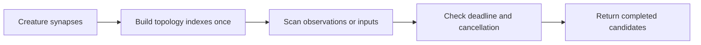

## Summary

Removed the repeated synapse rescans from observation utilisation and dominant input detection by building topology indexes once per scan. Added deadline and cancellation checks while preserving completed candidates. Closes #2379.

Version bump: `Cargo.toml` updated for this change; the merged commit records the final version.

## Spec

### Intent and Rationale

- Both scans repeated work over hostile model topology, causing quadratic work. One-pass indexes make topology work linear in the synapse count.

### Essential Design Decisions

- Existing public functions remain compatibility wrappers. Production dispatch uses deadline-aware scan implementations and retains candidates completed before cancellation.
- Duplicate observation synapses retain the prior first-matching-weight behaviour and candidate ordering.

### Undiscoverable Facts

- Baseline and after benchmarks used the same Criterion bench and workload sizes, N=128 and 4N=512.
- Each growth guard was also run with its corresponding old rescan temporarily restored; both failed on the deterministic work counts.

## Evidence

Backend-only Rust change. No visual surface changed.

| Scan | N=128 baseline | N=128 after | 4N=512 baseline | 4N=512 after | Scaling, baseline → after |
| --- | ---: | ---: | ---: | ---: | ---: |
| Observation utilisation | 47.950 µs | 58.070 µs | 552.32 µs | 216.18 µs | 11.52× → 3.72× |
| Dominant inputs | 198.15 µs | 58.439 µs | 2.8007 ms | 221.18 µs | 14.13× → 3.78× |

Observation utilisation at N=128 was 21% slower in this run, while the 4N case improved 61%. Dominant inputs improved about 71% at N and 92% at 4N. Deterministic topology-work counts verify linear growth independently of timing.

The observation scan indexes outgoing targets and their weights in one topology pass. The dominant-input scan records whether each source reaches an output during topology construction. Membership checks replace the repeated hidden-neuron fan-out scan, closing both original quadratic triggers without an equivalent repeated topology scan.

## Test Plan

- `src/analysis/detection/observation_utilisation.rs::issue_2379_observation_topology_work_grows_linearly_and_scans_the_fan_out` — passed; restoring the old filter/find rescan made the deterministic counts `[592, 8512]` instead of `[32, 128]`, and the test failed.
- `src/analysis/detection/input_sensitivity.rs::issue_2379_dominant_input_topology_work_grows_linearly_on_shared_hidden_fanout` — passed; restoring the old hidden fan-out scan made the counts `[1120, 16768]` instead of `[96, 384]`, and the test failed.
- `tests/detection/issue_2379_quadratic_synapse_rescans.rs::issue_2379_observation_candidates_keep_target_weights_order_and_duplicate_semantics` — passed.
- `tests/detection/issue_2379_quadratic_synapse_rescans.rs::issue_2379_dominant_inputs_preserve_direct_hidden_and_record_filters` — passed.
- `tests/detection/issue_2379_quadratic_synapse_rescans.rs::issue_2379_observation_cancellation_stops_before_work` — failed against base production code and passed at head.
- `tests/detection/issue_2379_quadratic_synapse_rescans.rs::issue_2379_dominant_input_cancellation_stops_before_work` — failed against base production code and passed at head.
- `src/analysis/detection/observation_utilisation.rs::issue_2379_observation_deadline_stops_before_work_and_during_fan_out` — passed.
- `src/analysis/detection/input_sensitivity.rs::issue_2379_dominant_input_deadline_stops_before_work_and_during_topology` and `src/analysis/detection/input_sensitivity.rs::issue_2379_dominant_input_deadline_keeps_completed_connection_candidates` — passed.
- `src/analysis/module_dispatch_specs/scoring_specs.rs::issue_2379_observation_dispatch_passes_its_deadline_to_conversion` and `src/analysis/module_dispatch_specs/scoring_specs.rs::issue_2379_dominant_input_dispatch_passes_its_deadline_to_detection` — passed.
- `cargo fmt --all -- --check` — passed.
- `cargo test --lib issue_2379_ -- --test-threads=1` — passed, 7 tests.
- `cargo test --test detection issue_2379_ -- --test-threads=1` — passed, 4 tests.
- `cargo test --test detection issue_543_observation_utilisation` — passed, 6 tests.
- `cargo test --test detection issue_435_input_sensitivity_analysis` — passed, 14 tests.
- `cargo clippy --all-targets --all-features -- -D warnings` — passed.
- `timeout 900 ./quality.sh < /dev/null` — timed out after 900 seconds (exit 124) while running the full library and integration test suite. Earlier quality stages passed, including dependency audit, debug build, formatting, Clippy and type check. The full suite result remains unverified.
