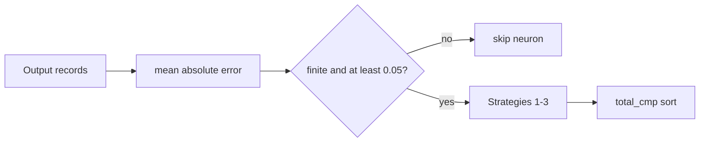

## Summary

`detect_output_squash_mismatches_with_cost_hint` no longer emits a candidate with a `NaN` or `+∞` `estimated_improvement`, and its final sort (plus two sibling sorts) now uses `total_cmp`. Closes #2381.

Version bump: `Cargo.toml` updated for this change; the merged commit records the final version.

## Spec

### Intent and Rationale

- A `NaN` mean absolute error loses `mean_error < MIN_MEAN_ERROR_THRESHOLD`, so the neuron was kept and Strategy 1 pushed a `NaN` gain. 40 finite `3e38` errors overflow the `f32` sum to `+∞`, giving a `+∞` gain. Rejecting `!mean_error.is_finite()` at the gate closes both (CWE-697 / CWE-682).
- `partial_cmp(..).unwrap_or(Equal)` is not a total order under `NaN`; `total_cmp` is, as in every sibling detector.

### Essential Design Decisions

- The neuron is skipped (fail closed), not clamped: a non-finite mean error carries no usable signal.
- The issue comment asked for `total_cmp` in `squash_weight_rescale.rs` and `weight_magnitude_reset.rs` too. Their fallbacks were already dead (inputs filtered finite), so this is a behaviour-neutral conversion and has no test that can go red.
- With the gate in place no `NaN` can reach the `output_squash_mismatch.rs` sort, so the `total_cmp` there is defence in depth; the regression test guards the gate, not the comparator.

### Undiscoverable Facts

- None.

## Evidence

Regression test: `tests/issue_2381_output_squash_mismatch_non_finite_gain.rs::non_finite_error_emits_no_non_finite_candidate`.

- Base (`output_squash_mismatch.rs` restored from `HEAD`): all 3 tests fail; the emitted candidates carry `estimated_improvement: NaN, mean_error: NaN` and `estimated_improvement: inf, mean_error: inf`, and the ranking test returns `["out-lo", "out-nan", "out-hi"]`.
- Head: `cargo test --test issue_2381_output_squash_mismatch_non_finite_gain` passes 3 of 3.

Original trigger closed: a `NaN` error or an overflowing error sum makes `mean_error` non-finite, which `!mean_error.is_finite()` now rejects before any strategy runs. When `mean_error` is finite every `|error|` is finite, and `mean_error * clipping_fraction * 0.5` cannot exceed `f32::MAX`, so no equivalent bypass reaches the gain. Strategies 2 and 3 already compared against `mean_error` and fail closed.

## Test Plan

- `tests/issue_2381_output_squash_mismatch_non_finite_gain.rs` (new): `non_finite_error_emits_no_non_finite_candidate` (positive control, one `NaN`, all `3e38`), `finite_candidates_rank_by_descending_improvement` (NaN neuron dropped, two finite neurons in descending order), `neg_infinity_and_infinity_errors_are_skipped`. All three go red on the base file and green at head.
- Passed at head: `cargo test --test issue_2381_output_squash_mismatch_non_finite_gain` (3), `issue_2300_chunk_08a_neuron_sweep` (10), `issue_2281_chunk_08a_shared_sweep` (4), `issue_2280_chunk_08a_ledger_scaffold` (6), and the other six `chunk_08a` ledger pinning tests (the ledger executor reported them passing); `cargo test --test detection squash` (21 passed).
- Not covered by a red test: the two sibling `total_cmp` conversions (dead fallbacks, behaviour-neutral).
- Docs updated: `docs/DISCOVERY_TYPES.md` (Output Squash Mismatch Detection, new criterion 4) and `docs/audits/security-sweep-chunk-08a-detection-neuron.md` (#2381 row, bullet and list marked fixed).

<!-- vibe-quality-gate-skipped reason="the cargo-clippy proxy refuses the pinned 1.99.0 toolchain in this environment, so ./quality.sh was not run end to end; rustfmt --check and the targeted tests above pass, CI runs the full gate" -->
