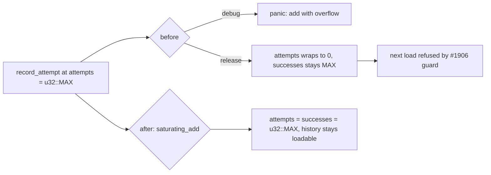

## Summary

`NeuronDiscoveryHistory::record_attempt` now uses `saturating_add(1)` for both counters, so `attempts` and `successes` pin at `u32::MAX` instead of panicking (debug) or wrapping `attempts` to 0 (release) at the ceiling the #1906 guard accepts. Closes #2391.

Version bump: `Cargo.toml` and `Cargo.lock` updated for this change; the merged commit records the final version.

## Spec

### Intent and Rationale

- `successes <= attempts` is the #1906 invariant, enforced on deserialise; `record_attempt` is the only mutator and must keep it at the counter ceiling.
- `saturating_add` is the smallest change: `attempts` pins at `u32::MAX`, and `successes` can never pass it because it is only incremented alongside `attempts`.

### Essential Design Decisions

- Saturate rather than return an error: `record_attempt` has no `Result` return and no in-tree caller, so the signature is unchanged.
- The previously `#[ignore]`d unit test `test_record_attempt_keeps_successes_within_attempts_at_u32_max` is enabled. The #2392 ignored tests are untouched.

### Undiscoverable Facts

- `[profile.release]` leaves `overflow-checks` off, so the release failure is a silent wrap, not a panic.

## Evidence

Backend-only change; no UI. Tests:

- `tests/issue_2391_record_attempt_saturates.rs::record_attempt_failed_at_u32_max_saturates`
- `tests/issue_2391_record_attempt_saturates.rs::record_attempt_successful_at_u32_max_saturates`
- `tests/issue_2391_record_attempt_saturates.rs::record_attempt_failed_at_ceiling_with_fewer_successes`
- `tests/issue_2391_record_attempt_saturates.rs::discovery_history_record_at_ceiling_keeps_whole_history_loadable`
- `tests/issue_2391_record_attempt_saturates.rs::record_attempt_below_ceiling_increments_normally` (control)
- `src/discovery_history.rs::tests::test_record_attempt_keeps_successes_within_attempts_at_u32_max` (`#[ignore]` removed)

## Security

The original trigger (a history entry at `attempts == successes == u32::MAX` followed by `record_attempt(false, _)` or `DiscoveryHistory::record(uuid, false, _)`) is closed with no trivial bypass: both counters are mutated only in `record_attempt` (`src/discovery_history.rs`), both now use `saturating_add`, and `DiscoveryHistory::record` delegates to `record_attempt`, so no other path increments them. `successes` is incremented only inside the same call as `attempts`, which is already at its maximum whenever `successes` is, so the invariant holds.

## Test Plan

- `cargo fmt --check`: passed.
- `cargo clippy --all-targets -- -D warnings`: no issues.
- `cargo test --lib discovery_history`: 8 passed, 0 failed, 2 ignored (the #2392 tests).
- `cargo test --test issue_2391_record_attempt_saturates`: 5 passed.
- `cargo test --test issue_2253_chunk_11c2_discovery_history_test`: 6 passed.
- `cargo test --test issue_2254_chunk_11_finalisation`: 7 passed.
- `cargo test --test recording issue_227`: 25 passed.
- Red check (both `saturating_add` calls reverted to `+= 1`): 4 of the 5 new tests fail with `attempt to add with overflow` at `src/discovery_history.rs:372` (the control passes), and the enabled unit test fails the same way. Fix restored, all green.
- Docs: `docs/audits/security-sweep-chunk-11-filesystem-lifecycle.md` marks #2391 fixed, and its open-findings count now reads one of five. Greps of `docs/` (excluding the archive), README, CONTRIBUTING and AGENTS found no other mention. The file-row at line 172 still describes the finding as filed; the ledger tests pin it.
- Callers of `record_attempt`: only `DiscoveryHistory::record` and tests; none depend on overflow behaviour.

<!-- vibe-quality-gate-skipped reason="full ./quality.sh not run; targeted fmt, clippy and the touched test suites run instead. CI runs the same checks on the PR." -->

Not done: the full `./quality.sh` gate and the full test suite.
