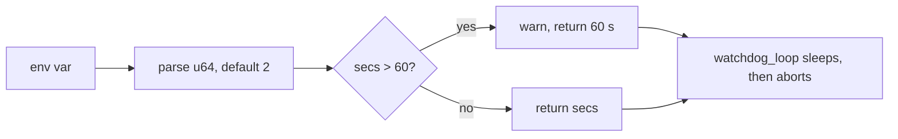

## Summary

`watchdog_abort_delay()` now clamps `NEAT_AI_DISCOVERY_WATCHDOG_ABORT_DELAY_SECS` to `0..=60` seconds (`MAX_WATCHDOG_ABORT_DELAY_SECS`) and logs a `WARN` naming the variable, the value given and the cap whenever it clamps. `watchdog_loop` is unchanged: it still sleeps on `config.abort_delay`, so a huge or mistyped value can no longer turn "dump threads, then abort" into a hang. Closes #2404.

Version bump: `Cargo.toml` updated for this change; the merged commit records the final version.

## Spec

### Intent and Rationale

- The issue asks for the clamp in the accessor (`src/config/user_facing.rs`), not in `src/watchdog.rs`, so every consumer of the accessor gets the bound.

### Essential Design Decisions

- Cap is 60 s, as the issue suggests; `0` stays `0` (abort straight after the dump) and unset or unparsable still gives the 2 s default.
- Clamp to the cap (not fall back to the default) so an operator who wanted a long delay still gets the longest allowed one.

### Undiscoverable Facts

- None.

## Evidence

Backend-only change; no UI. Tests: `tests/issue_2404_watchdog_abort_delay_cap.rs` (7 tests, `#[serial]`).

- Bug-path input from the issue: `u64::MAX` and `2000000000` both return exactly the cap.
- Boundary: `60` passes through, `61` clamps to 60.
- Warn: `clamping_logs_a_warning_naming_variable_value_and_cap` asserts one WARN with the variable name, the value and the cap; `in_range_unset_and_unparsable_values_do_not_warn` asserts none for 0, 5, 60, `abc` and unset.

The original trigger is closed with no trivial bypass: the only reader of the setting is `watchdog_abort_delay()` (`WatchdogConfig::from_env` is its sole caller, `src/watchdog.rs:51`), and every parsed value above 60 now returns 60 s, so the sleep before `std::process::abort()` is at most 60 s whatever the environment holds.

## Test Plan

- `cargo test --test issue_2404_watchdog_abort_delay_cap`: 7 passed.
- Red-check: with the clamp disabled (`if false && secs > MAX…`), `huge_values_are_clamped_to_the_cap`, `cap_boundary_is_accepted_and_one_above_clamps` and `clamping_logs_a_warning_naming_variable_value_and_cap` went red (4 passed, 3 failed); restored, 7 pass. On the base commit the file does not compile because `MAX_WATCHDOG_ABORT_DELAY_SECS` does not exist, so it is also red there.
- Existing suites re-run and passing: `issue_2006_numeric_env_override_trim` (14), `issue_2096_config_user_facing_a` (16), `issue_2096_config_doc_parity` (17), `issue_2252_chunk_11c1_watchdog_tracking_alloc_test` (4), `issue_1611_env_var_single_source` (8), `issue_2124_chunk_13d_ledger` (10), `issue_2211_chunk_13_ledger_scaffold` (12), chunk-11 ledger suites 2233, 2251, 2253, 2254, and `cargo test --lib config::` (34). `cargo fmt --check` and clippy `--lib --tests -D warnings` are clean.
- `tests/issue_2096_config_user_facing_a.rs`: comment only; no assertion removed.
- Docs updated: `docs/CONFIGURATION.md` (abort-delay row), `docs/GPU_GUIDE.md`, and the chunk 11 and chunk 13 audit ledgers (finding marked fixed, range `0..=60`, "ten rows with no numeric bound" corrected to nine).
- Not run: the full `./quality.sh` gate and the full test suite.

<!-- vibe-quality-gate-skipped reason="run budget: gate takes about 15 minutes; targeted checks above passed, CI runs the full gate" -->
