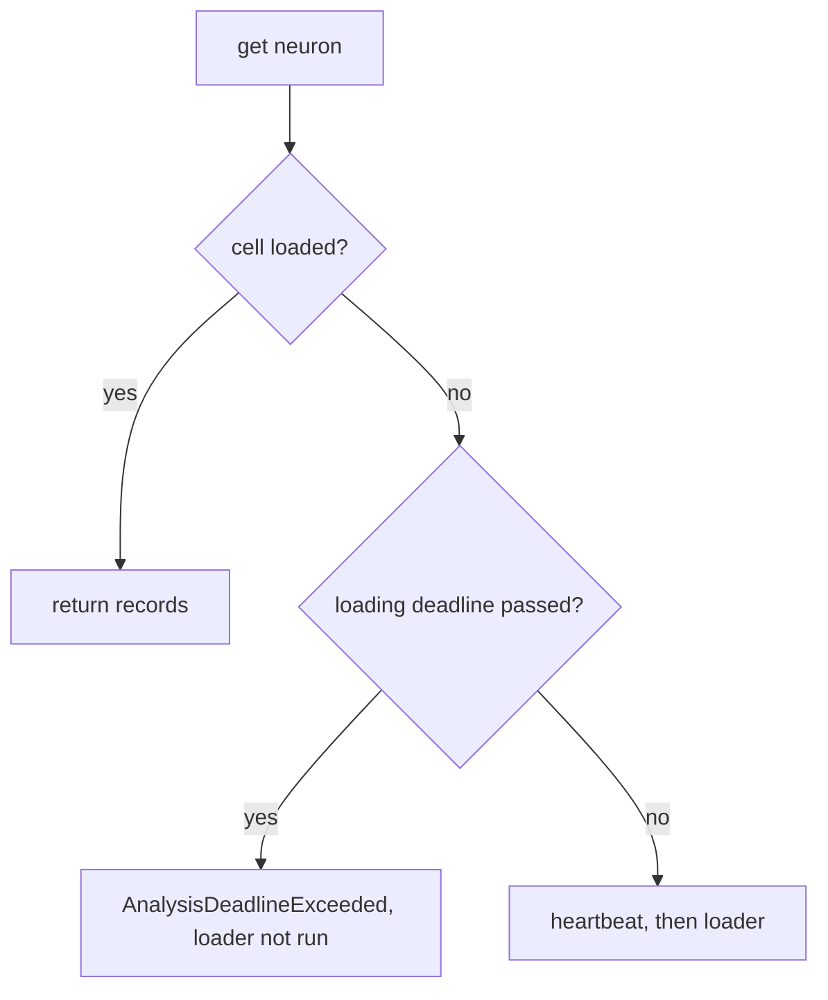

# Poll RecordCache deadline only on cache miss (Issue #2408)

Closes #2408

- [x] Serve an already-loaded `RecordCache` cell before polling the deadline
- [x] Keep the deadline check on the miss path, ahead of the heartbeat and loader
- [x] Doc comments and `docs/CACHE_TUNING.md` say "on a cache miss"
- [x] Two regression tests in `src/analysis/cache/lazy_deadline_tests.rs`
- [x] Version bump 0.74.287 → 0.74.288 (branch merged onto Develop 469d1c8)

## Spec

### Intent and Rationale

- Orchestration builds the `RecordCache` with the #1408 reserved *loading*
  deadline (`overall - reserve`). `get` polled that deadline before looking at
  the cell, so once loading time ended every read failed with
  `AnalysisDeadlineExceeded`. That included preloaded records. As a result,
  synapse and neuron analysis could read nothing during the window reserved
  for them.
- `get` now returns a cell that is already loaded straight away. The deadline
  is polled only when the loader would run.

### Essential Design Decisions

- The check moves rather than being removed. A lazy miss after the deadline
  still returns the typed `AnalysisDeadlineExceeded` that the #2352 callers
  downcast, and the loader does not run (#2013 is kept).
- Orchestration and the deadline passed to the cache are unchanged. The
  analyses keep polling the later overall deadline themselves.

### Undiscoverable Facts

None.

## Evidence

Backend-only change. There is no visual surface, so there are no screenshots.

Tests, in `src/analysis/cache/lazy_deadline_tests.rs`:

- `preloaded_records_served_after_loading_deadline`: a preloaded cell with a
  past deadline still returns the same `Arc`, and the loader is never called.
- `loaded_records_still_served_once_deadline_passes`: the deadline passes
  between two gets. The loaded neuron is still served, while a miss on another
  neuron returns `AnalysisDeadlineExceeded` without running the loader.

Docs sweep — grep: "polled on every", "shared analysis deadline", "in pre-loaded mode too" over `src/`, `docs/`, `README.md`; section: `RecordCache` doc comments, `docs/CACHE_TUNING.md` "Lazy per-neuron"; siblings: none — no set gained a member; updated: `src/analysis/cache/mod.rs` (`AnalysisDeadlineExceeded`, `deadline` field, `new_adaptive_with_deadline_and_budget`, `new_lazy`, `get` `# Errors`), `docs/CACHE_TUNING.md`.

- `src/analysis/orchestration.rs:650` — still true because it says the
  loading deadline curtails loading, and it still does.

Cited issues:

- #2408: RecordCache polls the loading deadline on every get, so synapse/neuron analysis cannot read any records during its reserved #1408 window
- #1408: Reserve a guaranteed minimum analysis budget so focus selection + parquet load cannot starve synapse/neuron analysis
- #2013: bug: lazy analysis ignores hard deadline + silent for hours when projected ≫ budget
- #2352: 🟡 Neuron analysis drops a focus target silently when its RecordCache load fails, misreporting it as NoEligibleSources (src/analysis/neuron/mod.rs)
- #648: Add deadline-aware parquet loading with early abort

## Test Plan

- `cargo test --lib cache`: 82 passed.
- `cargo test --features regression-harness --test issue_2352_neuron_target_load_failure_surfaced`: 4 passed.
- `cargo test --test recording deadline_aware_loading_checks_before_load_starts`: 1 passed.
- `cargo clippy`, `cargo fmt --check`: clean.
- `./quality.sh`: **not green.** Cycle 1 failed in
  `tests/issue_1726_archive_no_private_repo_names.rs` on a private repository
  name in this summary, which has been removed. Cycles 2 and 3 hit the 900 s
  `timeout` while still compiling test targets, with the host load average at
  about 15–20 on 7 cores from other builds. Neither run reached a test result.

Red checks:

- Unfixed `get`: both new tests failed (`lazy_deadline_tests.rs:138` and
  `:176`), giving 6 passed, 2 failed.
- Unconditional deadline check moved back to the top of `get`: both new tests
  went red.
- Miss-path check deleted: `loaded_records_still_served_once_deadline_passes`
  and `lazy_get_returns_at_deadline` went red.
- Restored: 8 passed.

Branch outcomes:

- `src/analysis/cache/mod.rs:405`, cell loaded and deadline passed, so records
  are served. Reached by `preloaded_records_served_after_loading_deadline` and
  `loaded_records_still_served_once_deadline_passes`. Moving the check above
  this line went red.
- `src/analysis/cache/mod.rs:414`, miss with the deadline passed, so
  `AnalysisDeadlineExceeded` is returned and the loader does not run. Reached by
  `lazy_get_returns_at_deadline` and by the neuron-b get in
  `loaded_records_still_served_once_deadline_passes`. Deleting the check went
  red.
- `src/analysis/cache/mod.rs:414`, miss with the deadline not passed, so the
  loader runs. Reached by `lazy_get_runs_loader_when_deadline_in_future` and by
  the first get in `loaded_records_still_served_once_deadline_passes`. This
  flip was **not run**: forcing the check to `true` would return before the
  loader, so both tests' load assertions should fail. That is a reading of the
  code, not an observed red run.
