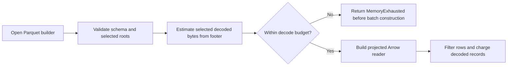

## Summary

Parquet readers now compare selected-column footer estimates with the decode
budget before building Arrow batches, then retain cumulative per-record
charging. The streaming UUID index validates and projects its UUID column
before building a reader, including for malformed schemas. Regression coverage,
a fuzz target and corpus seed, and the budget documentation cover the change.
Closes #2446.

Version bump: `Cargo.toml` updated for this change; the merged commit records
the final version.

## Spec

### Intent and Rationale

- A small compressed Parquet file could force Arrow to materialise a very large
  `errors` list before the existing per-record budget check ran. Footer metadata
  is available before `build()`, so selected-column estimates can reject known
  oversized reads before batch allocation.

### Essential Design Decisions

- Footer preflight does not consume the budget; cumulative per-record charging
  remains in place after batch decoding.
- Projections count only selected roots. The streaming index validates and
  projects `neuron_uuid`, while record block loads preflight the full discovery
  schema.
- The fuzz target creates an exclusive temporary directory, reports file-write
  failures, and passes an explicit 1 MB budget.

### Undiscoverable Facts

- On `origin/Develop` (`37fe687`), the original regression test failed with an
  additional 239,460 KiB of Linux process high-water memory; the malformed
  schema regression failed with 161,288 KiB. Both tests pass with the fix.
- Linux `/proc` provides the allocation check. Other platforms still assert the
  typed error and preflight message, and exercise the near-budget legal file.

## Evidence

Backend-only change. The 20,000,000-value hostile row is refused as
`MemoryExhausted` before Arrow constructs a batch. UUID and observation filters
cannot hide the row because preflight runs before either filter. `Full` includes
the `errors` leaf estimate; `WithoutErrors` and `ActivationOnly` do not reject a
large skipped error list. The multi-row-group fixture checks that footer values
are accumulated across groups. The near-budget 1 MB fixture remains readable.

The streaming index now returns a schema error for a missing, nullable or
non-`Utf8` `neuron_uuid` before building its projected reader. It has no
unprojected fallback, so an unchecked `errors` list cannot be materialised on
that malformed path. The streaming block reader and merge reader preflight
before building their full readers; a merge refusal leaves an existing output
file intact.

The original trigger is closed for files whose footer reports their selected
decoded sizes: the `errors` leaf value count is checked before `build()`, and
filtering occurs only after that check. A footer that understates decoded sizes
is outside this fix and remains the separate open #2447 issue, “SEC-2091-02:
read_footer_stats maps negative footer sizes to 0”.

## Reproduction

- **symptom** — a compact one-row file materialised a 20,000,000-value
  `errors` list before the 1 MB budget rejected it.
- **status** — `verified` — the regression test failed against `origin/Develop`
  production files and passed on the fixed head.
- **regression test** —
  `tests/issue_2446_parquet_predecode_budget.rs::oversized_error_list_is_rejected_before_arrow_materialises_it`

## Test Plan

- `tests/issue_2446_parquet_predecode_budget.rs::oversized_error_list_is_rejected_before_arrow_materialises_it`
  — passed on the final head. Its base-production run failed at the allocation
  guard with 239,460 KiB additional high-water memory. The test also verifies
  the footer-preflight error and reads a 1,000-row, 100-error-per-row legal
  fixture near the 1 MB budget.
- `tests/issue_2446_parquet_predecode_budget.rs::every_production_reader_preflights_before_filtering_and_respects_projection`
  — passed on the final head. It checks grouped, UUID-filtered,
  observation-limited, activation-summary, streaming-index, streaming-block and
  merge readers; Linux allocation checks run around each refusal. It also checks
  the two-row-group footer, `WithoutErrors` projection and preservation of the
  merge destination.
- `tests/issue_2446_parquet_predecode_budget.rs::streaming_index_rejects_malformed_schema_before_reading_unprojected_errors`
  — passed on the final head. Against base production files it failed with
  161,288 KiB additional high-water memory while the missing-UUID fallback
  built an unprojected reader.
- `tests/issue_2005_shared_batch_decoder.rs::the_streaming_index_preflights_the_decode_budget`
  — passed; the streaming index rejects the projected file before indexing.
- `tests/recording/issue_193_streaming_parquet.rs::streaming_cache_new_rejects_short_schema_without_panic`
  and `tests/recording/issue_193_streaming_parquet.rs::streaming_cache_get_rejects_missing_columns_without_panic`
  — passed as part of `cargo test --all-features --test recording -- --test-threads=1` (81 passed).
- `cargo test --all-features --test issue_1869_parquet_decode_bound -- --test-threads=1`
  — 11 passed; `cargo test --all-features --test issue_1923_activation_summary -- --test-threads=1`
  — 7 passed; `cargo test --all-features --test issue_1901_parquet_schema_nullability -- --test-threads=1`
  — 7 passed.
- `cargo fmt --all -- --check` and `cargo fmt --manifest-path fuzz/Cargo.toml -- --check`
  — passed. `cargo clippy --all-targets --all-features -- -D warnings` and
  `cargo clippy --manifest-path fuzz/Cargo.toml --locked --bins -- -D warnings`
  — passed.
- `cargo check --manifest-path fuzz/Cargo.toml --locked --bins` — passed. The
  committed oversized-list corpus replay via
  `cargo run --manifest-path fuzz/Cargo.toml --locked --bin fuzz_parquet_predecode_budget -- fuzz/corpus/fuzz_parquet_predecode_budget -runs=1`
  completed 2 runs over 1 corpus file. The binary was not sanitizer-instrumented,
  so the replay did not provide coverage feedback.
- `./quality.sh < /dev/null` — timed out with exit code 124 at its 900-second
  bound while `cargo test --lib --tests --all-features -- --test-threads=2`
  was still running. No test failure was reported before termination; the full
  gate did not complete.
