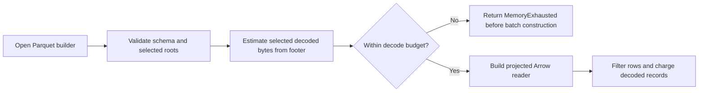

## Summary

Parquet readers now compare selected-column footer estimates with the decode
budget before building Arrow batches, then retain cumulative per-record
charging. The streaming UUID index validates and projects its UUID column
before building a reader, including for malformed schemas. Regression coverage,
a fuzz target and corpus seed, and the budget documentation cover the change.
Closes #2446.

Version bump: `Cargo.toml` and both lockfiles now record `0.74.320`.

## Spec

### Intent and Rationale

- A small compressed Parquet file could force Arrow to materialise a very large
  `errors` list before the existing per-record budget check ran. Footer metadata
  is available before `build()`, so selected-column estimates can reject known
  oversized reads before batch allocation.

### Essential Design Decisions

- Footer preflight does not consume the budget; cumulative per-record charging
  remains in place after batch decoding.
- Projections count only selected roots. The streaming index validates and
  projects `neuron_uuid`, while record block loads preflight the full discovery
  schema. Streaming block and merge readers validate and project exactly those
  five roots, so additional columns cannot bypass the estimate.
- The fuzz target creates an exclusive temporary directory, reports file-write
  failures, and passes an explicit 1 MB budget.

### Undiscoverable Facts

- On `origin/Develop` (`37fe687`), the original regression test failed with an
  additional 239,460 KiB of Linux process high-water memory; the malformed
  schema regression failed with 161,288 KiB. Both tests pass with the fix.
- Linux `/proc` provides the allocation check. Other platforms still assert the
  typed error and the phase-specific `footer preflight before Arrow batch
  construction` message, and exercise the near-budget legal file. Post-batch
  charging identifies its different phase, so it cannot satisfy that assertion.

## Evidence

Backend-only change. The 20,000,000-value hostile row is refused as
`MemoryExhausted` before Arrow constructs a batch. UUID and observation filters
cannot hide the row because preflight runs before either filter. `Full` includes
the `errors` leaf estimate; `WithoutErrors` and `ActivationOnly` do not reject a
large skipped error list. A separate accumulation fixture writes two groups
with 150,000 errors each. Each group is readable alone under 1 MB, while their
combined file must return the preflight-phase error. The near-budget 1 MB fixture remains readable.

The streaming index now returns a schema error for a missing, nullable or
non-`Utf8` `neuron_uuid` before building its projected reader. It has no
unprojected fallback, so an unchecked `errors` list cannot be materialised on
that malformed path. The streaming block reader and merge reader preflight
before building readers projected to the five validated discovery roots.
Allocation regressions add a 20,000,000-value extra list beside small discovery
columns, then verify streaming and merge still return the discovery data without
materialising that list. A merge refusal leaves an existing output file intact.

The original trigger is closed for files whose footer reports their selected
decoded sizes: the `errors` leaf value count is checked before `build()`, and
filtering occurs only after that check. A footer that understates decoded sizes
is outside this fix and remains the separate open #2447 issue, “SEC-2091-02:
read_footer_stats maps negative footer sizes to 0”.

## Reproduction

- **symptom** — a compact one-row file materialised a 20,000,000-value
  `errors` list before the 1 MB budget rejected it.
- **status** — `verified` — the regression test failed against `origin/Develop`
  production files and passed on the fixed head.
- **regression test** —
  `tests/issue_2446_parquet_predecode_budget.rs::oversized_error_list_is_rejected_before_arrow_materialises_it`

## Test Plan

- Retry verification: all 118 tests passed across the issue #2446, #1869,
  #1901, #1923, #2005 and recording integration targets, using
  `--all-features -- --test-threads=1`. Both decode-budget unit tests also
  passed. Root and fuzz formatting checks passed.
- `tests/issue_2446_parquet_predecode_budget.rs::oversized_error_list_is_rejected_before_arrow_materialises_it`
  — passed on the fixed head. Its base-production run failed at the allocation
  guard with 239,460 KiB additional high-water memory. The test also verifies
  the footer-preflight error and reads a 1,000-row, 100-error-per-row legal
  fixture near the 1 MB budget.
- `tests/issue_2446_parquet_predecode_budget.rs::every_production_reader_preflights_before_filtering_and_respects_projection`
  — passed on the final head. It checks grouped, UUID-filtered,
  observation-limited, activation-summary, streaming-index, streaming-block and
  merge readers; Linux allocation checks run around each refusal. It also checks
  the two-row-group footer, `WithoutErrors` projection and preservation of the
  merge destination. Cross-group accumulation is verified by the separate test
  below, rather than inferred from this fixture.
- `tests/issue_2446_parquet_predecode_budget.rs::streaming_index_rejects_malformed_schema_before_reading_unprojected_errors`
  — passed on the final head. Against base production files it failed with
  161,288 KiB additional high-water memory while the missing-UUID fallback
  built an unprojected reader.
- `tests/issue_2446_parquet_predecode_budget.rs::streaming_index_rejects_nullable_uuid_column`
  and `tests/issue_2446_parquet_predecode_budget.rs::streaming_index_rejects_non_utf8_uuid_column`
  — passed. Removing the nullability check made the nullable test return a
  cache; removing the type check made the wrong-type test reach the later
  `Failed to cast neuron_uuid column` error instead of the schema refusal.
- Earlier per-reader mutation checks — removing the grouped preflight made
  the hostile row test fail at 239,620 KiB additional high-water memory. Removing
  the UUID-filtered or observation-limited preflight made the broad reader test
  return `Ok` because each filter skipped the hostile row. Removing the
  activation-summary or streaming-index preflight also returned `Ok`; removing
  the streaming-block preflight failed at 237,776 KiB additional high-water
  memory; removing the merge preflight returned `Ok`. Each mutation was
  restored, and the test passed with all guards present.
- `tests/issue_2446_parquet_predecode_budget.rs::streaming_projects_away_oversized_extra_columns`
  and `tests/issue_2446_parquet_predecode_budget.rs::merge_projects_away_oversized_extra_columns`
  — reproduced on the incoming head: Linux high-water increases of 156,288 KiB
  and 161,792 KiB respectively failed the 8 MiB allocation guard. Both pass
  after adding projections, with a 1 MB decode ceiling and correct retained
  discovery data.
- `tests/issue_2446_parquet_predecode_budget.rs::combined_row_groups_exceed_budget_even_when_each_group_fits`
  — passed. Both single-group controls fit 1 MB, while the two-group file is
  refused specifically during footer preflight. Mutating the estimator to
  inspect only the last group makes this test fail on the post-batch charging
  phase, despite both single-group controls succeeding. The mutation was
  restored.
- Current phase-contract mutation check — removing the grouped preflight makes
  the hostile-row test fail on its phase-specific error assertion before it
  reaches the Linux-only allocation assertion. This check therefore remains
  effective outside Linux. The mutation was restored.
- `tests/issue_2005_shared_batch_decoder.rs::the_streaming_index_preflights_the_decode_budget`
  — passed; the streaming index rejects the projected file before indexing.
- `tests/recording/issue_193_streaming_parquet.rs::streaming_cache_new_rejects_short_schema_without_panic`
  and `tests/recording/issue_193_streaming_parquet.rs::streaming_cache_get_rejects_missing_columns_without_panic`
  — passed as part of `cargo test --all-features --test recording -- --test-threads=1` (81 passed).
- `cargo test --all-features --test issue_1869_parquet_decode_bound -- --test-threads=1`
  — 11 passed; `cargo test --all-features --test issue_1923_activation_summary -- --test-threads=1`
  — 7 passed; `cargo test --all-features --test issue_1901_parquet_schema_nullability -- --test-threads=1`
  — 7 passed.
- `cargo fmt --all -- --check` and `cargo fmt --manifest-path fuzz/Cargo.toml -- --check`
  — passed. `cargo clippy --all-targets --all-features -- -D warnings`
  — passed on this retry. Earlier fuzz Clippy validation with
  `cargo clippy --manifest-path fuzz/Cargo.toml --locked --bins -- -D warnings`
  also passed.
- Earlier fuzz validation: `cargo check --manifest-path fuzz/Cargo.toml --locked --bins`
  — passed. The committed oversized-list corpus replay via
  `cargo run --manifest-path fuzz/Cargo.toml --locked --bin fuzz_parquet_predecode_budget -- fuzz/corpus/fuzz_parquet_predecode_budget -runs=1`
  completed 2 runs over 1 corpus file. The binary was not sanitizer-instrumented,
  so the replay did not provide coverage feedback.
- `timeout 180 ./quality.sh < /dev/null` — exited 124 while the full test
  suite was still compiling. Script checks, the dependency audit, debug build,
  formatting, Clippy and all-target type checks passed. No compiler or test
  failure was reported before termination. The full gate did not complete
  locally; the 120 focused tests above completed separately.

## Security Checklist

- [x] **capsec-file-bounds** — The library continues to read caller-selected
  paths, with root selection belonging to its host. This change adds no path
  input or root policy. For the changed decoded-size boundary, every reader
  projects exactly the roots covered by its footer preflight, including
  streaming blocks and merge inputs. Extra-column allocation tests verify the
  previous bypass is closed, and the cross-row-group test verifies the whole
  selected file is budgeted. Existing merge destinations survive refusal.
