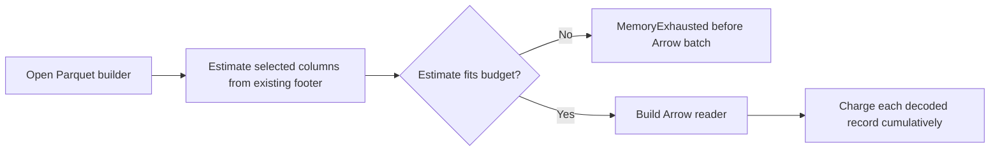

## Summary

Parquet readers now compare selected-column footer estimates with the decode budget before building Arrow batches, while retaining cumulative per-record charging. Added regression and fuzz coverage and corrected the allocation guarantees in the documentation. Closes #2446.

Version bump: `Cargo.toml` updated for this change; the merged commit records the final version.

## Spec

### Intent and Rationale

- A compact Parquet list could allocate far beyond the configured decode budget before per-record charging. Footer metadata is already available before batch construction, so it provides a preflight point without reopening the file.

### Essential Design Decisions

- Preflight is non-consuming; cumulative record charging remains the second check.
- Estimates include selected columns and exact `errors` leaf value counts. Projected readers do not reject large skipped error lists.
- Fuzz lockfile entries were synced to the existing root Arrow/Parquet and crate versions so the new fuzz target builds with `--locked`; no dependency was added to the product manifest.

### Undiscoverable Facts

- Footer values are trusted for preflight. A footer that understates decoded sizes remains the separate #2447 finding.
- The full quality gate exposed a malformed-schema panic in streaming projection. The schema fallback is fixed and its regression test passes, but the full gate was not rerun within the run budget.

## Evidence

Backend-only change; validated with Rust tests and a bounded fuzz replay.

The hostile 20,000,000-error row was refused as `MemoryExhausted` before batch creation. Removing the grouped-reader preflight made the test fail with a measured high-water increase of about 239,644 KiB; the head test passes. Separate wiring mutations also made the UUID-filtered, observation-limited, activation-summary, streaming-index, streaming-block, and merge-reader cases fail when their respective preflight was removed.

The trigger is closed for files whose footer reports the selected decoded sizes: each production Parquet path checks before batch construction, and later UUID/observation filters cannot bypass that check. Projection excludes unselected columns. Understated footer sizes remain outside this fix.

## Reproduction

- **symptom** — a compact one-row file materialised a 20,000,000-value `errors` list before the 1 MB budget rejected it.
- **status** — `verified` — the regression test failed when the grouped-reader preflight was removed and passed with it restored.
- **regression test** — `tests/issue_2446_parquet_predecode_budget.rs::oversized_error_list_is_rejected_before_arrow_materialises_it`

## Test Plan

- `tests/issue_2446_parquet_predecode_budget.rs::oversized_error_list_is_rejected_before_arrow_materialises_it` — passed on the final head; includes two row groups, an oversized row outside UUID/observation filters, Linux high-water accounting after fixture creation, and a legal file below the 1 MB budget.
- `tests/issue_2446_parquet_predecode_budget.rs::every_production_reader_preflights_before_filtering_and_respects_projection` — passed on the final head; covers the readers, projections, environment-based limit, and merge-output preservation.
- `tests/issue_2005_shared_batch_decoder.rs::the_streaming_index_preflights_the_decode_budget` — passed; the changed expectation now asserts the streaming index refuses before batch decoding.
- `tests/recording/issue_193_streaming_parquet.rs::streaming_cache_new_rejects_short_schema_without_panic` — passed after the full gate found the short-schema projection panic; missing `neuron_uuid` schemas retain the existing batch-validation path.
- `cargo test --all-features --test issue_1869_parquet_decode_bound -- --nocapture` — 11 passed.
- `cargo test --all-features --test issue_1923_activation_summary -- --nocapture` — 7 passed.
- `cargo test --all-features --lib parquet_format::decode_budget::tests -- --nocapture` — 2 passed.
- `cargo check --manifest-path fuzz/Cargo.toml --locked --bins` — passed. Direct bounded replay, `cargo run --manifest-path fuzz/Cargo.toml --locked --bin fuzz_parquet_predecode_budget -- fuzz/corpus/fuzz_parquet_predecode_budget -runs=1`, passed for the oversized-list seed (1 corpus file, 2 runs). The environment lacked sanitizer instrumentation; this replay did not provide coverage feedback.
- `cargo fmt --all -- --check`, `cargo clippy --all-targets --all-features -- -D warnings`, and `cargo clippy --manifest-path fuzz/Cargo.toml --bins -- -D warnings` — passed before the final short-schema fix; `cargo fmt --all` and the focused final-head tests passed after it.
- `./quality.sh < /dev/null` — the first run failed at `issue_193_streaming_parquet::streaming_cache_new_rejects_short_schema_without_panic`. The cause was fixed and the named test passed, but the full gate was not rerun because the run-budget file directed wind-down with 391 seconds remaining.

<!-- vibe-quality-gate-skipped reason="The first full gate found the short-schema panic; its focused regression test now passes, but the run budget required wind-down before a full rerun." command="./quality.sh < /dev/null" -->

## Remaining

Rerun `./quality.sh < /dev/null`; the previous run stopped in the integration tests after reaching `tests/recording`. No other verification is pending beyond CI and review.
