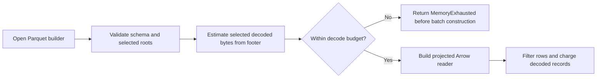

## Summary

Parquet readers validate schemas and compare selected-column footer estimates
with the decode budget before building projected Arrow batches. Cumulative
per-record charging remains in place, and the streaming UUID index validates
and projects its column before reading. Regression tests demonstrate the
original allocation, verify that a legal near-budget file still reads, and
retain separate coverage of streaming block record charging after preflight.
Closes #2446.

Version bump: `VERSION` updated for this change; the merged commit records the
final version.

## Spec

### Intent and Rationale

- A compact Parquet file could force Arrow to materialise a very large `errors`
  list before record charging. Footer metadata is available before `build()`,
  so selected-column estimates can reject reported oversized reads first.

### Essential Design Decisions

- Footer preflight does not consume the budget; cumulative per-record charging
  remains as a second check after batch decoding.
- Profile-based readers derive preflight roots and projections from the same
  `ColumnProfile`. The streaming index preflights and projects only
  `neuron_uuid`; streaming blocks and merge inputs select the five validated
  discovery roots.
- The fuzz target writes each input to a fresh temporary directory and sends it
  through the real bounded grouped reader with a 1 MB budget.

### Undiscoverable Facts

- On `origin/Develop` at `37fe687`, the regression test failed with a 239,748
  KiB high-water increase. On the fixed head, it passed its allocation bound.
- The allocation assertion uses Linux `/proc`. Other platforms still require
  the typed error and the footer-preflight phase message, and read the legal
  near-budget fixture.

## Evidence

Backend-only change. Footer preflight runs after schema validation and before
`build()` on the grouped, UUID-filtered, observation-limited,
activation-summary, streaming-index, streaming-block and merge readers. The
readers project the same selected roots used by the estimate. Filters cannot
hide oversized rows because they run after the preflight. The existing merge
destination remains intact when its input is refused.

The operator guidance in `docs/CONFIGURATION.md` and `docs/CACHE_TUNING.md`,
and the affected source module comments, describe the preflight and its footer
trust limit. The related security-sweep audit files retain their historical
baseline findings and measurements.

Dependency bump commit `0e89c3c` remains in the branch. `Cargo.toml`,
`Cargo.lock` and `fuzz/Cargo.lock` are versioned at `0.74.320`.

For files whose footer reports their selected decoded sizes, the original
trigger is closed: the `errors` leaf value count contributes to the estimate
before Arrow batch construction. Footer under-reporting remains outside this
change and is tracked in open #2447, “SEC-2091-02: read_footer_stats maps
negative footer sizes to 0 (src/parquet_format/footer.rs)”.

## Reproduction

- **symptom** — a compact one-row file materialised a 20,000,000-value
  `errors` list before the 1 MB budget rejected it.
- **status** — `verified` — the regression test failed against base production
  code and passed on the fixed head.
- **regression test** —
  `tests/issue_2446_parquet_predecode_budget.rs::oversized_error_list_is_rejected_before_arrow_materialises_it`

## Test Plan

- `cargo test --locked --all-features --test issue_2446_parquet_predecode_budget -- --test-threads=1`
  — passed, 8 tests. The regression includes the 20,000,000-value hostile row,
  a phase-specific `MemoryExhausted` refusal and a readable 1,000-row,
  100-error-per-row fixture under the 1 MB budget.
- Red-to-green check for
  `tests/issue_2446_parquet_predecode_budget.rs::oversized_error_list_is_rejected_before_arrow_materialises_it`
  — against `origin/Develop` (`37fe687`), failed because the read increased
  Linux `VmHWM` by 239,748 KiB; after the fix, the same test passed.
- Independent preflight removals — each mutation was reverted after its
  covering test failed: grouped read hit the allocation assertion; UUID and
  observation filters, activation summary, streaming index and merge no longer
  returned the expected preflight refusal; streaming block returned the
  post-batch charging phase instead of the preflight phase.
- Projection removals — removing the streaming UUID-index projection made its
  extra-column test fail at 161,664 KiB growth; removing the merge projection
  made its test fail at the same growth. Both projections were restored.
- Bypass coverage in the Issue #2446 suite — a two-row-group fixture confirms
  cumulative footer estimates reject the combined size when each group fits
  alone; malformed, nullable and non-`Utf8` UUID schemas are refused; the
  `WithoutErrors` profile skips the oversized list; and merge refusal preserves
  the existing destination.
- `cargo test --locked --all-features --test issue_2005_shared_batch_decoder --test issue_2446_parquet_predecode_budget -- --test-threads=1`
  — passed, 13 tests (5 shared-decoder tests and 8 predecode-budget tests).
  The separate
  `the_streaming_block_loader_charges_the_decode_budget` regression uses
  7,000 rows with repeated 100-byte identifiers and empty error lists. It
  asserts that both index and block footer preflights fit within 1 MB, builds
  the streaming index successfully, then requires a typed `MemoryExhausted`
  error from record charging during `.get()`. The index-preflight test remains.
- Record-charging mutation check — removing only the streaming block's
  `charge_record` call left all 12 previous Issue #2005/#2446 tests passing.
  With that same mutation, the restored charging regression failed because
  all 7,000 records were returned. Restoring the production call made all
  13 tests pass; no production-source change remains from this check.
- `cargo clippy --locked --all-features --test issue_2005_shared_batch_decoder -- -D warnings`
  and `cargo fmt --all -- --check` — passed after restoring the charging
  regression.
- Earlier focused validation:
  `tests/issue_1869_parquet_decode_bound.rs` — passed, 11;
  `tests/issue_1901_parquet_schema_nullability.rs` — passed, 7;
  `tests/issue_1923_activation_summary.rs` — passed, 7;
  `tests/recording/main.rs` — passed, 81.
- `cargo fmt --all -- --check` and
  `cargo fmt --manifest-path fuzz/Cargo.toml -- --check` — passed.
  `cargo clippy --locked --all-targets --all-features -- -D warnings` and
  the focused Issue #2446 test Clippy check — passed.
- Fuzz validation — `cargo check --manifest-path fuzz/Cargo.toml --locked --bins`
  and `cargo clippy --manifest-path fuzz/Cargo.toml --locked --bins -- -D warnings`
  passed. Replaying
  `fuzz/corpus/fuzz_parquet_predecode_budget/oversized-errors.parquet` with
  `cargo run --manifest-path fuzz/Cargo.toml --locked --bin fuzz_parquet_predecode_budget -- fuzz/corpus/fuzz_parquet_predecode_budget -runs=1`
  completed 2 runs over 1 corpus file. The binary was not coverage-instrumented.
- `timeout 900 ./quality.sh < /dev/null` — passed on the regression-coverage
  retry. All script checks, dependency audit, debug build, formatting, Clippy,
  type checks, tests, documentation build and release library build completed.
  The 291 test suites reported 6,438 passed, 0 failed and 8 ignored.
- A separate base-branch replay of the malformed-UUID test was not completed:
  the copied test failed to compile with `E0308` / `E0277` because the base
  dependency graph had mismatched Arrow schema `Field` types. The malformed
  schema head test passed; the hostile-list regression above is the verified
  base-to-head reproduction.

## Security Checklist

- [x] **capsec-file-bounds** — No path input or root policy changed. Readers
  project the selected roots covered by their footer estimate, including
  streaming and merge paths. Extra-column allocation checks and cross-group
  tests cover those paths, and merge refusal preserves an existing destination.
