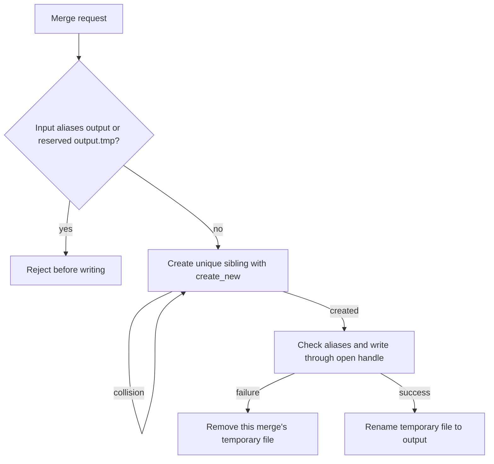

## Summary

Merge inputs can no longer be truncated or redirected through `{output}.tmp`.
The merge rejects aliases to that reserved path and writes through an
exclusively created, unique sibling file, cleaning up only its own file. The
FFI merge documentation describes the updated behaviour. `Cargo.toml` and
`Cargo.lock` carry the required version bump. Closes #2450.

Version bump: `Cargo.toml` updated for this change; the merged commit records
the final version.

## Spec

### Intent and Rationale

- Preserve recordings and symlink targets that occupy the former predictable
  temporary path.
- Use exclusive creation and bounded collision retries so a merge never opens
  or removes an occupied candidate.

### Essential Design Decisions

- Reserve `{output}.tmp` from inputs and allocate sibling files named
  `{output-name}.tmp.{process-id}.{counter}` with `create_new`.
- Limit allocation to 128 attempts, fail on non-collision errors, and pass the
  exclusively opened file handle to the Parquet writer.
- Remove a temporary file only after this merge created it; keep rename-on-
  success so failed merges leave the destination untouched.

### Undiscoverable Facts

- Against `origin/Develop` at `21371f7`, the input regression reproduced the
  reported `EOF: Parquet file too small. Size is 0 but need 8` after the input
  had been truncated.
- Against the same base, the symlink regression observed the victim changed to
  merged Parquet bytes. The fixed symlink test ran on Linux.

## Evidence

Backend-only change. Regression tests use real Parquet recordings and paths
inside `tempfile` directories. The original trigger is closed: the literal
`{output}.tmp` input is rejected before allocation, aliases to an allocated
temporary path are rejected before reading, and each candidate is opened with
`create_new`. An occupied regular file or symlink causes a collision retry;
the merge does not open or delete that candidate. The destination is renamed
only after a successful write.

## Reproduction

- **symptom** — an input named `{output}.tmp` was truncated and later deleted;
  a symlink there redirected the merged Parquet output to its target.
- **status** — `verified` — both regression tests failed against the base
  production code and passed with the fix.
- **regression test** — `tests/issue_2450_merge_temp_path.rs::input_at_legacy_temp_path_is_refused_without_changing_bytes`

## Test Plan

- `tests/issue_2450_merge_temp_path.rs::input_at_legacy_temp_path_is_refused_without_changing_bytes` — passed on the final head; failed against `origin/Develop` with the reported EOF after truncation.
- `tests/issue_2450_merge_temp_path.rs::pre_existing_temp_symlink_and_target_are_unchanged` — passed on the final head; failed against `origin/Develop` after the victim was overwritten.
- `tests/issue_2450_merge_temp_path.rs::occupied_regular_temp_path_is_preserved_during_successful_merge` — passed; the merge succeeds and leaves the occupied bytes intact.
- `tests/issue_2450_merge_temp_path.rs::failed_merge_preserves_occupied_temp_path_and_cleans_its_own_temp` — passed; the error preserves the occupied path and removes the file created by this merge.
- `tests/issue_2450_merge_temp_path.rs::resolved_alias_to_legacy_temp_path_is_refused_unchanged` — passed; a symlink alias is refused with its target unchanged.
- `src/parquet_format/writer.rs::tests::merge_temp_creation_does_not_open_an_existing_path` — passed; replacing `create_new` with truncating creation made it fail.
- `src/parquet_format/writer.rs::tests::merge_temp_allocation_retries_collision_without_changing_occupied_file` — passed; changing the collision branch to fail immediately made it fail.
- `src/parquet_format/writer.rs::tests::merge_temp_allocation_fails_after_collision_limit` and `src/parquet_format/writer.rs::tests::merge_temp_allocation_reports_non_collision_errors` — passed for exhausted collisions and an unavailable parent directory.
- `src/parquet_format/writer.rs::tests::merge_rejects_input_alias_to_new_temp_path` — passed; removing the allocated-path alias guard made it fail.
- `src/parquet_format/writer.rs::tests::merge_rename_failure_preserves_destination_and_cleans_created_temp` — passed; removing rename-failure cleanup made it detect the leftover temp file.
- Removing cleanup after an input-read failure made `tests/issue_2450_merge_temp_path.rs::failed_merge_preserves_occupied_temp_path_and_cleans_its_own_temp` fail on the leftover file.
- Final targeted runs: `cargo test --test issue_2450_merge_temp_path -- --nocapture` passed (5 tests); `cargo test --lib parquet_format::writer::tests::merge_ -- --nocapture` passed (11 tests).
- `cargo fmt --all -- --check` passed. `git diff --check` passed.
- `./quality.sh < /dev/null` passed, including dependency audit, build, Clippy, type checks, all tests (1,762 passed, 2 ignored), documentation build, and release library build.
- Updated all four existing merge cleanup assertions to scan for unique temporary siblings after success, missing inputs, foreign schemas and output aliases. macOS and Windows execution was not checked; the symlink-specific cases are Unix-only.

### PR review follow-up

- Replaced four legacy temporary-path assertions with a shared sibling scan
  for the current unique merge temporary filenames. Success and schema-error
  cleanup are now guarded alongside missing-input and output-alias cases.
- Formatting and diff whitespace checks passed on the review host. Bash
  syntax, ShellCheck and cargo-install pinning gates passed.
- Local Clippy, type checks and both targeted merge test suites could not
  compile because the sandbox refused dependency extraction into the Cargo
  cache. The pinned Rust 1.99 toolchain is also unavailable locally. The full
  quality gate stopped at temporary-file allocation in the summary-layout
  check. Existing PR CI checks were all successful before this follow-up.
