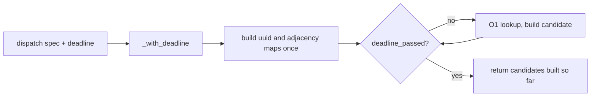

## Summary

Seven coordinated-candidate converters scanned `creature.neurons` or `creature.synapses` once per candidate (O(C·N) or O(C·S)) and never checked a deadline (CWE-407). Each now builds its lookups once per call and checks `deadline_passed` once per candidate, returning the candidates built so far on expiry. Each dispatch spec passes the dispatch deadline. Closes #2479.

Version bump: `Cargo.toml` updated for this change; the merged commit records the final version.

## Spec

### Intent and Rationale

- Follows the shape PR #2428 used for `fanin_polarity_conflict.rs`: a `_with_deadline` entry point, a private `_with_observer` seam, the old public function delegating with `&None`.
- `squash_weight_rescale` is a detector, not a converter, so `detect_squash_weight_rescale_candidates_with_deadline` is the deadline entry point. Its `feeds_downstream_aggregate` rescan is replaced by an outgoing-target map plus a uuid → "any neuron with this uuid is aggregate" map.

### Essential Design Decisions

- Behaviour with a `None` deadline is unchanged: adjacency is built in synapse order, and the neuron lookups use first-match (`or_insert`), except the aggregate check, which keeps the original `any` over duplicate uuids.
- The deadline is checked once per candidate, before any `continue`, and nowhere else in the function, so a scripted `[false, true]` sequence stops at the second candidate.
- The six converter dispatch sites keep returning `Some` with an empty candidate list after an elapsed deadline (the macro path); only the squash detector returns `None`. The fan-in spec maps empty to `None` in its own custom closure and that was not copied.

### Undiscoverable Facts

- The worker's sweep ledger (`docs/audits/security-sweep-chunk-08a-detection-neuron.md`) keys capacity rows by enclosing function, so rows moved to the `_with_observer` symbols.

## Evidence

Backend-only change; no UI. Original trigger (per-candidate scans, no deadline) is closed with no trivial bypass: the seven converters no longer contain any per-candidate `iter().find` or `filter` over `creature.neurons` or `creature.synapses`, every candidate iteration checks the deadline, and every production call site (`neuron_specs.rs`, `scoring_specs.rs`) now passes the dispatch deadline. The old non-deadline functions delegate with `&None`, so they stay callable but no dispatch path uses them.

Regression tests that build and run on the base and fail there by assertion (the discrimination tests): `tests/issue_2479_cancellation_stops_converters.rs::bottleneck_stops_when_cancelled` and its six siblings for monotonicity, operating_point, restricted_range, output_range_compression, sentinel_gating and squash_weight_rescale. They call only the long-standing legacy converter functions with the global cancellation flag set (which `deadline_passed` honours): the base returns the full candidate set (red, e.g. 9 vs 0), the head returns none (green). Verified by running the file against a clean `Develop` checkout.

Further regression tests (these need the new `_with_deadline` entry points, so they cannot build on the base):

- `tests/issue_2479_converter_deadline.rs::bottleneck_conversion_stops_at_an_elapsed_deadline`, and the sibling `*_stops_at_an_elapsed_deadline` tests for monotonicity, operating_point, restricted_range, output_range_compression, sentinel_gating and squash_weight_rescale.
- `src/analysis/detection/bottleneck.rs::deadline_mid_conversion_returns_the_candidates_built_so_far` and its six siblings (a `[false, true]` scripted deadline keeps only the first of three candidates).
- `src/analysis/detection/bottleneck.rs::squash_lookup_work_scales_linearly_at_n_and_4n` and its siblings (exact work counts at N and 4N through the observer seam).

## Test Plan

- `tests/issue_2479_cancellation_stops_converters.rs` (new): 7 tests, one per converter (full set, then empty once cancellation is requested). Passed on the head, failed on the base.
- `tests/issue_2479_converter_deadline.rs` (new): 21 tests, three per converter (full set with `&None`, empty with an elapsed deadline, legacy function equals `_with_deadline(.., &None)`). Passed.
- In-file `issue_2479_tests` modules in the seven detection files: a work-count test at N and 4N and a `#[serial]` `DeadlineOverrideGuard::with_sequence(vec![false, true])` test with a positive control. Passed.
- `src/analysis/module_dispatch_specs/mod.rs`: seven `*_spec_threads_deadline_*` tests (live deadline gives candidates, elapsed deadline gives fewer). Passed.
- Contract tests: `tests/issue_2282_chunk_08a_graph_sweep.rs`, `issue_2284_chunk_08a_per_neuron_a_sweep.rs`, `issue_2298_chunk_08a_per_neuron_b_sweep.rs` gained checks that the ledger rows read `yes` and the source holds `deadline_passed`; `issue_2294`, `issue_2300`, `issue_2377` and `issue_2154` pass unchanged. No assertion was removed from any existing test.
- Red checks: moving the in-loop deadline check out of the loop turned the deadline tests red in each of the seven files; reverting each dispatch call to the non-deadline function turned its spec test red; setting a ledger cell back to `no (module-level only)` turned the graph contract test red.
- `cargo fmt --check` and `cargo clippy --all-targets -- -D warnings`: clean on the final head.
- Twinned rule: the ledger and its contract tests are the pair; both updated here. The `fanin_polarity_conflict.rs` reference needed no change.

<!-- vibe-quality-gate-skipped reason="full ./quality.sh exceeded the 580 s foreground cap during compilation; fmt, clippy --all-targets and the targeted tests listed in the Test Plan were run on the final head; CI runs the full gate" -->

Not done / risk: the full `./quality.sh` was not completed; the work-count tests assert exact counts, so a later change to lookup structure needs them updated.
