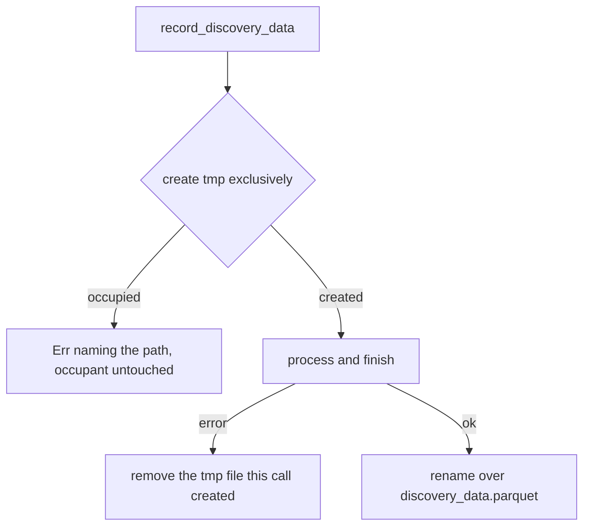

## Summary

`record_discovery_data` now creates `<temp_dir>/discovery_data.parquet.tmp` exclusively (`ParquetRecordWriter::new_exclusive`), the same way the streaming path has since #2515. Anything already at that path (a file, a symlink, a live streaming session's recording, a retained #1902 recording) is refused with an error naming the path and left untouched. A failure to create the file no longer triggers `cleanup_temporary_file`, so only a file this call created is ever removed. Closes #2547.

Version bump: `Cargo.toml` is bumped by CI's `version-increment` job; the merged commit records the final version.

## Spec

### Intent and Rationale

- `File::create` truncates an existing file and follows a symlink, and the old error path then deleted whatever sat at the fixed tmp name. Exclusive creation fixes both with the helper the streaming path already uses (no new mechanism).
- The fixed name was kept (the issue's first option) rather than a unique sibling name, so the batch and streaming paths share one rule and `start_session` and `record_discovery_data` exclude each other.

### Essential Design Decisions

- The writer is created before the `write_result` closure, so a creation failure returns directly and never reaches `cleanup_temporary_file`. Failures after creation (processing, finalise, rename) still clean up the file this call created.
- Trade-off: a crash orphan or retained recording at the tmp path now makes the next batch record fail until the directory is cleaned (for example with `cleanup_discovery_dir`), exactly as `start_session` already does.
- `tests/issue_2451_record_atomic_write.rs::writer_construction_error_reports_cleanup_failure` pinned the old behaviour (a removal attempt on an occupant). It is replaced by `writer_construction_error_leaves_occupied_temporary_path_untouched`.

### Undiscoverable Facts

- None.

## Evidence

Backend change, no UI. Verified by the tests below. Rust only; no new dependency.

## Test Plan

- New in `src/record/tests.rs`: `test_record_discovery_data_refuses_existing_tmp_file_issue_2547` (regular file keeps its bytes, no final file, positive control succeeds once removed), `test_record_discovery_data_refuses_symlink_at_tmp_path_issue_2547` (symlink and its target keep their bytes), `test_record_discovery_data_does_not_create_dangling_symlink_target_issue_2547`, and `test_record_discovery_data_failure_after_creation_removes_its_own_tmp_file_issue_2547` (a failure after creation still cleans up).
- Red check: with `new_exclusive` swapped back to `new` in `src/record/mod.rs`, the refuse-file, symlink and dangling-symlink tests fail; the failure-after-creation test stays green, as expected, since that cleanup is unchanged.
- Edited existing test: `tests/issue_2451_record_atomic_write.rs`. Removed from it: the assertion `chain.contains("Failed to remove temporary Parquet file")`. Required by the issue: "the failure path should remove only a file this call created". Replaced by the assertions that the chain does not contain that text, still names `discovery_data.parquet.tmp`, and that the occupying directory and its `keep.txt` survive. Red check: making the creation failure call `cleanup_temporary_file` turns the edited test red. The other four tests in that file pass unchanged.
- Results: `cargo test --lib record::` 17 passed; `cargo test --test issue_2451_record_atomic_write` 5 passed; `cargo test --test issue_2515_streaming_exclusive_temp` 5 passed; `cargo test --test integration --test ffi` passed; `cargo clippy --lib --tests` clean; `cargo fmt --check` clean.
- Callers of `record_discovery_data` checked: the FFI and integration tests above plus `tests/issue_2452_shared_cache_inplace_rewrite.rs`, `tests/issue_2047_records_per_sample_helper.rs`, `tests/issue_2067_record_module_docs.rs` (all passed). Each records into a fresh temp directory, so none depends on the old truncating behaviour.
- Docs updated: `docs/FFI_API.md` (record paragraph), `docs/STREAMING_GUIDE.md` (Process Crash Recovery), the module doc in `src/streaming.rs`, and the doc comment on `record_discovery_data`. `docs/FFI_API.md:1223` and `docs/audits/*` re-read and left as they were: the former is about `start_discovery_session` and is still true; the latter are dated findings.

<!-- vibe-quality-gate-skipped reason="`./quality.sh` ran for the 595 s foreground cap and was stopped while the `cargo test` stage was still running (no failure seen in its output); the touched test targets were run directly and passed, and CI runs the full gate" -->

## Not checked

- Full `./quality.sh` test stage (stopped at the time cap, no failure seen).
- Standards/Spec reviewer sub-agents were not dispatched: the issue states no acceptance-criteria list.
