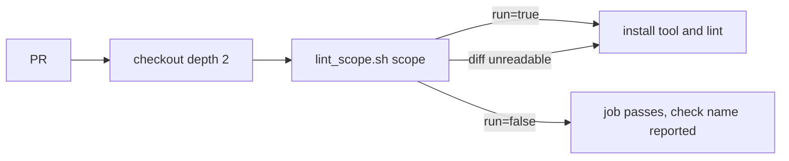

## Summary

The actionlint, Markdown Lint and ShellCheck jobs now skip tool setup and the lint when a PR touches nothing they lint. A new committed script, `quality/lint_scope.sh`, makes the decision. Each job keeps its name (`actionlint`, `markdownlint`, `shellcheck`) and always runs, so the required check names always report. Closes #2560.

Merge conflict resolution retained the PR version 0.74.366, ahead of Develop at 0.74.365, in `Cargo.toml` and `Cargo.lock`. `fuzz/Cargo.lock` was synchronised to the same version without changing dependencies.

## Spec

### Intent and Rationale

- Unrelated Rust PRs started all three lint jobs, paying runner setup, Node setup, the npm install and the ShellCheck install for nothing.
- Gating at step level inside the existing job, rather than a separate detection job plus aggregator, keeps one job per required check name. It cannot leave a required check pending, and there is no extra job to maintain.
- The scope decision lives in a script, not inline YAML, so it can be tested against real git repositories.

### Essential Design Decisions

- On a `pull_request` run `HEAD` is GitHub's merge commit and `HEAD^1` is the base tip, so `git diff --name-only --no-renames -z HEAD^1 HEAD` is exactly the PR's change set. `--no-renames` lists both sides of a rename, and deleted files appear. The checkout uses `fetch-depth: 2` for this.
- Fail closed: if the diff cannot be read, the script reports `run=true`. A usage error exits 2 and prints no `run=` line, which fails the job loudly.
- Each workflow's own file, and `quality/lint_scope.sh` itself, enable the gates. A change to any `.github/workflows/*` file enables actionlint, so editing `shellcheck.yml` also runs actionlint.
- The Markdown rule mirrors only the `docs/archive/**` and `**/CHANGELOG.md` entries of `.markdownlint-cli2.jsonc` `ignores`. The other ignores (`target/**`, `node_modules/**`, `graft/**`) are not mirrored, which can only cause an extra run, never a skipped lint. A test pins the two mirrored entries in the config.

### Undiscoverable Facts

- Gitleaks, Semgrep, CodeQL and the Rust quality and coverage jobs are deliberately untouched, as the issue asks.
- No actionlint config file exists in the repo today; the script still watches `.github/actionlint.yml` and `.github/actionlint.yaml`.

## Evidence

Backend/CI change only, so there is no screenshot. Tests run the real script against real throwaway git repositories and check the printed decision, and a second test file validates the workflow structure.

## Acceptance Criteria

The issue states no acceptance-criteria heading; its suggested fix is met in full, so nothing is left undone and no reviewer sub-agents were dispatched.

## Test Plan

- `tests/issue_2560_lint_scope.rs`: runs `quality/lint_scope.sh` over throwaway git repos. `default_range_on_merge_commit_selects_only_pr_changes` invokes the workflow's scope-only entry point on merge commits, checking both a PR-only shell change and a base-only shell change. It also covers a Rust-only change (false for all scopes), a positive and a look-alike negative per scope, each workflow enabling its own gate, the script enabling all gates, deleted files, renames through the old path, paths with spaces, an unreadable base and a missing `HEAD^1` (both fail closed to `run=true`), unknown scope and no arguments (non-zero exit, no `run=` line), `GITHUB_OUTPUT` appending, and a drift pin on the two mirrored `ignores` entries. Each `run=false` case has a positive control in the same test.
- `tests/issue_2560_lint_gating_workflows.rs` (new, 8 tests): checks the three jobs keep their names, no `paths:` or `paths-ignore:` under `on:`, `fetch-depth: 2`, exactly one `id: scope` step running the right scope after checkout, and every later step gated. Negative tests mutate the text (add `paths:`, drop an `if:`, drop the scope step, wrong scope name, drop `fetch-depth`); each asserts the exact problem message and has an unmutated positive control.
- Red checks on `quality/lint_scope.sh`, each run against `issue_2560_lint_scope`: fail-closed emitting `false` → red (2 tests); dropping `--no-renames` → red; dropping the `docs/archive/*` exclusion → red; dropping the nested `CHANGELOG.md` exclusion → red; removing the self-rule → red; removing the `GITHUB_OUTPUT` append → red.
- Red check on the workflows: removing one `if:` from the real `shellcheck.yml` → `gated_jobs_keep_their_names_and_pass_the_gate` red.
- Existing workflow tests still pass: `issue_1287_workflow_timeouts`, `issue_1288_workflow_concurrency`, `issue_1292_actionlint_workflow`, `issue_1484_markdownlint_pin`, `issue_1565_markdown_lint_no_push_trigger`, `issue_1649_shellcheck_persist_credentials`, `issue_1650_actionlint_milestone_filter`, `issue_2036_setup_rust_composite`, `issue_2555_quiet_quality_gate`. No existing test was edited or had assertions removed.
- Local `actionlint` on the three workflows: clean. `shellcheck -s bash quality/lint_scope.sh` and `bash -n`: clean. `cargo clippy` on both new tests: clean.
- Docs: `CONTRIBUTING.md` bullets for shellcheck, Markdown Lint and actionlint updated. I read each bullet in full after editing.
- Full `./quality.sh`: format, lint, type check and dependency checks passed. The test phase was cut off by the 10-minute foreground limit at 348/1852 tests, with no failures reported. The change touches no Rust source under `src/`.

<!-- vibe-quality-gate-skipped reason="full ./quality.sh needs about 15 minutes and the foreground command limit is 10; fmt, clippy, type check and deny passed, the test phase was cut off at 348/1852 with no failures; CI runs the same checks" -->

## Not done / risks

- The full test phase of `./quality.sh` did not finish locally; CI will run it.
- The default merge-commit range is exercised using local Git fixtures; the script fails closed if `HEAD^1` is unavailable.
